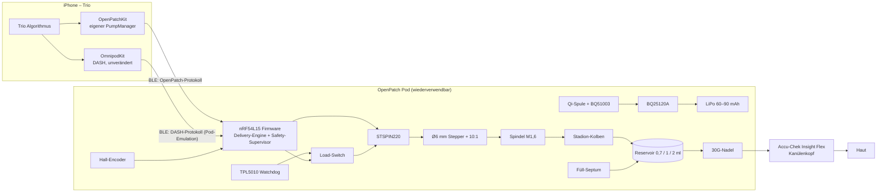

# Systemarchitektur

## Entscheidungen

| Thema | Entscheidung | Warum |
|---|---|---|
| „Eigener Chip“ | **Kein ASIC.** Stattdessen eine eigene, hochintegrierte 4-Lagen-Platine um den nRF54L15 | Ein ASIC kostet sechs- bis siebenstellig und dauert 1–2 Jahre. PCBWay fertigt keine ICs. Das Ziel „super optimiert“ erreichen wir über Layout, Firmware und Stromsparmodi. |
| Antrieb | Schrittmotor + Spindel + Kolben | Genau, mit Encoder verifizierbar, Prinzip patentfrei. Piezo-Pumpen sind mit Insulin nicht validiert. |
| Flachheit | **Stadion-Reservoir 16 × 5 mm** statt Rundzylinder | Ein runder 2-ml-Zylinder bräuchte Ø ≥ 9,5 mm und damit ≥ 12 mm Bauhöhe. Mit dem Stadion-Querschnitt sind ≤ 8,5 mm möglich. |
| Größen | Nur die Länge variiert (Hub 9,4 / 13,4 / 26,8 mm) | Gleiche Elektronik, gleicher Antrieb, gleiche Kanülentasche |
| Laden | Qi (BQ51003), Laden nur abgenommen | Kein Steckerloch, dadurch dicht; keine Wärme am Insulin während der Förderung |
| Trio | (1) eigenes `OpenPatchKit`, (2) DASH-Emulation | (1) zeigt echte Werte und bleibt sauber. (2) funktioniert sofort mit einem unveränderten Trio. Die Referenz-Implementierung ist nightscout/ESP-Sim. |
| Omnipod 5 | **nicht emuliert** | O5-Pairing nutzt signierte P-256-Transkripte und einen externen Key-Manager mit App Attest. Gegenüber DASH bringt das keinen Vorteil. |
| Lizenz | Hardware CERN-OHL-S v2, iOS-Kit MIT, Firmware GPL-3.0 (wegen ESP-Sim im DASH-Modus) | Echt Open Source |

## Was Trio im Quellcode macht (verifiziert)

- `nightscout/Trio/.gitmodules`: Pumpen sind Submodule (OmnipodKit, DanaKit, MedtrumKit, MinimedKit, AccuChekKit …).
- `Trio/Sources/APS/Devices/DeviceCatalog.swift` → `DeviceCatalog.pumps`: Eine neue Pumpe braucht dort einen Eintrag.
- `loopandlearn/OmnipodKit/OmnipodKit/Bluetooth/`: DASH-Service `1A7E4024-E3ED-4464-8B7E-751E03D0DC5F`, Command `…2441`, Data `…2442`. Pairing per X25519 + AES-CMAC zum LTK, Session per EAP-AKA/Milenage, Nachrichten per AES-128-CCM. Details stehen in `firmware/docs/dash-compat.md`.
