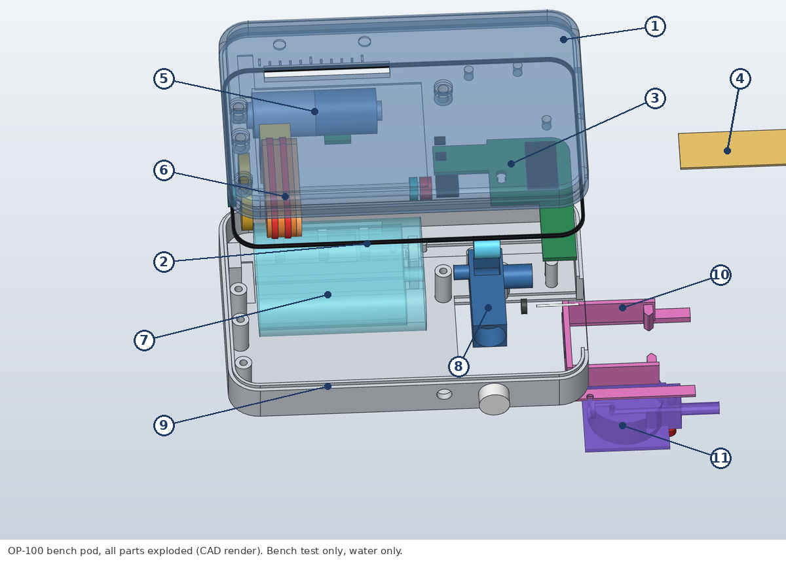

# 00. Overview: what you build and what it is for

> **WARNING: BENCH TEST ONLY.** OpenPatch is a test project and **not a medical device**. The pod you build here must **never be worn on, attached to, or used on a person or an animal**. **Fill it with water only. Never put insulin or any other drug into it, not even into a container or a test vial.** Every test in this guide runs on a table, into a beaker or onto a balance. See [DISCLAIMER.md](../../DISCLAIMER.md) and [docs/02-safety.md](../02-safety.md).

This guide takes you from a parts list to a pod that delivers measured amounts of **water** and from there to a written test report. It is written for people who want to check the mechanics and the firmware of OpenPatch against the predictions of the simulations. It is not a guide to using a pump.

## 0.1 What you build

A **bench pod** (spec §4a, "Rev A bench split") plus a **bench controller board**:

| Part | What it is | Where it comes from |
|---|---|---|
| **Pod** (this guide, chapters 02 to 09) | Housing, stadium reservoir 16 x 5 mm, plunger with lip seal, M1.6 x 0.35 leadscrew on a carriage, NFP-608-26.45 geared stepper beside it, a purchased brass gear pair (16 teeth on the motor, 20 teeth on the screw), end cap with fill septum, duckbill valve and 30G outlet needle, a small pod sensor board (TMAG5273 angle sensor, dock hall switch, FFC connector), swappable dock insert. | printed parts, bought parts, one small PCBA |
| **Bench controller board** (chapter 10) | About 40 x 50 mm board with the nRF52840 module (Ebyte E73), STSPIN220 stepper driver, the hardware interlock (MCU enable AND TPL5010 watchdog latch AND docked), USB-C 5 V power, SWD header, FFC connector to the pod. | JLCPCB assembled board (package in `electronics/bench/fab/jlcpcb/controller/`) |
| **Dummy cannula head** (chapter 09) | A printed copy of the Insight Flex dome with a magnet in it. It makes the pod believe it is docked and gives the outlet needle a septum to pierce. | printed part + magnet + silicone plug |
| **Bench rig** (chapters 11 and 12) | Precision balance, beaker, clamped outlet line, vial for the draw test. | your bench |

There is **no battery, no Qi coil and no radio in the pod**. The pod is powered and controlled through a flat cable (FFC) and the motor's own lead, both going to the controller board on the table.

*Figure 0.1: exploded view of the OP-100 bench pod (CAD render by `tools/render_steps.py`). Callouts: 1 lid, 2 gasket, 3 pod sensor board, 4 FFC cable, 5 motor with gear A, 6 carriage and plunger, 7 reservoir, 8 end cap, 9 bottom shell, 10 dock insert, 11 dummy cannula head.*

## 0.2 Sizes

The three sizes differ only in the length of the reservoir, the leadscrew and the housing. The pod board, the end cap, the dock and all small parts are identical. **This guide shows OP-100**; the table says what changes for the other sizes (values from `mechanical/params.json` and `mechanical/out/bench/OP-xx.mech.json`).

| | OP-70 | **OP-100** | OP-200 |
|---|---|---|---|
| Volume at U100 (model) | 70 U (0.70 ml) | **100 U (1.00 ml)** | 200 U (2.00 ml) |
| Pod L x W x H (mm) | 43.0 x 32.0 x 8.4 | **47.0 x 32.0 x 8.4** | 60.4 x 32.0 x 8.4 |
| Plunger stroke (mm) | 9.4 | **13.4** | 26.8 |
| Reservoir overall length (mm) | 17.70 | **21.70** | 35.10 |
| Leadscrew cut length (mm), `mechanical/parts.md` | 21.0 | **25.0** | 38.5 |
| Leadscrew buckling margin (sim 4.8) | 21x | **12x** | 4x (WARN) |

"U" in this guide always means the **model unit of the U100 convention: 1 U = 10 microlitres of water** (about 9.98 mg at 20 degC). Nothing here contains insulin; the unit only keeps the numbers comparable with the firmware and the simulations.

## 0.3 Why build it: bench-only purpose

The aim is to **measure, with water**, the things the simulations cannot settle (`mechanical/sim/REPORT.md`, "Bench tests that remain necessary"):

1. does the drive have enough thrust to move the plunger through the lip seal (the biggest open risk: sim says 4.0 N available against about 9.6 N modelled seal friction),
2. does a dose of 0.05, 1 and 10 U weigh what the firmware says (spec §7: within +-5 % from 1 U),
3. does an occlusion (clamped outlet) raise an alarm before 2 U are undelivered,
4. does the automatic draw (refill) mode work with water from a vial,
5. does the pod survive 72 h of basal with Bluetooth disconnects,
6. does the dock insert fit the dummy cannula head and latch reliably,
7. are the fault codes and self-test results (docs/06-diagnostics.md) what the table in chapter 13 says.

Each result goes into a data sheet (templates in [templates/](templates/)) and, at the end, into a test report (template in [templates/test-report-template.md](templates/test-report-template.md)). **Please report results, also negative ones.** The predictions you compare against are linked in chapter 12.

## 0.4 Time, skill and cost

| | |
|---|---|
| Lead time for prints, boards and CNC/shop parts | 1 to 3 weeks (JLC3DP, JLCPCB, GHW, magnet and motor shops; order the dock insert set first) |
| Preparation (chapter 02) | 3 to 5 h: measuring, post-drilling, cutting the rod, turning two gear hubs (or a visit to a lathe) |
| Assembly of one pod (chapters 03 to 09) | 6 to 10 h the first time, spread over two evenings; the 0.5 mm FFC and the 1 mm parts are the slow part |
| Electronics, flashing, first boot (chapter 10) | 2 to 4 h plus the Rust toolchain installation |
| Bench tests (chapter 11) | 2 to 3 days of attended work plus **72 h** unattended endurance |
| Skill level | **Advanced hobbyist.** You must be comfortable with calipers, tweezers and parts of 1 mm and below, with a command line, and with reading a data sheet. **No soldering iron is needed** (spec §1a); the boards arrive assembled. |
| Rough cost | see [01-parts-and-tools.md](01-parts-and-tools.md) and `docs/SHOPPING.md` (first pod about 230 to 300 EUR including both boards, marginal pod 65 to 95 EUR; tools extra) |

## 0.5 Safety rules (read before ordering, repeat before every session)

1. **Water only.** Use tap, distilled or deionised water. Label every container "WATER ONLY". Do not keep insulin, other drugs or medical supplies on the bench during tests. Printed resin parts and the silicone parts are not validated for any drug and must never be used as if they were.
2. **Never on a body.** Do not strap, tape or hold the pod to skin. Do not push the outlet needle into anything living. The outlet needle is a 30G blunt dispensing needle whose **cut rear end is sharp**: handle it with tweezers and dispose of it like a sharp.
3. **No cannula in tissue.** The dock fit test (chapter 09, 11.6) uses a printed dummy head. If you also fit-test an **unused** Roche Accu-Chek Insight Flex head to take the measurements of `mechanical/cannula-measurement.md`, never insert the cannula into skin and do not use the head afterwards.
4. **Hardware interlock stays.** The motor only runs when the MCU enable **and** the watchdog latch are on **and** the pod is docked (or the motor runs backwards for the draw). Never bridge, jumper or bypass a gate to "make it move". Latched faults have no service override.
5. **Do not relax safety limits** (spec §7: max single bolus 10 U, max 15 U per hour, 1.5 U/min, occlusion alarm at 2 U undelivered, encoder deviation above 10 % over 1 U). The bench runner paces pulses through the normal firmware path; it does not raise any limit.
6. **Magnets and the cut rod.** The NdFeB magnets pinch and shatter; keep them away from the sensors and the controller board when not fitted. Wear eye protection when cutting the rod and the needle.
7. **Mains and water.** The controller board runs from USB 5 V. Keep the board dry and above the water: the pod housing is printed polyamide and **not watertight** (chapter 11.5 explains what is, and is not, a leak test).
8. **Stop rule.** If anything smells hot, the motor or the driver gets too hot to hold, the plunger jams, or a latched fault appears twice for the same cause: unplug USB, do not retry, look it up in chapter 13.

## 0.6 What the pod can and cannot do

| It can | It cannot |
|---|---|
| Deliver **water** in steps of about 0.004 U (0.05 U is about 12.7 steps) through the outlet needle into a dummy cannula head or a beaker | Be worn, be used with a cannula in a body, or hold any drug. It is not approved, validated or sterile |
| Draw water from a vial through the fill septum (automatic draw mode, motor reverses; firmware refuses it while docked) | Run on a battery or charge: no battery, no Qi, USB-C on the controller only |
| Measure its own leadscrew angle with the TMAG5273 and compare steps with rotation (deviation above 10 % per U stops delivery) | Claim dosing accuracy: the simulations predict that several requirements are **not** met on the current CAD (see below) |
| Detect "docked" with a hall switch and a magnet in the dummy head | Be water-tight: PA12 MJF is porous, the FFC slot is open, no IP rating |
| Latch faults with structured codes (docs/06-diagnostics.md; see the "implemented?" column in chapter 13) | Talk to a real Trio/Loop installation as a therapy device; the BLE bench service and the dev build only exercise the protocol against a pod **on the bench** |

**What the simulations already tell you** (`mechanical/sim/REPORT.md`, 2026-11-19, current CAD): 16 pass, 10 warn, 17 fail. The ones that decide whether your pod works: available thrust 4.0 N at the 105 mA controller limit (7.0 N at the 181 mA rated current) against a modelled seal friction of about 9.6 N (plausible range 3 to 20 N); the carriage tongue (now a steel shim, chapter 04) and the thrust train stiffness; the dead layer in front of the plunger; the priming path (2.2 U) against the firmware prime limit (0.524 U); the lid touching the reservoir; the first dose after a draw losing 22 to 60 % without a backlash take-up. **Your pod may therefore stall, or deliver less than commanded, and that is a valid and valuable result.** The tests in chapter 11 are ordered so that you find this out early: seal friction (step 03) and thrust (11.1) before any dosing run.

## 0.7 Known gaps in the source files (read this once)

The guide follows the newest sources (`spec/design-parameters.md`, `mechanical/params.json`, `mechanical/parts.md`). Where files disagree, it says so in the step and marks the value **verify on your sample**. The ones that matter most:

| # | Gap | Effect | Where handled |
|---|---|---|---|
| G1 | The firmware has **no drive preset for the 16:20 gear pair** (0.003951 U/step). The shipped presets `g15-12` and `g1-1` give 0.00617 and 0.00494 U/step | commanded doses are wrong by a factor (1 U commanded delivers about 0.64 U with `g15-12`); the gear-ratio self-test (POST-A05) would flag it | chapter 10.4 and 11.2 (the analysis tool uses the real step count, not the commanded dose) |
| G2 | `mechanical/ASSEMBLY.md` still contains old numbers (0.00494 U/step, rod 19/23/37 mm, 3.5 mm needle, press-fit nut, 6 lid screws) | wrong lengths if followed | this guide uses `params.json`/`parts.md`: rod 21.0/25.0/38.5 mm, 4 lid screws |
| G3 | `docs/SHOPPING.md` still prices the 15:12 gear pair | wrong gears | chapter 01 uses GHW 390754 (z16) + 753020 (z20) |
| G4 | The FFC pin count differs: pod board 10 pin (`pod/parts.json`), controller documentation 12 pin, controller BOM 16 pin | cable may not match | chapter 10.1 ("to be confirmed when the controller board is final") |
| G5 | `plunger_nose` and the stainless tongue shim are not in the fab upload folder | missing parts | chapter 01 |
| G6 | No verified shop listing for the spindle magnet (diametric d3 x 1.5), the duckbill valve (OD <= 3 mm) and a 20-step 26:1 alternative motor | you must source and measure samples | chapter 01 |
| G7 | The diagnostics catalogue (docs/06-diagnostics.md) is a design: only part of it runs in the firmware today (legacy fault bits) | POST and most codes may not exist on your build | chapter 10.6 and 13 |
| G8 | No pod board fab package yet (only the KiCad project in `electronics/bench/pod/`) | you cannot order the pod board from the repository alone | chapter 01 |

Next: [01-parts-and-tools.md](01-parts-and-tools.md).
