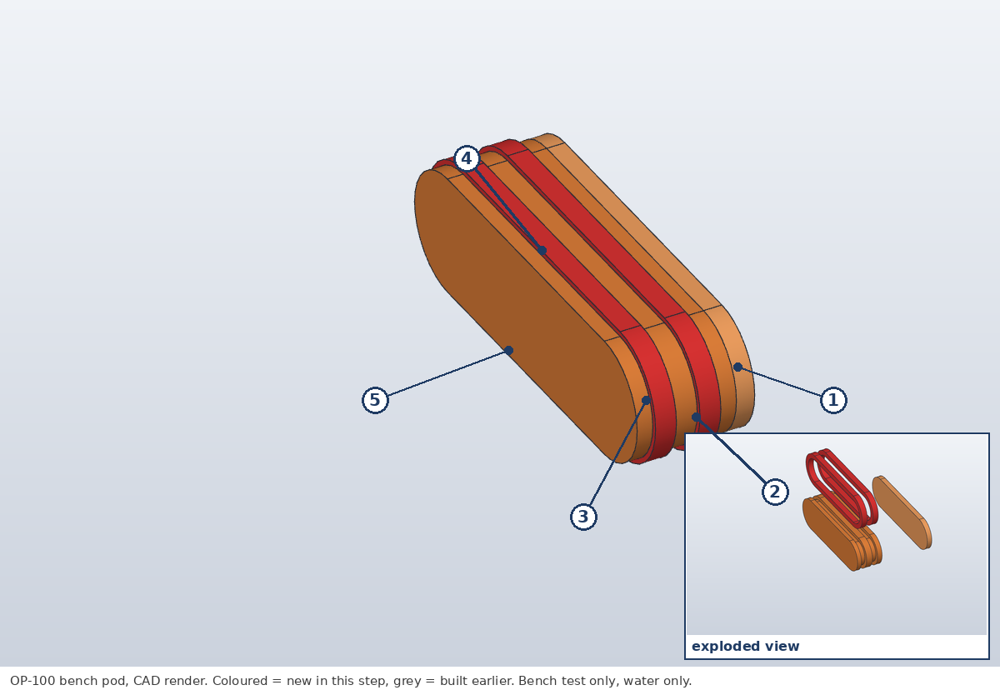

# 03. Plunger and seal

> **WARNING: BENCH TEST ONLY.** Test project, not a medical device. Never worn, never used on a person or animal. **Water only: never fill it with insulin or any other drug, not even into a container.** See [DISCLAIMER.md](../../DISCLAIMER.md).

The plunger is a printed stadium-shaped core (P4) with two silicone lip rings in its grooves and a thin printed nose (P5). It is the part the simulation worries about most: its seal friction decides whether the motor can move it at all.

*Figure 3.1: plunger core (orange) with the two lip rings (red). Inset: exploded. Callouts: 1 nose (front, toward the closed end of the reservoir), 2 seal ring B (front), 3 seal ring A (rear), 4 core, 5 rear face (toward the dry end). The carriage socket is a slot in the +Y side face between the two rings, on the side turned away from the camera.*

**Parts used:** P4 plunger core (2), P5 nose (2), P6 reservoir (for the test), seal material (B15), silicone oil, thin cyanoacrylate. Route A also uses the mould P11.
**Tools:** calipers, new razor blades, tweezers, 22G syringe (route A), force gauge or masses (03.5).
**Time:** 1 h plus cure time.

Geometry (from `params.json`, **verify on your sample**): reservoir bore 16.0 x 5.0 mm; plunger core about 15.6 x 4.6 mm (0.2 mm per side clearance); two grooves 0.8 mm wide and 0.5 mm deep at 0.6 to 1.4 mm and 2.3 to 3.1 mm from the rear; seal outside diameter when fitted equals the bore minus 0.02 mm, free (cast) size is **bore + 0.3 mm**, i.e. about 16.3 x 5.3 mm, giving a radial squeeze of about 0.13 mm per side.

## Step 3.1 Prepare the core

1. Remove any support remnants from the core and the grooves with a blade. Wash with water, dry.
2. Check the grooves with the calipers (0.8 x 0.5 mm) and that the **carriage socket**, a slot in the +Y side face of the core between the two grooves (0.8 mm wide along the plunger, 1.5 mm high, 1.6 mm deep), is open and clean.
3. **Check after the step:** the core enters the reservoir bore (P6) from the open end by hand and slides its full length **without** the seals fitted, with no rocking you can see. **Pass:** free sliding, about 0.2 mm play per side. **Fail:** tight spots mean a bore below 16.00 x 5.00 or a core too large: hone the bore lightly or reprint the core.

## Step 3.2 Seal rings: choose a route

You need two rings per plunger. **Route A (cast)** gives the designed lip geometry. **Route B (cut rings)** is the quick water-test route and is easier to vary. Both are water-only: the silicone is not validated for any drug.

### Route A: cast in the mould

Materials: 2-part platinum-cure silicone, Shore A 40 (Smooth-On Smooth-Sil 940 class; the kit's own mixing ratio and cure time apply), the printed mould halves (P11), silicone oil, 22G syringe.

1. Lightly oil nothing in the mould cavity unless the kit says so (release agent can inhibit platinum cure; follow the kit).
2. Put the plunger core in the lower mould half (the core sits on the 4 pins d2.0 into holes d2.2). Close with the upper half.
3. Mix the silicone as instructed (weigh), degas if you can, draw into the 22G syringe.
4. Inject through the d0.7 sprues until silicone leaves the d0.5 vents.
5. Cure per the kit. Demould, trim flash with a new blade without cutting into the lip.
6. **Check:** each ring about 0.8 mm wide, free outside size 16.3 +-0.15 x 5.3 +-0.15; no voids, no tears; the ring sits in its groove all around.

### Route B: cut rings from sheet (the "punched washer" route)

Materials: 0.8 mm silicone sheet (platinum cure if you have it), 1:1 paper template, new blade.

1. Print the outline at 1:1 from `mechanical/out/bench/fab/OP-100/reference_not_ordered/plunger_seal.step` (or draw it): **outer stadium 16.3 x 5.3 mm (end radius 2.65 mm), inner stadium 14.4 x 3.4 mm** (a little smaller than the groove root of 14.6 x 3.6 mm so the ring stretches onto the groove; **derived, verify**).
2. Tack the sheet to a cutting mat, cut the inner opening first with a sharp 3 mm biopsy punch for the end radii and the blade for the straights, then the outer. Webs are 0.8 mm: use a fresh blade each time.
3. Stretch each ring over the core into its groove with tweezers, working round the stadium so that it lies flat with no twist.
4. **Check:** the ring lies in its groove, no gap, no fold, the lip stands proud of the core by about 0.3 mm all round.

**If seal friction turns out too high (03.5):** make the contact narrower. Cut a ring 0.4 mm wide, or use **one ring** instead of two (simulation table 1.2: a single 0.4 mm ring at 0.2 mm oversize gives about 0.7 N). Document the change in the report: it is a deviation from the CAD.

## Step 3.3 Nose

1. Put one thin drop of cyanoacrylate on the **front** face of the core (the end that will face the closed end of the reservoir, the end **away** from the dry end), set the printed nose (0.7 mm stadium disc) on it, centred, and press for 10 seconds.
2. The nose cuts the dead layer in front of the plunger to about 0.3 mm (about 2.2 U of air or water at U100). Without it, the dead layer is 1.0 mm, about 7.5 U of trapped air (sim 5.2), which delays the first dose.
3. **Check:** nose flat, centred, no adhesive on the seal or in the grooves. Dry fit into the reservoir: the nose does not catch the bore.

## Step 3.4 Lubricate

Wipe a thin film of silicone oil (350 cSt, a few drops) on the seal lips and the bore. A dry silicone-on-resin seal sticks (sim: mu 0.9 dry against 0.15 lubricated).

## Step 3.5 Seal friction pull test (go / no-go; do it now)

Bench test 1 of `mechanical/sim/REPORT.md`. **Do it before chapter 06.**

1. Hold the reservoir (P6, **no end cap, port open to air**) in a clamp with the open end up and the bore vertical, or on its side.
2. Push the plunger in from the open end until the rear face is 3 mm inside.
3. With a force gauge and a flat tip, push the plunger **forward** by 5 mm and read the peak at the start of the motion (**breakaway**) and the average during the motion (**kinetic**). Without a gauge: lay a flat pad (card) on the rear face and add small masses until it moves: 100 g is about 1 N.
4. Repeat 5 times, then again after the plunger has stood still for 1 minute and for 1 hour.

| Result | Meaning | Action |
|---|---|---|
| Kinetic <= **1.7 N**, breakaway <= 2.5 N | **GO**: within the budget at the 105 mA controller limit (sim 1.2) | continue |
| Kinetic 1.7 to **3.0 N** | **Marginal**: only works if the phase current is raised towards the rated 181 mA (thermal limit: 1.74 W, no continuous hold) | continue, but record it; expect stalls |
| Kinetic > **3.0 N** | **NO-GO**: the motor cannot move it (sim: 7.0 N at 181 mA is the ceiling, with margin 1.5 and breakaway factor 1.49 this leaves about 3.0 N) | reduce friction: oil film, one ring, 0.4 mm ring, or +0.05 mm bore (ream); retest. Do not continue until it passes |

Record in `templates/incoming-inspection.csv` (rows `seal_breakaway_N`, `seal_kinetic_N`, ring route, number of rings, oil yes/no). The simulation's prediction is 3.6 to 21.5 N depending on the friction coefficient (table 1.2 of the report); your number is the most valuable data point of the whole build.

## Check after the step (summary)

| Check | Pass | Fail |
|---|---|---|
| Core slides in the bore without seals | free | hone or reprint |
| Rings seated, no tears | yes | recut |
| Nose flat | yes | re-glue |
| Friction | <= 3.0 N kinetic | reduce friction (above) |

Next: [04-carriage-nut-shim.md](04-carriage-nut-shim.md).
