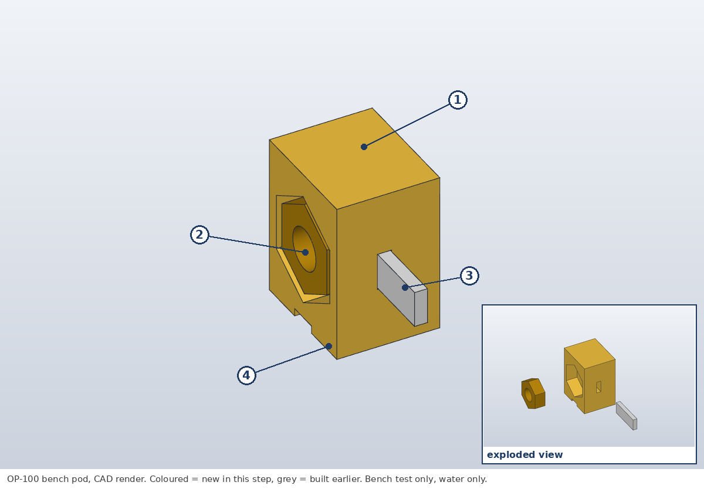

# 04. Carriage, nut and steel tongue shim

> **WARNING: BENCH TEST ONLY.** Test project, not a medical device. Never worn, never used on a person or animal. **Water only: never fill it with insulin or any other drug, not even into a container.** See [DISCLAIMER.md](../../DISCLAIMER.md).

The carriage converts the leadscrew rotation into a straight push on the plunger. The M1.6 brass nut sits in a hex pocket, the carriage rides on a floor rail, and a **stainless steel shim** reaches through the slot in the reservoir wall into the plunger socket. The shim replaces the printed tongue of the earlier design, which the simulation found far too weak (tongue stress 22 MPa per newton, allowable thrust 2.0 N; sim 4.4 to 4.6).

*Figure 4.1: carriage (yellow), nut (dark gold) and shim (silver). Inset: exploded. Callouts: 1 carriage body 4.8 mm wide, 2 hex pocket with the M1.6 nut, 3 stainless shim in its pocket, free end 2.5 mm, 4 rail groove on the underside.*

**Parts used:** P3 carriage (2), B6 nut (4), B10 shim (4), a spare M1.6 rod piece (to align the nut), cyanoacrylate.
**Tools:** tweezers (non-magnetic for the shim), calipers, loupe.
**Time:** 40 minutes.

## Step 4.1 Fit the nut

1. Clean the hex pocket (rear face of the carriage, the face toward the dry end) with a 1.5 mm blade; do not sand it.
2. Insert the nut with tweezers from the **rear**, flats aligned to the pocket, until it sits against the pocket floor.
3. Look up what you measured in 02.3: **AF 3.3 mm pocket**: the nut should press in with light finger force and not fall out when you shake the carriage. **AF 3.8 mm pocket (current CAD, nut_hex_clr 0.6)**: the nut floats about 0.3 mm per side by design so it can find the screw axis (sim 3.2); it will fall out of the open rear of the pocket as soon as the leadscrew turns backwards. **In both cases the nut must be captive in both directions** because the draw mode pulls the carriage backwards through the nut (spec §4: "fixed nut").
4. Thread the spare M1.6 rod piece through the carriage bore (d1.9) and the nut to centre the nut on the bore. Put **one tiny drop** of cyanoacrylate on two flats of the nut at the rear opening of the pocket with a toothpick (not onto the thread). Wait 2 minutes, then unscrew the rod piece: it must turn free. If the rod is stuck to the nut, discard rod and nut and start again.

**Check after the step:** The nut cannot be pushed out with the tweezers from either side, and the **rod runs through the nut and the carriage bore along its whole length with light finger force** and without binding. **Fail:** adhesive in the thread, binding: take a new nut. **Fail:** the nut is loose after the cure: add one more drop at the other flat pair.

## Step 4.2 Fit the steel shim

1. Hold the shim in non-magnetic tweezers. The pocket is on the carriage face that looks **toward the reservoir** (the open face). It is 0.55 mm wide, 1.45 mm high and 1.5 mm deep.
2. Put one drop of thin cyanoacrylate in the pocket, push the shim in to the bottom so that **about 2.5 mm** stick out. Do not bend it. Hold 10 seconds.
3. Look along the shim from the side and from the top: it must be **parallel** to the carriage axis and **centred** on the carriage height (the plunger socket is centred on the bore axis).
4. **Check after the step:** the free end of the shim enters the plunger socket (P4, 0.8 wide x 1.5 high x 1.6 deep) with 0.1 to 0.2 mm play and bottoms out. **Pass:** enters by hand, no force. **Fail:** shim skewed: warm the joint with a soldering-free method (a drop of acetone dissolves cyanoacrylate: use it sparingly and keep it off the resin) and reset, or discard the carriage and use the spare. **Fail:** shim bent: discard it, fit a new one. A bent shim means lost motion at every reversal (sim 4.6, thrust-train stiffness).

## Step 4.3 Rail test (without the shell)

1. Put the carriage on the bench with the rail groove (underside) down.
2. The groove is 1.2 mm wide by 0.3 mm deep (fab README says 0.5 deep, **verify**). When the shell is available (chapter 06) the carriage must slide on the floor rail with no wobble and no vertical float.
3. **Check:** nothing to measure here, but note any visible layer defects on the rail groove.

## Check after the step (summary)

| Check | Pass | Fail |
|---|---|---|
| Nut captive both ways, rod turns through | yes | new nut or carriage |
| Shim straight, parallel, 2.5 mm free | yes | re-seat or replace |
| Shim enters the plunger socket | yes | check the socket with a 0.5 mm blade; replace |

Next: [05-reservoir-end-cap-needle.md](05-reservoir-end-cap-needle.md).
