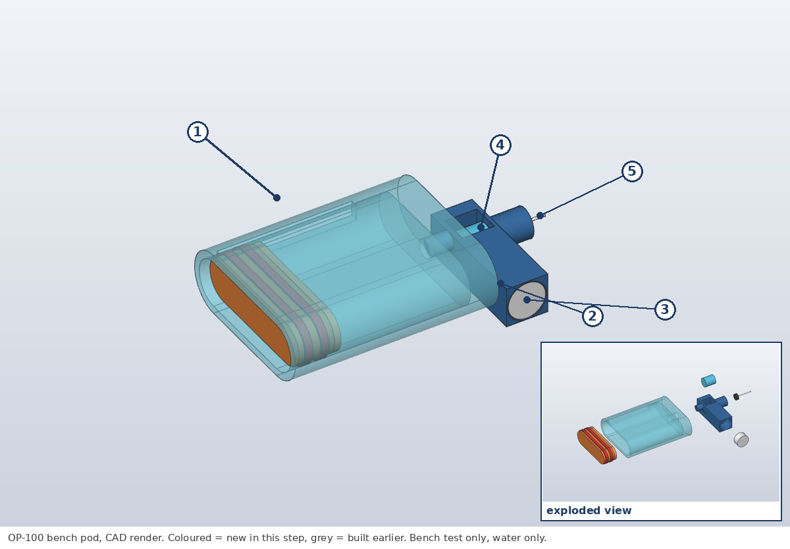

# 05. Reservoir, end cap, fill septum, duckbill valve and outlet needle

> **WARNING: BENCH TEST ONLY.** Test project, not a medical device. Never worn, never used on a person or animal. **Water only: never fill it with insulin or any other drug, not even into a container.** See [DISCLAIMER.md](../../DISCLAIMER.md).

The reservoir is the frozen stadium part (printed copy for water tests). It has one closed end with a single d2.0 port. Everything fluidic that may change lives in the separate **end cap**: the side **fill septum**, the one-way **duckbill valve** and the guard tube that carries the **30G outlet needle** on a press-fit hub.

*Figure 5.1: reservoir (transparent cyan) with the plunger (orange) at the dry end, end cap (blue) on the port, and the needle pointing toward the dock mouth. Inset: exploded. Callouts: 1 reservoir, 2 end cap, 3 fill septum side bore, 4 duckbill valve pocket, 5 needle and hub.*

**Parts used:** P6 reservoir, P7 end cap (2), plunger from chapter 03, B11 needle (3), B12 hub (4), B13 duckbill (3), B14 silicone sheet 2.0 mm, silicone oil.
**Tools:** 4 mm biopsy punch, new blade, tweezers, 0.5 mm wire, cut-off wheel or fine cutters, deburring stone, loupe, calipers, 1 ml syringe.
**Time:** 1.5 h.

## Step 5.1 Fill septum plug

1. Lay the 2.0 mm silicone sheet on a clean plastic or PTFE board. Twist the 4 mm biopsy punch through it with light downward pressure. Do not rock the punch.
2. **Check:** plug d4.0 x 2.0 mm, flat faces, no ragged edge. **Pass:** the plug presses into the d4.2 side bore of the end cap with a little squeeze and stays when the cap is shaken. **Fail:** loose or torn: punch another with a fresh punch.
3. Fit the plug later (step 5.4); put it in a labelled bag now.

## Step 5.2 Duckbill valve

1. With tweezers hold the valve by its sleeve. **Flow direction is from the reservoir toward the needle, which is toward +X (the dock mouth).** The two bills point toward the needle.
2. Drop it into the open slot on top of the cap and push it into the d3.05 pocket until it stops (`mechanical/ASSEMBLY.md` B4). The cap holds it; no adhesive.
3. **Check after the step:** the valve sits fully in the pocket, the bills point toward the needle end, the sleeve is not twisted. Blow gently into the cap from the **reservoir side**: air passes; from the **needle side** with the same effort: it does not (do this with the end cap alone, a syringe on a short tube is better; see 02.9). **Fail:** passes both ways or the valve distorts: it is not the part (check OD, step 02.9), or it is fitted backwards: turn it.

## Step 5.3 Outlet needle and hub

> **Sharp.** The cut rear end of the needle is sharp. Hold it with tweezers, cut over a tray, and discard offcuts into a sharps container or a jar with a lid.

1. Cut the 30G blunt dispensing needle from its plastic luer hub with the cut-off wheel (clamp in the pin vise, do not crush the tube with side cutters). Keep the **blunt factory end** as the tip.
2. Press the needle through the 0.3 mm bore of a PTFE hub until **4.8 mm** of needle protrude from the hub face that looks toward the cannula (CAD `dock.needle_free`; the older 3.5 or 3.0 mm in `ASSEMBLY.md` and `parts.md` are superseded, **verify with the dummy head in chapter 09**) and the cut end is flush with the other hub face. The needle is 6.35 mm long, so about 0.85 mm of surplus is cut off at the rear.
3. Deburr the cut end on a fine stone. Check that the needle is open: push water through it with a 1 ml syringe on a short tube; water must emerge as a fine jet. A blocked needle (the lumen is only 0.15 mm) is discarded.
4. **Do not fit the hub and needle yet.** Fit them in step 6.6, after the sub-assembly sits in the shell, so the tip is not bent while the sub-assembly is moved. (Figure 5.1 shows them fitted.)

## Step 5.4 End cap onto the reservoir

1. Look through the reservoir port (d2.0) at the plunger-less bore: no burrs inside the port.
2. Clear the cap channels with the 0.5 mm wire (d0.7 channels from the septum bore and the port to the valve and on to the needle bore).
3. Press the cap's **spigot (d1.98 x 2.0)** into the **port (d2.0 H7)** by hand until the cap block touches the end face of the reservoir. No glue. Press the septum plug into the side bore.
4. **Check after the step:** cap block flush against the reservoir end face, no gap you can slide a 0.05 mm feeler into, and the cap does not wobble. **Pass:** flush. **Fail:** spigot too tight: ream the port with a 2.0 drill by hand (turn, do not push); too loose: reprint the cap. **Water-only fallback:** a thin drop of UV adhesive on the outside of the joint after a successful dry fit. It must not run into the port.

## Step 5.5 Plunger into the reservoir

1. Lubricate the bore with a thin film of silicone oil.
2. Insert the plunger **nose first** from the **open dry end**, with the carriage socket (the slot in its +Y side) turned toward the **arm slot in the +Y wall** of the reservoir. Push it in until the nose is about **0.3 mm** short of the closed end wall (the dead layer). This is the **empty** position: 0 U in the reservoir. If you plan the manual fill of chapter 11.0, pull the plunger back to the position of the water volume you will fill instead. The socket must stay in line with the arm slot in every position.
3. **Check after the step (dry check):** with the cap on and the needle not yet fitted, push the plunger forward by a few millimetres with the tip of a blunt rod through the open end: air leaves through the cap channel and the valve (outlet open), and the plunger stays where you leave it. Now pull it back 2 mm: it moves back and, because the valve closes, the plunger meets resistance (a small vacuum) and a spring-back when released. **Pass:** forward motion free, backward motion resisted and springing back slightly. **Fail:** no resistance backwards means the valve is fitted the wrong way or leaks (step 5.2); the plunger sticking in both directions means the bore is too tight (step 3.5).

## Step 5.6 Final check of the sub-assembly (before it goes into the shell)

| Check | Pass | Fail |
|---|---|---|
| Overall: reservoir + cap length (OP-100) | 21.7 mm + cap block | wrong parts |
| Cap does not move on the port | yes | 5.4 |
| Septum plug flush | yes | re-punch |
| Plunger socket visible through the arm slot, slot clear | yes | clean the slot (1.6 mm high) |

Next: [06-drive-motor-gears-leadscrew.md](06-drive-motor-gears-leadscrew.md).
