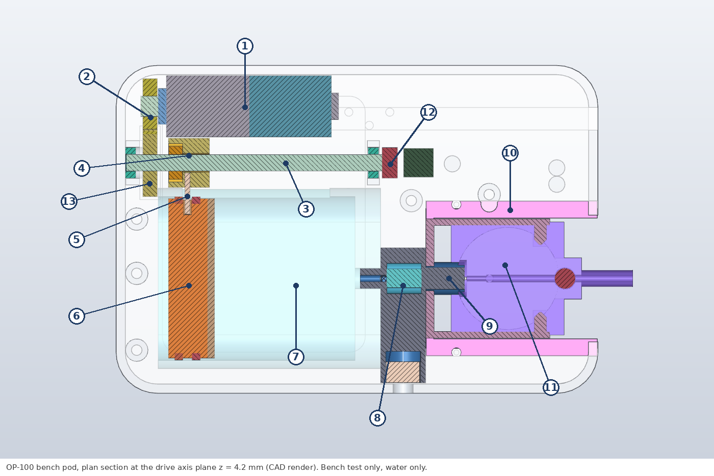
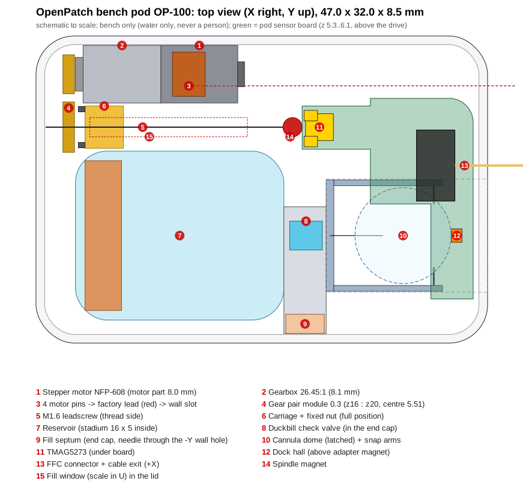
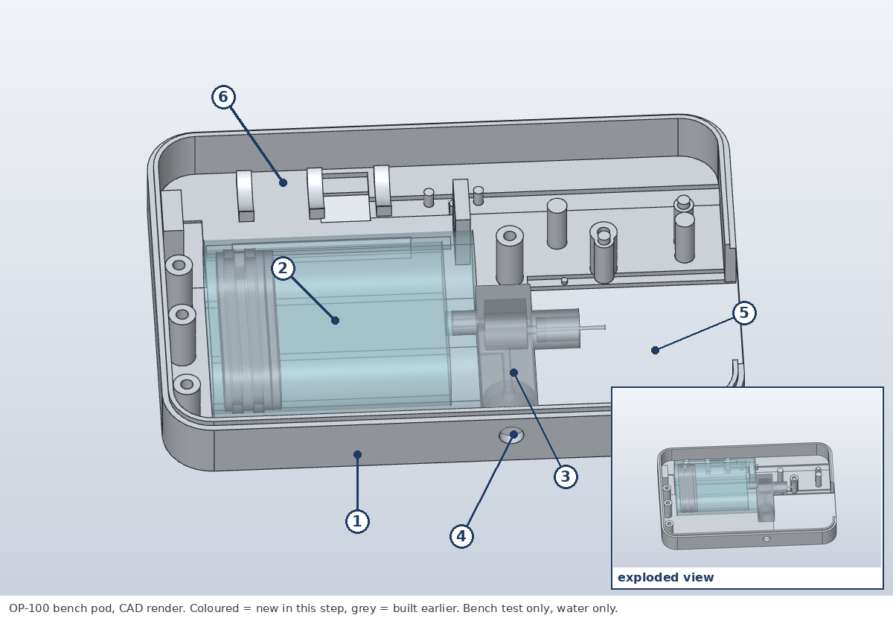
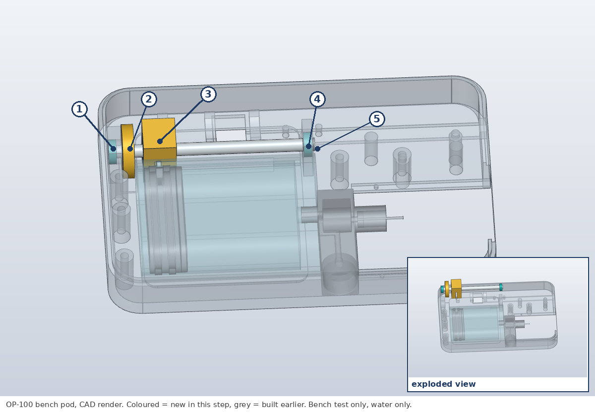
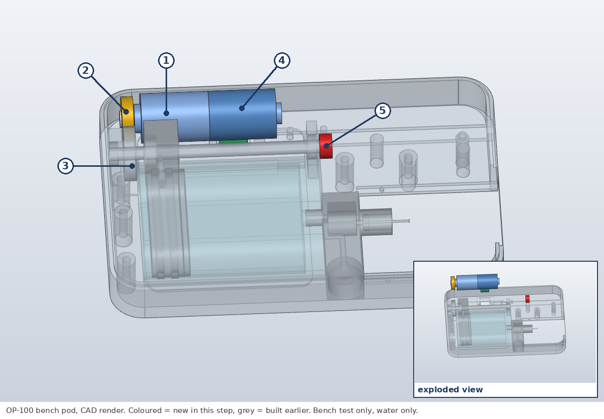

# 06. Drive: shell, reservoir in place, leadscrew, carriage, motor and gear pair

> **WARNING: BENCH TEST ONLY.** Test project, not a medical device. Never worn, never used on a person or animal. **Water only: never fill it with insulin or any other drug, not even into a container.** See [DISCLAIMER.md](../../DISCLAIMER.md).

This is the mechanical core. The order below is derived from the geometry (the leadscrew can only enter from the dock end once gear B and the carriage are in place); it is **not** the order of `mechanical/ASSEMBLY.md`, which describes the older layout. If your print differs, adapt but keep the rule: **never glue anything that must move, and test the travel by hand before the motor is fixed.**

Pod geometry (OP-100, x along the length, y across the width, z up from the floor; from `OP-100.mech.json`): dry end wall at x = 0; dry bush x 0.9 to 1.9; gear plane x 2.6 to 4.0; carriage rear stop at x = 5.1; reservoir x 4.1 to 25.8 at y = 11.2; leadscrew axis y = 22.5, z = 4.2; motor axis y = 28.0, z = 4.2 (gearhead x 4.9 to 13.0, motor x 13.0 to 21.0); far bush x 24.6 to 25.6; end cap and needle x 25.8 to 36.1 at y = 11.2, z = 3.0.

*Figure 6.0: plan section through the drive axis plane of the finished OP-100 (CAD render, x to the right, y up). Callouts: 1 motor (gearhead and motor), 2 gear A (z16) on the motor shaft, 3 leadscrew, 4 carriage with its nut, 5 steel shim in the plunger socket, 6 plunger with seal rings, 7 reservoir bore, 8 end cap (duckbill valve in teal), 9 outlet needle in its hub, 10 dock insert arms, 11 dummy cannula head, 12 spindle magnet, 13 gear B (z20).*

*Figure 6.0b: annotated top view of the same pod (`mechanical/out/bench/OP-100_layout_annotated.png`, unchanged). It also shows the sensor board (green) and the lid fill window.*

## Step 6.1 Bottom shell and bushes

*Figure 6.1: bottom shell (light) with the reservoir, plunger, end cap and septum placed. Inset: exploded. Callouts: 1 bottom shell, 2 reservoir on its floor trough, 3 end cap in its tower pocket, 4 fill septum facing the -Y wall hole, 5 dock channel open toward +X.*

**Parts used:** P1 bottom, bushes B7 (2 of 4), the sub-assembly of chapter 05. **Tools:** tweezers, loupe.

1. Press one **bush** (OD 3.0 x ID 1.7 x 1.0) into the **dry** bearing bore (x 0.9 to 1.9) and one into the **far** bore (x 24.6 to 25.6 for OP-100, `far_bush` in `mech.json`): flush, by finger. If you have no bush, the printed bore d1.7 runs the screw directly (fallback in `parts.md`, add a drop of oil).
2. Lower the reservoir sub-assembly into the shell, **open dry end toward the dry-end wall (x = 0)**, end cap toward the dock end. Seat it on the floor trough.
3. **Check after the step:** the reservoir lies flat and does not rock; the **fill septum** plug is visible through the 2.0 mm hole in the **-Y** wall; the cap sits in its tower; the plunger socket is visible through the arm slot; the dock channel to +X is clear. **Pass:** all true. **Fail:** reservoir proud of the floor by more than 0.1 mm: check the floor for support remnants; cap not in the tower: re-seat the spigot (5.4).

## Step 6.2 Carriage, leadscrew and gear B (no motor yet)

*Figure 6.2: leadscrew (silver) through the dry bush, gear B, the carriage nut and the far bush; carriage (yellow) with its shim in the plunger socket. Inset: exploded. Callouts: 1 dry bush, 2 gear B on its sleeve, 3 carriage with nut, 4 far bush, 5 rod end (the magnet comes in 6.4).*

**Parts used:** carriage sub-assembly (chapter 04), leadscrew (02.5), gear B and sleeve (02.6), retaining compound. **Tools:** pin vise, non-magnetic tweezers.

1. **Pre-assemble gear B and the sleeve** on the bench: slide the 2.1 mm sleeve into gear B so that the sleeve end is flush with the gear face on the **carriage side** and the sleeve sticks out **0.7 mm on the dry-bush side** (toward x = 0, bridging the gap to the bush face). Fix it with one drop of retaining compound between sleeve and gear bore. Let it cure (follow the product sheet).
2. Put the **carriage** on the floor rail at its **forward** end (nose toward the reservoir; the shim goes into the plunger socket through the arm slot). Put **gear B + sleeve** into the gear plane over the screw lane.
3. Insert the **leadscrew from the dock end (+X)**: through the far bush, then the carriage nut (turn the rod with the pin vise: the carriage must follow and wind rearward), then the sleeve in gear B, then into the dry bush. The rod end must sit flush with the outer face of the dry bush (x about 0.9).
4. Do not fix the sleeve yet.
5. Turn the rod with the pin vise: the carriage must run from the **front** to the **rear stop** (x = 5.1) and back, and the plunger must follow it **in both directions** (the shim pulls and pushes). The carriage stops against the two printed rear blocks, not against the thread.
6. **Check after the step:**

| Check | Pass | Fail |
|---|---|---|
| Carriage runs the whole stroke (13.4 mm for OP-100) with two fingertips on the pin vise | smooth, no tight spot, no click from the nut | binding: rod bent (02.5), nut off-axis (04.1), rail groove blocked; carriage must not touch the shell walls |
| The plunger follows in both directions | yes, no lost motion you can see | shim in the wrong place or bent (04.2) |
| Rear stop | carriage bears on both blocks, rod can still turn a quarter turn with light force | stop too early: file the carriage rear face |

**Starting position:** for the manual fill of chapter 11.0 (route 1) finish this test with the **carriage retracted** to the position that matches the amount of water you will fill (the rear stop is full; 50 U is 6.7 mm in front of the rear stop at 0.35 mm per turn, about 19 turns). With the motor not yet fitted you can do this with the pin vise; afterwards the motor gearbox cannot be turned back by hand.

**Note:** the drag torque the motor can tolerate is tiny (10 % of 1.83 N mm is 0.18 N mm, sim 3.2). You cannot feel that in a pin vise. This check only finds gross binding; the real friction test is the motor current in chapter 11.1.

## Step 6.3 Motor and gear A

*Figure 6.3: motor (blue) in its three cradles on the +Y side, gear A (brass) on the shaft meshing with gear B, spindle magnet (red) on the rod end. Inset: exploded. Callouts: 1 motor gearhead, 2 gear A (z16), 3 gear B (z20), 4 motor body and terminal block, 5 spindle magnet.*

**Parts used:** B1 motor, B2 gear A (turned to 1.4 mm), retaining compound (Loctite 638), 0.1 mm feeler.

1. Measure the shaft: you recorded the D-flat and the free length in 02.3. The gear sits **0.1 mm in front of the gearhead boss** (gear plane x 2.6 to 4.0, boss front at x = 4.1).
2. Put the motor in the **three cradles** with the shaft pointing toward the dry-end wall. The 4 terminal pins as delivered point down (-Z); the factory lead is soldered to them. **Never pull the lead.** The CAD floor pocket is under the terminal block; if the pins hold the block above the floor, bend the pin tips flat toward the rear **very gently** (verify on your sample) or leave the pins and check the block clears the floor.
3. Lay the lead in the floor pocket under the terminal block and along the 2.2 mm channel to the +X end wall; weave the four wires between the three printed posts (strain relief), and out through the end-wall slot (3 x 2.4 mm).
4. Slide **gear A** onto the shaft **dry** (no compound yet). Check the mesh with gear B: **centre distance 5.51 mm is set by the shell**, so the gears turn with a little backlash (about 0.1 mm).
5. **Check after the step (mesh, before any compound):**

| Check | Pass | Fail |
|---|---|---|
| Rotate gear A by hand through one full turn | gear B follows, the carriage moves, **small rattle at every angle, no binding** | binding at some angle: gear plane or centre error (sim 3.1: 35 % of pods bind at a theoretical centre of 5.40 mm). Do not fix: re-seat the motor in the cradles, check the screw bush bore, check the gear is on the D-flat square |
| Gear A and gear B coplanar | within 0.2 mm (compare faces with a feeler) | move gear A on the shaft; gear B on its sleeve (before fixing) |
| Gear A rear face to boss | about 0.1 mm | move it |
| Lead exits through the slot, no sharp bend | yes | re-route |

6. Fix **gear A**: one drop of retaining compound on the **round** part of the bore; the D-flat leaves a 0.5 mm gap that the compound fills. Keep it off the gearhead boss and the bearing. Hold alignment while it sets (follow the product sheet).
7. Fix **gear B's sleeve** to the rod: touch the end of the sleeve on the **reservoir side** with a needle tip of retaining compound. Capillary action pulls it into the sleeve-rod gap. **Keep it off the dry bush face**, which is the thrust face, and **do not glue the sleeve to the bush**. Check that the sleeve end face touches the dry bush face (zero to 0.1 mm axial gap) before it sets. **Thrust:** the sleeve end on the bush face takes the delivery thrust (sim 1: collar at the bush face).
8. **Check after the compound cures:** turn the carriage through the full stroke with the pin vise on the rod end (turning gear A by hand works the 26.45:1 gearhead backwards and is stiff). The travel must stay smooth; then return the carriage to the starting position you chose in step 6.2.

## Step 6.4 Spindle magnet

1. With the sleeve on the dry bush face, pull the rod axially toward the dry end (it bears on the dry bush). Measure the gap between the rod end (+X) and the **far bush face** with a feeler: this is where the magnet will sit. **Axial end float must be 0.1 mm or less** after the magnet is fitted: each 0.1 mm of float is a lost motion of about 0.75 U (74.6 mm2 x 0.1 mm) at every direction reversal (draw to deliver; sim 2.9). If the gap is more than 0.35 mm, cut the rod 0.2 mm shorter next time or shim with a thin washer (verify on your sample).
2. Put one **tiny drop of gel cyanoacrylate** on the rod end face, place the **spindle magnet** (d3.0 x 1.5, diametric) with **non-magnetic** tweezers, aligned so that its edge follows the outline of the far bush (OD 3.0). Hold 30 seconds. **The pole orientation does not matter** (angle is absolute), but note the dot from 02.8.
3. Keep the magnet **away from the sensors and the controller** until chapter 07. Do not let it touch the steel shim.
4. **Check after the step:** the magnet is flat, centred within 0.1 mm of the bush, and the rod still turns freely. Spin the rod with the pin vise: the magnet runs true (no visible wobble at 3 mm). **Fail:** wobble means a tilted magnet; an off-centre magnet gives a once-per-turn error. Pop it off with a blade and redo.

## Step 6.5 Hub and needle

1. Press the **hub with the 4.8 mm needle** (05.3) into the end cap's guard-tube bore (d2.0) from the dock mouth (+X) until it bottoms. No glue. **Fallback if it weeps:** a drop of UV adhesive around the hub, cured with the UV lamp (water test only).
2. **Check after the step:** needle tip at **x = 36.1 mm** (OP-100 from the dock geometry: hub at x 30.6 to 31.3, free needle 4.8 mm) and at **y = 11.2, z = 3.0** (the dock axis), parallel to the floor within about 0.2 mm (sight along it). **Pass:** needle straight, aligned. **Fail:** bent: replace it (do not straighten a 30G needle).

## Check after the chapter (mechanical drive)

| Check | Pass | If it fails |
|---|---|---|
| Carriage full stroke by hand, plunger follows both ways | yes | rebuild from 6.2 |
| Mesh with rattle, no binding | yes | 6.3 |
| End float <= 0.1 mm | yes | 6.4 |
| Needle aligned | yes | 6.5 |

Next: [07-pod-sensor-board-ffc.md](07-pod-sensor-board-ffc.md).
