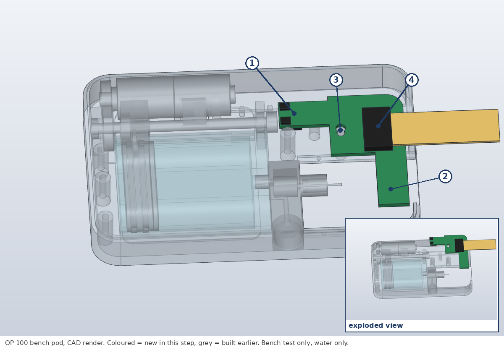

# 07. Pod sensor board and FFC cable

> **WARNING: BENCH TEST ONLY.** Test project, not a medical device. Never worn, never used on a person or animal. **Water only: never fill it with insulin or any other drug, not even into a container.** See [DISCLAIMER.md](../../DISCLAIMER.md).

The pod sensor board is a small 2-layer board (15.5 x 25.9 mm, 0.6 mm thick, same for all sizes) that carries the **TMAG5273 angle sensor** under the end of the spindle magnet, the **dock hall switch** at the dock mouth, an optional pair of DRV5032 hall switches, and the **FFC connector** for the cable to the bench controller. There is no motor contact on it: the motor's own lead goes to the controller (Rev A bench decision, spec §4a).

*Figure 7.1: pod sensor board (green) with its sensors (black) and the FFC cable (gold) leaving toward +X. Inset: exploded. Callouts: 1 TMAG5273 under the magnet end, 2 dock hall switch, 3 locating pins and the M1.2 x 4 board screw, 4 FFC connector J1.*

**Parts used:** the pod sensor board (PCBA), B17 FFC cable, B16 one M1.2 x 4 screw. **Tools:** loupe or USB microscope, multimeter, feeler gauges, screwdriver for M1.2, tweezers.
**Time:** 45 minutes.

> **To be confirmed when the controller board is final:** the FFC pin count and pin assignment. The pod board has **10 pins** (`electronics/bench/pod/parts.json`: FH12-10S). The controller documentation (`electronics/bench/pin-assignment.md`) describes a **12-pin** FFC of the earlier SMA concept, and the controller BOM lists a **16-pin** connector. Do not connect the cable to the controller until chapter 10.1 has been resolved for your board revision.

Pod board pin map as built (`electronics/bench/pod/build_pod.py`): 1 GND, 2 3V3, 3 HALL_A, 4 HALL_B, 5 DOCK_N, 6 I2C_SDA, 7 I2C_SCL, 8 TMAG_INT, 9 not connected, 10 GND. TMAG5273 at I2C address 0x35.

## Step 7.1 Inspect the board

1. Under the loupe: TMAG5273 (SOT-23-6) and the DRV5032 parts (X2SON, 4 small pads) on the **bottom** side sit square and fully soldered; no bridges; the 100 nF caps are present; the connector J1 flip lock is intact. Note the dock hall variant that was assembled (FADMR or AJDMR) in `incoming-inspection.csv`.
2. Multimeter, board unpowered: resistance between 3V3 (cable pin 2 pad) and GND (pin 1 pad) is **not** a short. A reading below about 10 ohm is a defect. **Check after the step:** no short, all parts present. **Fail:** return the board; do not power it.

## Step 7.2 Seat the board

1. The board lies on the tower top and two support posts and is located by **two pins d1.0** (board holes d1.2). Lower it straight down.
2. The **leg** of the board overhangs the dock channel. The **TMAG5273 hangs under the board** and must sit **behind the end face of the spindle magnet**: the CAD gives an air gap of **0.6 mm** between the magnet end face and the sensor body (the sensing point is on the shaft axis, z = 4.575 mm for a magnet axis at z = 4.2 mm; expected field about 35 mT; `OP-100.layout.json`, `hall_sensors`).
3. Measure the gap with feeler gauges **before** the screw goes in. **Pass:** 0.4 to 0.8 mm and the board does not touch the magnet, the rod or the bush. **Fail:** gap too small: the magnet sits too far toward +X (check 6.4). Gap too large: the magnet is too far back. Both change the field, which the firmware checks (field magnitude 50 % to 160 % of nominal, self-test S09).

## Step 7.3 Board screw

1. One **M1.2 x 4** self-tapping screw into the boss next to the locating pins (center at pod x = 36.4, y = 19.4).
2. Drive it **until the head touches** the board. **Stop.** Printed PA12 strips above about 0.1 N m. **Pass:** the board does not rock; **fail:** the board bows or cracks: back the screw off a quarter turn.

## Step 7.4 FFC cable

1. Open the flip lock of J1 with a fingernail or tweezers.
2. Insert the cable straight in to the stop with the **contacts facing the board** (bottom-contact connector; **verify on the Hirose drawing**, and order the cable with the matching contact side: A = same side, D = opposite). **Pin 1 mark of the connector to pin 1 mark of the cable.**
3. Close the lock. Tug gently (about 0.5 N): the cable must not move. The cable leaves through the +X wall: the slot in the lid is 8.0 x 1.1 mm and the cable is 6.0 x 0.3 mm.
4. **Check after the step:** with the multimeter on the **far end** of the cable, pin 1 and pin 10 show continuity to the ground pads; pin 2 (3V3) to ground is not a short; the cable is not folded sharply (minimum bend radius about 3 mm).

## Step 7.5 Clearances before the lid

| Check | Pass | If it fails |
|---|---|---|
| The tallest part under the lid, the FFC connector (about 1.0 mm), clears the lid (lid inner z = 7.5, board top z = 5.9, free 1.6 mm) | at least 0.3 mm | sim 3.8: the lid clears the tallest board component only by 0.20 mm nominal (-0.28 worst case): if it touches, trim the lid's hold-down pad |
| Board does not touch the spindle magnet or the bush | yes | file the board notch (never the magnet) |
| The dock hall chip sits **in the dock recess** (bottom side), the mouth stays clear | yes | re-seat |

Next: [08-closure.md](08-closure.md).
