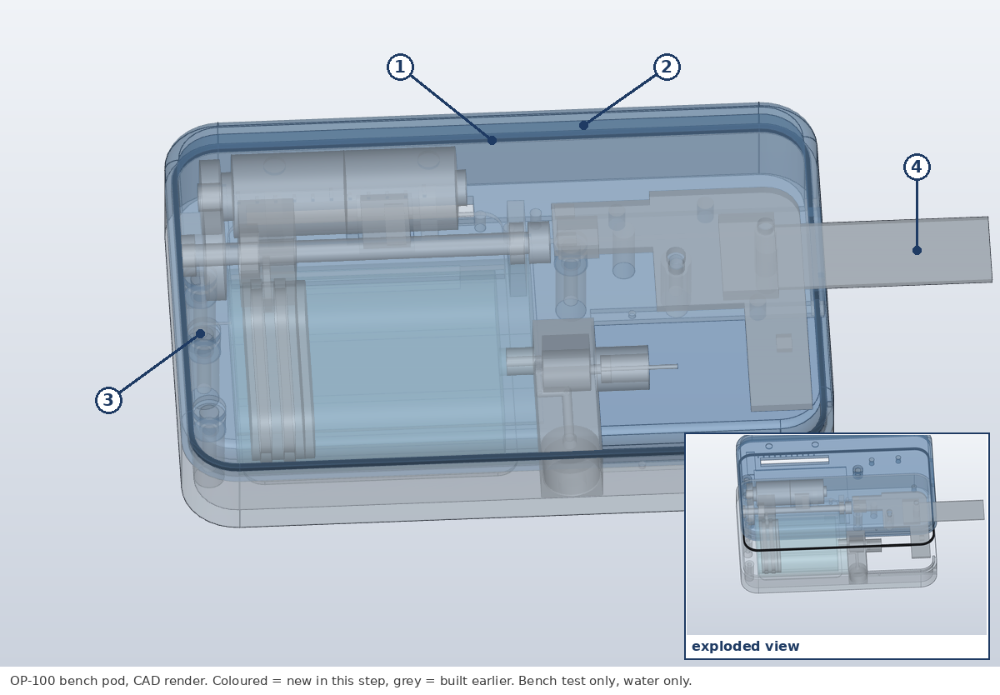

# 08. Gasket, lid and closure

> **WARNING: BENCH TEST ONLY.** Test project, not a medical device. Never worn, never used on a person or animal. **Water only: never fill it with insulin or any other drug, not even into a container.** See [DISCLAIMER.md](../../DISCLAIMER.md).

The lid closes the pod with a lap joint, a 0.5 mm silicone gasket and **four M1.2 x 6 screws** (three at the dry end at x = 2.0, y = 4.2 / 11.7 / 17.0 and one next to the reservoir at x = 28.8, y = 18.8; `OP-100.mech.json`). Two pads on the underside of the lid press the sensor board down and the motor into its cradle without preload. A 2 mm window in the lid shows the carriage; a scale of ticks every 10 U is moulded next to it.

*Figure 8.1: gasket (black) and lid (transparent blue) on the pod. Inset: exploded. Callouts: 1 gasket ring on the bottom tongue, 2 lid with fill window and scale, 3 screw positions at the dry end, 4 FFC slot in the +X wall.*

**Parts used:** P2 lid, gasket (0.5 mm silicone), B16 four M1.2 x 6 screws. **Tools:** screwdriver, calipers, blue marking dye or soft pencil, tweezers.
**Time:** 30 minutes.

> The housing is printed PA12, porous, with an open FFC slot: **the gasket is for a consistent lid seat and splash resistance only. There is no watertightness claim** (`mechanical/README.md`, known conflict 8). Do not test the pod by submerging it.

> **Order option:** if you want to watch the carriage during the first boot (chapter 10.5), do chapter 10 up to 10.5 now with the lid off and come back; the lid can be removed again at any time.

## Step 8.1 Dry-fit the lid and mark the contact points

1. **Before the gasket:** put a thin film of marking dye (or soft pencil graphite) on the **top of the reservoir**, on the **top of the gear B / sleeve**, and on the **tallest board parts**. Lower the lid straight down, press with your fingers once, lift it.
2. Look at the underside of the lid and the marked parts: the dye must be **untouched** (no transfer onto the lid) except on the two **hold-down pads**. **Pass:** no contact except the pads. **Fail:** transfer on the reservoir outline means the lid touches the reservoir (sim 3.7: nominal gap 0.00 mm, 50 % probability of contact). A lid pressing on the reservoir loads the plunger seal and changes the friction. Sand the **lid underside** over the reservoir **0.2 mm** (the CAD recess is 0.3 mm), or sand the reservoir outside top by 0.1 mm, repeat the dye test.
3. Clean the dye off with isopropanol and wash with water; dry.

## Step 8.2 Gasket

1. Cut the gasket ring from the 0.5 mm silicone sheet from the outline `OP-100_gasket.step` (ring **0.4 mm wide**, fragile: cut with 0.8 mm webs).
2. Lay it on the bottom tongue (z about 5.5), with tweezers. It must not cover a screw boss.

## Step 8.3 Lid and screws

1. Lower the lid straight down; the FFC cable goes through its slot; the pads touch the board and the motor.
2. Drive the four **M1.2 x 6** screws in a cross pattern (dry end first). **Stop when the head touches the counterbore.** The lid skirt then seats on the bottom shell at the hard stop (gasket compressed to about 0.45 mm). **Do not over-torque: PA12 strips above about 0.1 N m.**
3. **Check after the step:**

| Check | Pass | Fail |
|---|---|---|
| Closed height (calipers, lid top to bottom face) | **8.3 to 8.5 mm** (nominal 8.4; sim 3.6: up to 8.6 mm on MJF, spec limit 8.5) | file the lid top or the bottom face flat; record the actual value |
| Lid gap all round | even, no step more than 0.2 mm | a screw is not seated, or the gasket is folded |
| Press the lid over the reservoir with your thumb | no give, no click | spacer too high under the reservoir: see 8.1 |
| FFC cable | leaves freely, not pinched | widen the slot with a fine file |
| Fill window | the carriage can be seen as a dark block in the 2 mm window | check the carriage position |
| Weigh the closed pod and write it down | for the leak test baseline | |

## Step 8.4 Fill-window scale

The ticks on the lid are every 10 U (long every 50 U), measured from the **full position**: the carriage at the rear stop is 0 U delivered, and the ticks count the units delivered as the carriage moves forward (`mechanical/REFILL.md`). Use them to read the fill level by eye; the **step count from the firmware is the authority**.

Next: [09-dock-insert-and-dummy-head.md](09-dock-insert-and-dummy-head.md).
