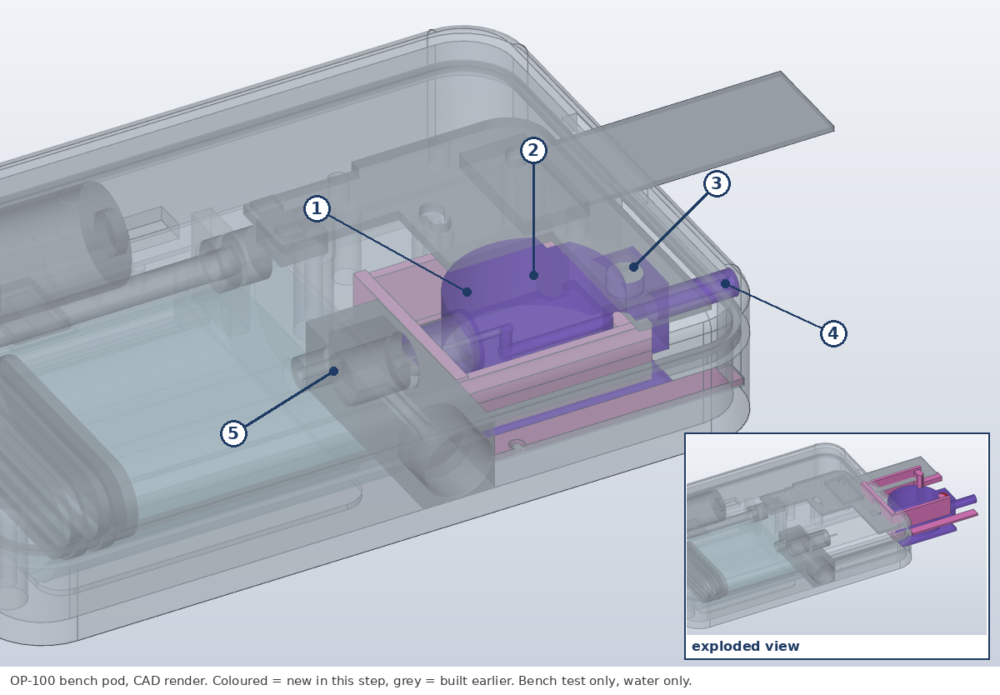

# 09. Dock insert, dummy cannula head and docking

> **WARNING: BENCH TEST ONLY.** Test project, not a medical device. Never worn, never used on a person or animal. **Water only: never fill it with insulin or any other drug, not even into a container.** See [DISCLAIMER.md](../../DISCLAIMER.md).

All the cannula-specific geometry lives in **one small swappable part, the dock insert** (spec §8a): pocket, two snap arms with hooks, needle centring. The pod keeps a **frozen dock interface** (window, flange ledge, detent holes, needle axis, dock hall position), so inserts can be changed without rebuilding the pod. On the bench the pod docks onto a **dummy cannula head** (printed dome with a magnet and a septum plug), not onto a real cannula.

*Figure 9.1: dock insert (pink) sliding into the pod's dock window from the +X mouth and the dummy head (purple) with its rear magnet lug and hose barb. Inset: exploded. Callouts: 1 dock insert with the two snap arms, 2 dummy head dome, 3 magnet in the rear lug, 4 hose barb, 5 30G outlet needle entering the septum recess.*

**Parts used:** P9 insert set (12), P10 dock fixture, P8 dummy head (2), B9 axial magnets d2 x 1, B14 silicone plug (2 mm punch), B18 silicone tube, cyanoacrylate. **Tools:** calipers, force gauge or masses, 2 mm punch, tweezers.
**Time:** 1 h for the dummy head and the first fit test, plus the full fit test in 11.6.

> **No real cannula is needed, and none is ever inserted anywhere.** If you want to see how your inserts fit a real Roche Accu-Chek Insight Flex head, borrow an **unused** one, measure it with the sheet in `mechanical/cannula-measurement.md` (calipers only, do not touch the cannula tube or any needle: puncture and sterility hazard) and do the same fit test on the table. Never attach it to a person.

## Step 9.1 Prepare the dummy head

1. Press a **d2 x 1 axial magnet** into the magnet pocket (d2.1 x 1.05) of the rear latch lug, with a drop of cyanoacrylate. The top face sits at z = 4.3 mm. **Same face up on every head** (the pole you marked in 02.8).
2. Punch a **d2 plug from 2 mm silicone sheet** and press it into the septum recess of the head (recess d3.6, through bore d0.5; the bore leads to the channel d0.7 that ends at the hose barb d1.6). The outlet needle will pierce this plug. **Verify on your print:** the plug must fill the recess without covering the bore. Make a 0.5 mm pilot with a fresh needle only if the plug blocks the bore.
3. Push 300 mm of **1/16 in ID silicone tubing** onto the barb with a little stretch. The other end goes into a beaker or onto the balance later.
4. **Check after the step:** magnet flush and glued; plug seated; blow through the tubing: air flows between the tube and the septum bore (hold a finger over the bore: the tube pressurises). **Fail:** no flow: clear the channel with a 0.5 mm wire; leaks around the plug: punch a bigger plug.

## Step 9.2 Fit test with the dock fixture (no pod needed)

The fixture carries the same frozen interface as the pod. Do this before you rely on any insert.

1. Slide **insert v01** into the fixture from the open end until the front face meets the rear dock face and the two ledge bumps (d0.5) click into the flange holes (d0.9). Swap by pushing it out with a pin from the open end.
2. Hold the fixture flat on the table, open end toward you. Slide the dome of the dummy head into the insert along the plate, as the pod will go on: **the arms must spread (under 1 N), snap behind the dome with a click, and the dome stops against the guard tube.**
3. Rate it in `templates/dock-fit-log.csv`: *slides freely (Y/N), snaps (Y/N), rattles (Y/N), pull-off force (light / firm / stuck, number if you have a gauge)*.
4. Repeat for all 12 variants. They sweep two parameters (`variants.csv`):

| ID | dome diameter A (mm) | hook height N (mm) | hook gap (mm) | predicted arm strain / tip travel / force |
|---|---|---|---|---|
| 1, 5, 9 | 9.7 | 2.7 / 3.0 / 3.3 | 6.189 | 1.59 % / 1.855 mm / 0.58 N |
| 2, 6, 10 | 9.9 | 2.7 / 3.0 / 3.3 | 6.453 | 1.53 % / 1.823 mm / 0.55 N |
| 3, 7, 11 | 10.1 | 2.7 / 3.0 / 3.3 | 6.713 | 1.48 % / 1.793 mm / 0.53 N |
| 4, 8, 12 | 10.3 | 2.7 / 3.0 / 3.3 | 6.970 | 1.43 % / 1.765 mm / 0.50 N |

5. **Measure your dummy dome** (it is a print: nominally 10.0 mm, +-0.1) at three places and expect variants with A between 9.9 and 10.1 to fit best. The one that **snaps, does not rattle and lets go with 2 to 4 N** wins.
6. **Check after the step:** at least one variant snaps without rattling and releases by hand. **Pass:** note its ID and the measured values. **Fail:** all too tight: the dome is larger than the range of the sweep, so shift the sweep to larger A; all too loose or rattling: shift it to smaller A (rebuild with `python3 mechanical/generate.py --coupon`, order again). Enter the winning values in `params.json` only through the project owners' process (`mechanical/cannula-measurement.md`): the insert, not the pod, is what changes. **Fail (arm crack or whitening):** the arm is over-strained; SLA tough resin allows 2.0 % strain, PA12 3.0 % (sim 4.1, 4.2): the predicted values above are 1.4 to 1.6 %, so a crack is a material or print defect.

## Step 9.3 Fit the chosen insert in the pod

1. Take the winning insert. Slide it into the dock window of the **closed pod** from the **+X mouth** (arms toward you) until the front face meets the rear dock face and the detent bumps click.
2. A drop of cyanoacrylate at the flange is optional. Swap by pushing the insert out from the open end with a pin.
3. **Check after the step:** the insert is flush in the mouth, does not move sideways or lift, and the guard tube bore (d2.0) lines up with the needle. The needle tip must lie centred in the insert's needle guide. **Pass:** centred within 0.4 mm (sim 3.3: residual offset +-0.40 mm against a usable septum radius of 1.34 mm). **Fail:** off-centre: re-seat; if the needle is bent, replace it (6.5).

## Step 9.4 Dock the pod on the dummy head

1. Lay the dummy head flat on the table, tube leading away. Put the pod flat on the table **mouth first** toward the head. Push straight on along the table: the dome enters the channel, the arms spread (under 1 N), snap behind the dome, the needle enters the septum plug. Release by pulling the pod straight back.
2. **Check after the step:**

| Check | Pass | Fail |
|---|---|---|
| Docking effort | under about 2 N, one click | too stiff: the insert for the next print needs a larger A |
| Fully latched | no gap between the dome and the insert stop, pod does not rock | the hooks do not engage: hook height N too small (sim 3.5 predicts a 0.25 mm worst-case overlap) |
| Needle entry | needle tip inside the plug, no deflection; the tubing at the barb moves slightly when you push water into the needle later | needle misses: lead-in too small (sim 3.4 WARN: guard tube float only 0.2 mm, lead-in 0.4 mm) |
| Release by pulling | 2 to 4 N (`cannula-measurement.md`); the simulation predicts **0.6 N pull-off, 2.0 N insertion** | below 1.5 N the pod falls off a table edge: record it (sim 4.3 WARN) |
| Magnet and dock hall | checked in 10.5 | |

Next: [10-electronics-first-boot.md](10-electronics-first-boot.md).
