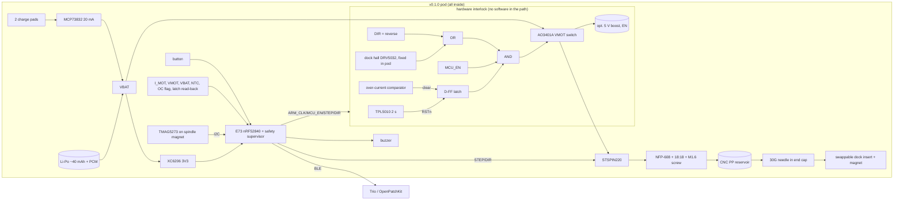

> **TEST ONLY - NOT FOR HUMAN USE** (see `../../DISCLAIMER.md`). OpenPatch is a test project, not a medical device. This document describes a bench/test pod. It is never worn and never used with insulin on a person; there are no on-body instructions here and there will be none.

# OpenPatch v0.1.0 - integrated pod architecture and feasibility (2026-11-19)

Status: architecture/feasibility study. Documentation + calculations only (scripts in `docs/v010/calc/`, outputs in `docs/v010/calc/results.txt`, board proposal in `docs/v010/board-outline-proposal.json`). Nothing here edits the spec; proposed spec changes are in section 10. All numbers marked **EST** are estimates; **VERIFY** means check before ordering; **BENCH** means taken from `electronics/bench/*/parts.json` (already used there).

## 0. Verdict

**Feasible, with three conditions.** A fully integrated v0.1.0 pod (all electronics inside, bench controller reduced to an optional fixture) can be built from parts that are already ~98 % final, in **one order**, if:

1. The footprint is allowed to grow by a **22 mm electronics tail** behind the dock (OP-100: 44.9 -> **66.9 x 32 x 8.5 mm**, 18.2 cm3, still 38 % smaller than an Omnipod DASH by volume). Without the tail the same parts fill the board to 1.5x its capacity (calc/envelope.py) - exactly why the 17.1 x 29 mm board failed.
2. The radio is the **bench-proven Ebyte E73 (nRF52840) module**, not the consigned ISP1807 and not a bare chip: LCSC-stocked, firmware pin map exists, no RF layout risk. Size is bought back later (v0.2).
3. **Qi is dropped for v0.1.0** (two flat charge contacts + a cradle instead) and the **battery is a ~40 mAh 3.0-3.2 mm Li-Po with PCM**. This frees the top 1.5 mm and ~20 nets and removes the most crowded part of the old board.

Costs: **~370-480 EUR for the minimum first pump** (fails spec 1d if MOQ overhead is charged to one pump), **~136-172 EUR per pod averaged over one 4-pod order (passes)**, **~85-110 EUR marginal pod**. Hardware safety stays independent of software: `MOT_ALLOW = MCU_EN AND watchdog latch AND (DOCKED OR DIR_REVERSE)` + a new hardware over-current cut; 6 single hardware faults can still reach a hazard (exhaustively enumerated), all covered by firmware proof tests that Trio shows as component diagnostics.

Top risks: (R1) E73 height/stock unverified, (R2) battery dimensions/capacity unverified (no AliExpress listing could be read), (R3) first-pass routing of a 2-sided 4-layer board (gate it in simulation before paying), (R4) leadscrew thrust margin on a sagging battery (est. 5.9 N vs 5 N), (R5) 0.03 mm of backlash = 0.22 U (dose accuracy after every refill reversal).

## 1. Inputs and findings that change the plan

* Rev A bench pod (`mechanical/out/bench/OP-100.mech.json` / `.layout.json`): reservoir + leadscrew lane + motor beside it, 18:18 GHW gear pair (centre 5.40), dock tower x 29.8..40.2 at y 11.5 (needle z 3.0, dome top z 5.0), sensor board 16.7 x 20.9 mm at z 5.3..6.1 over the dock, lid inner z 7.6, floor z 0.9. Everything to the right of the reservoir end `x_r1` ("u axis") is free for electronics: 17.3 mm long x 30.2 mm wide interior; the bench board already spans over the dock.
* **No stale numbers carried:** (a) the `OP-200` bench snapshot is 82.6 x 27 mm (coaxial layout, x_r1 62.7) - it is from the interrupted layout switch; I use the side-by-side formula `x_r1 = 11.6 + stroke` (reproduces OP-70 21.0 and OP-100 25.0). (b) The coordinator's "OP-100 ~42 x 27" cannot be reproduced from the JSON (it says 44.9 x 32.0); I therefore use 44.9 x 32.0 as the baseline.
* **Gear ratio decision (STATUS.md mismatch):** calc/power.py gives, at the motor terminal voltage a loaded Li-Po really delivers (~3.1-3.3 V), a leadscrew thrust of **5.9-6.2 N for 18:18 but only 4.7-5.0 N for 15:12** (requirement >= 5 N; EST, assumes the spec's 20 % screw efficiency and V/R torque scaling). 18:18 also has 25 % finer resolution (0.00494 vs 0.00617 U/step). The only thing 15:12 buys is 1.35 mm of width. **Recommendation: 18:18** (matches the CAD snapshot; firmware default feature must change to the 1:1 preset).
* Spec 1c (no cable in the pod) vs reality: the NFP motor only exists with a factory lead. v0.1.0 keeps the PicoBlade plug-in lead (no soldering, <= 25 mm, clipped flat); Rev B FPC/SMA remains the target (section 10).

## 2. Envelope options

Model (`calc/envelope.py`): board = rectangle right of the reservoir, 29.0 mm wide, same x origin logic as the bench board (`x_r1 + 1.7`), one board for all sizes. Zones: dock insert reserve (13.2 x 12.6 mm, only the dock hall below the board), battery bay (16 x 11 mm, parts <= 0.8 mm below the board), and the **tail** (free air below the board: 4.4 mm) where tall parts hang. Without the Qi coil the lid side has **1.5 mm** free height (board top z 6.1 -> lid 7.6).

Demand from the BOM (calc/bom.py): top 471 mm2 (all <= 1.5 mm), bottom tall parts 375 mm2 (E73 13 x 18, buzzer 8.5 x 8.5 x 3.0, PicoBlade 3.3 mm, TMAG), bottom-low 16 mm2 (battery contacts), dock hall 4 mm2. Fill = placed area / usable area of both sides (rule: <= 0.60 for a 4-layer autoroute; calibrated on the failed board ~1.0 and the routed bench controller ~0.5, **EST**).

| Tail Lt | Board L x W (mm) | Both-side fill | Verdict |
|---|---|---|---|
| 0 (bench footprint) | 16.7 x 29.0 | 1.48 | impossible |
| 8 | 24.7 x 29.0 | 0.86 | too dense |
| 12 | 28.7 x 29.0 | 0.71 | too dense (needs 6 layers) |
| 16 | 32.7 x 29.0 | 0.61 | borderline |
| 20 | 36.7 x 29.0 | 0.53 | passes |
| **22 (recommended, +2 margin)** | **38.7 x 29.0** | **~0.50** | **recommended** |

Pod outline per size (L x 32.0 x 8.5 mm; width unchanged from the bench pod; one PCB for all sizes, only the board origin moves):

| Size | Stroke | x_r1 | Bench pod (L) | **v0.1.0 (L)** | Volume | Trade-off |
|---|---|---|---|---|---|---|
| OP-70 | 9.4 | 21.0 | 40.9 | **62.9** | 17.1 cm3 | tail is 35 % of the length; if only OP-70 mattered, v0.2 shrink pays most here |
| OP-100 | 13.4 | 25.0 | 44.9 | **66.9** | 18.2 cm3 | reference size for the order (one reservoir CNC part, qty 2) |
| OP-200 | 26.8 | 38.4 | 58.3 | **80.3** | 21.8 cm3 | tail is relatively cheapest (+27 %); good size for TDD > 50 U |

DASH reference 52 x 39 x 14.5 mm = 29.4 cm3. Height stays **8.5 mm**: floor 0.9 | cell 1.05-4.25 | spring contacts | board 5.3-6.1 | top parts <= 1.5 | lid 7.6-8.5. Tallest top part (tact switch) is exactly 1.5 mm - choose a 0.55 mm class switch (spec button) or recess it. v0.2 shrink path (not v0.1.0): ISP1807 (8 x 8 x 1.0, top side) or nRF54L15 AN54LV (6.4 x 8.4 x 1.5) frees ~230 mm2 of bottom area -> estimated tail 10-12 mm.

**Dock insert reserve (spec 8a):** envelope 13.6 x 13.6 x 5.0 mm (x u 4.8..18.4, y 5.1..18.7, z 0..5.0). Frozen in the pod: needle exit (x_r1 + 5.5, y 11.5, z 3.0, axis +x, in the end cap), **dock hall at board (15.0, 6.9) = pod (x_r1 + 16.7, 11.5), bottom side, body z 4.9..5.3**, mount interface. The insert carries everything cannula-specific and the Ø2 x 1 mm axial magnet (top face z 4.3, 0.6 mm air gap to the hall). Board bottom over the insert: only the hall (0.4 mm).

## 3. Electronics partitioning and parts

### 3.1 Radio (nRF52840 family; firmware already exists for it)

| Option | Size (mm) | Antenna | Price / availability (2026-11-19) | Verdict |
|---|---|---|---|---|
| **Ebyte E73-2G4M08S1C** (LCSC C356849; CX = IPEX, C2764963, used on the bench) | 13 x 18 x ~2.2-2.4 (height VERIFY) | ceramic, integrated | ~5-7 USD (PARTS-LOCK #11); LCSC page exists, stock not readable | **PRIMARY**: bench-proven pins (`electronics/bench/pin-assignment.md`), no consignment, no RF layout |
| Raytac MDBT50Q-1MV2 / -P1MV2 (C5118826 / C5119772) | 15.5 x 10.5 x 2.2 / 2.0 | chip / PCB | LCSC 6.83 / 7.52 USD but **0 stock**; TME 9.45 USD, 1320 pcs | backup (consign); 71 mm2 smaller than E73 but a new pin map |
| Insight SiP ISP1807 | 8 x 8 x 1.0 | integrated | consigned (see electronics/fab/STATUS.md) | v0.2 shrink; inner pads need via-in-pad; avoid for v0.1.0 |
| Fanstel BC840M | 7.1 x 12.2 x 1.5 | PCB trace | DigiKey; not LCSC | possible v0.2 |
| Hongjia HJ-840 (SiP) | 6.2 x 7 x 0.9 | not stated | Nordic partner list only | watch |
| Raytac AN54LV-15 (nRF54L15) | 6.4 x 8.4 x 1.5 | chip | ~3.65-4.4 EUR DigiKey marketplace, ~14 d | v0.2 candidate; needs a firmware port (Embassy nRF54L support to check) |
| Holyiot 18010 | 18 x 13.5 x 1.6 | ceramic | not LCSC | no gain over E73 |
| Bare nRF52840 + chip antenna | ~150 mm2 + 2 crystals + matching | chip | cheapest BOM | **reject**: RF tuning needs a VNA, one more spin |

Antenna keep-out (E73 datasheet class, VERIFY drawing): copper-free on all layers, antenna at the +x end of the tail, away from battery (metal can) and motor; the proposal JSON carries a 5 x 10.5 mm zone. Because the pod is never worn, body detuning is not part of v0.1.0.

### 3.2 Everything else

| Block | v0.1.0 choice | Notes |
|---|---|---|
| Motor driver | STSPIN220 (C2150516) | VMOT from the battery through the interlock P-FET; optional 5 V boost (populate-or-0R-bypass, EN = MOT_ALLOW) |
| Watchdog + interlock | TPL5010 (C473912) ~2 s, SN74AUP1G74 latch (C140267), AO3401A high-side switch (C15127), 5 x 2N7002 (C8545) | `MOT_ALLOW = MCU_EN AND LATCH_Q AND (DOCKED OR DIR_REVERSE)`; latch cleared by TPL5010 RSTn, `LATCH_CLR_N`, and **new** over-current comparator |
| Over-current cut | nano-power comparator (TLV7011-class, VERIFY) on a 0.2-0.5 ohm shunt, supply from the gated VMOT (zero idle drain), trip ~0.35 A (2x burst current), RC blanking ~1 ms, slow PFET gate turn-on to avoid inrush trips | independent of firmware; also read by an INA180 for the ADC |
| Angle sensor | TMAG5273A1 (C3716049), SOT-23-6, hangs under the board on the spindle magnet | as bench pod |
| Dock hall | DRV5032FA (C2152496), fixed position | bench note: 3.9 mT switches ~4 mm early; the 9.5 mT AJ variant is not in JLC stock -> insert-side magnet strength/position is the tuning knob (simulate with `mechanical/hall_model.py`) |
| Battery | Li-Po **3.0-3.2 mm thick, PCM, ~40 mAh class** (bay 16 x 11 mm); 3 candidates in the order | capacity from 0.067 mAh/mm3 (401015 = 4.0 x 10 x 15 mm, 40 mAh, makerbazar.in); **no AliExpress listing could be read -> VERIFY dimensions and R_int**; 402025 class (150 mAh) is ~3.9 x 19.9 x 27 mm and does not fit |
| Battery connection | SMD spring fingers <= 1.2 mm on the board bottom (spec 1a); fallback M1.2 screw-clamp of the Ni tabs on ENIG pads | spring MPN not selected (VERIFY); 1.05 mm gap |
| Charging | **2 flat ENIG pads in a lid window + gasket, MCP73832 (20 mA), Schottky + TVS; cradle with 2 pogo pins + magnets (spring contacts allowed on the cradle side)** | see 3.3 |
| Fuel gauge | none; VBAT through a FET-switched 1M/1M divider, internal resistance from the voltage step during a motor burst, NTC for pod temperature; MAX17048-class DNP | gauge IC costs ~23 uA continuous (more than the whole idle budget) |
| Button | low-profile tact (spec 3.0 x 2.6 x 0.55 class) + ESD | membrane in the lid |
| Buzzer | **MLT-8530 magnetic 8.5 x 8.5 x 3.0 (C94599, bench part)** in the tail, 2N7002 + flyback | spec says buzzer needed eventually: it fits now |
| Debug | TC2030 pads + RESET pad + 14 test pads | flash/test before the lid is closed; no connector |

### 3.3 Qi vs contact charging (v0.1.0)

| | Qi (BQ51013B + coil Ø17.6) | 2 pads + cradle |
|---|---|---|
| Extra cost per pod | ~9-15 USD EST (coil 1.5-3, IC 2-4, 8 passives, TX pad 6-12 one-off) | ~1 USD + 12 USD cradle one-off |
| Board | ~20 nets, C0G 1206 caps, coil circle blocks top parts (coil z 6.9..7.5) | 2 pads, 3 parts |
| Sealing | best (no opening) | window + gasket (0.6 mm gasket exists in `shell`); corrosion of ENIG under moisture; IPX7 test is a physical item |
| Risk | FOD tuning, heat at the insulin (H8), the failed board's worst corner | trivial; charger can also act as the test power source |
| Decision | v0.2 (reserve a Ø18 zone on the lid side with parts <= 0.8 mm) | **v0.1.0** |

### 3.4 Board technology at JLCPCB (qty 5, with assembly; EST - no quote could be fetched, run the real quote on the final Gerbers)

| Option | PCB (5 pcs ~33 x 67 mm) | Assembly | Verdict |
|---|---|---|---|
| **Rigid 4L, 0.8 mm, ENIG, 0402, 3.5/3.5 mil** | ~20-35 USD | ~28 setup/stencil + 3 per unique extended part (8) + parts | **chosen** (same process as the routed bench controller; 4L min thickness at JLC is 0.8 mm) |
| Rigid 6L 0.8 mm | ~30-50 USD (promo "from ~2 USD" is for tiny boards) | same | fallback if Lt must stay <= 12 mm; impedance control not needed |
| HDI 1-step / via-in-pad | JLC announced HDI on 2026-09-14 (quote page); price unverified, EST 80-200 USD | same | not needed: E73 needs no VIP; keep as v0.2 option |
| Rigid-flex | no public JLC information found | - | not considered (price/lead time unknown, EST >150 USD from other houses) |
| 2-board stack + board-to-board connector | 2 x PCB + connector 1.5-3 USD + stack height ~1.0-1.5 mm | two assemblies | **rejected**: z budget is 1.5 mm; the tail gives the same area for free |

## 4. Routability

(`calc/routability.py`.) v0.1.0: ~299 pads, ~72 nets, ~227 connections, ~76 placed parts (add ~30 % for items not yet drawn), placed-area fill ~0.50 on a 38.7 x 29 mm, 4-layer, two-sided board. Failed integrated design: 212 connections, 63 DRC errors, 81 % routed, placed-area fill ~0.99 on 17.1 x 29 mm with a 0.5 mm bottom height limit.

Why it should route: (1) both sides usable, tall parts hang in free air; (2) no via-in-pad (E73 castellated pads, no ISP1807 inner rows); (3) no Qi front end; (4) no 0.5 mm bottom height cap, no bottom no-component tower zone; (5) antenna corner no longer shared with battery/dock; (6) the same 4L/0402 process as the already-routed bench controller. A global track-capacity heuristic does **not** separate the two designs (0.27 vs 0.19): the old board died of local congestion, so the gate is empirical - **100 % routed + DRC 0 in simulation (Freerouting) before any order**; interlock, driver and sense loops placed by hand.

## 5. Power budget (`calc/power.py`, all currents EST)

Usage: 50 U/day (288 basal pulses + 6 boluses), 18:18, 0.00494 U/step -> 10 130 steps/day, bursts at 150 steps/s with the driver in STBY between bursts (leadscrew is self-locking) -> 68 s/day of motor time.

| State | Current |
|---|---|
| Sleep (nRF52840 System ON + RTC 3.0, TPL5010 + 2 s wake 0.2, LDO 1.0, dock hall 0.6, sensors 0.5, charger/dividers 1.0, PCM/self-discharge 1.7) | ~8 uA |
| BLE connected, 1 s interval / 4 s interval | +8.7 / +2.2 uA (1.9 ms x 4.6 mA per event) |
| Motor burst (3.1 V / 26.5 ohm x 1.35 microstep factor) | ~160 mA (380 mA if fed through a 5 V boost) |
| Per delivery event overhead (arm, checks, TMAG) | 30 ms x 6 mA |
| Buzzer alarm | ~30-80 mA short, EST |

| Config | mAh/day | 72 h (2 d + 50 %) | Life on 40 mAh (usable = 85 % x 0.8 = 27 mAh) |
|---|---|---|---|
| 18:18, direct from the cell | 3.4 | 10.3 mAh | **8.0 days** |
| 18:18 via 5 V boost | 7.5 | 22.6 mAh | 3.6 days |
| 15:12 direct | 2.8 | 8.5 mAh | (thrust fails, see 1) |

Spec 1b assumed ~100 uA average; the estimate is ~17 uA idle incl. BLE + ~125 uA-equivalent motor share (3.0 mAh/day). A 25 mAh cell would also pass (5.0 d) but runs at 6.4 C peak; **40 mAh (4.0 C) recommended**. A refill (draw 100 U, on the cradle) costs 6.0 mAh.
Peak/sag: 160 mA with R_int 2 ohm gives 3.38 V at the terminal / 3.34 V at VMOT; R_int 4 ohm gives 3.02 V (thrust 5.7 N). With a boost the terminal sags to 2.9 V (R_int 2 ohm) -> boost only if the bench proves thrust < 5 N. 2 x 47 uF bulk ride through 0.29 ms; policy: no motor start below 3.4 V open-circuit (a diagnostics item). The LDO (XC6206, 200 mA) only feeds logic.

## 6. Cost (`calc/cost.py`; EST ex VAT, +19 % import VAT, 1 USD = 0.92 EUR assumed)

| Scenario | Low / mid / high (EUR) | Per pod |
|---|---|---|
| A. minimum first pump (2 boards assembled, 1 pod, 12 inserts) | 369 / 406 / 482 | 369 / 406 / 482 - **fails spec 1d** |
| **B. ONE order: 5 boards, 4 pods, 12 inserts, variants** | 543 / 591 / 687 | **136 / 148 / 172 - passes as an average** |
| Marginal pod | - | ~85-110 |

Biggest allocations (B, mid, USD): electronic components 100 (incl. ~8 USD module), JLC3DP housings 60, CNC reservoir 60, motors 43, gears 44, PCB+PCBA service 90 (PCB 26, stencil/setup 28, loading 24, SMT 8, shipping 30). Excluded as in spec 1d: nRF52840-DK programmer (45), balance, calipers. Component prices BENCH/WEB for the E73, interlock, driver, TMAG; EST for the mechanical items and everything marked VERIFY in `calc/bom.py`.

## 7. Recommendation

### 7.1 Block diagram

### 7.2 Parts list (key parts; full list with areas in `calc/bom.py`)

| Function | MPN | LCSC | Status |
|---|---|---|---|
| Radio | Ebyte E73-2G4M08S1C (ceramic) | C356849 | stock/height VERIFY (backup Raytac MDBT50Q-1MV2 C5118826, consigned) |
| Motor driver | STSPIN220 | C2150516 | BENCH |
| Watchdog | TPL5010DDCR | C473912 | BENCH |
| Latch | SN74AUP1G74DCUR | C140267 | BENCH |
| VMOT switch / series FETs | AO3401A / 2N7002 | C15127 / C8545 | BENCH |
| Current sense amp | INA180A1IDBVR | C122228 | BENCH |
| Over-current comparator | TLV7011-class | - | VERIFY |
| Angle sensor | TMAG5273A1QDBVR | C3716049 | BENCH |
| Dock hall | DRV5032FADMR | C2152496 | BENCH (threshold risk) |
| LDO | XC6206P332MR-G | C5446 | BENCH |
| Charger | MCP73832T-2ACI/OT | - | VERIFY |
| Motor connector | Molex PicoBlade A1251WR-S-4P | C225113 | BENCH |
| Buzzer | MLT-8530 | C94599 | BENCH |
| LF crystal (DNP if not needed) | Q13FC13500004 | C32346 | BENCH |
| Battery | 3.0-3.2 mm Li-Po + PCM, ~40 mAh | AliExpress | VERIFY |
| Battery contacts | SMD spring finger <= 1.2 mm | - | MPN to select |
| Motor / gears / rod | NFP-608-26.45-SGM / GHW m0.3 z18:z18 / M1.6x0.35 A2 | - | PARTS-LOCK #2-4 |

### 7.3 Board outline per size

`docs/v010/board-outline-proposal.json` (consumable by the mechanical generator): 38.7 x 29.0 mm rectangle, R2.5, 4L 0.8 mm, bottom z 5.3, zones with height limits (dock reserve 0.4 mm, battery bay 0.8 mm, tail 4.2 mm, antenna keep-out), frozen-interface items, per-size `board_origin_in_pod` (OP-70 22.7,1.5; OP-100 26.7,1.5; OP-200 40.1,1.5). Mount keepouts (pins, screw, posts, hold-downs) must be copied from the bench `layout.json`; notch details are the mechanical owner's refinement.

### 7.4 Diagnostics hooks (for `docs/06-diagnostics.md`; component-level, shown in Trio)

| Component | Measured how | Fault condition -> Trio item |
|---|---|---|
| Interlock terms | read-back of latch Q, MCU_EN, DOCK, DIR, MOT_ALLOW; proof tests at boot and every 24 h (below) | which AND term failed |
| Motor supply | VMOT_SENSE ADC, I_MOT (INA180) | VMOT present while not allowed (PFET stuck); I_MOT out of range (winding open/short) |
| Over-current cut | comparator flag + latch read-back, injected-reference test | trip count, last trip current |
| Watchdog | WAKE interval timing, deliberate missed DONE test | TPL5010 dead / interval drift |
| Motor/drive | TMAG angle per step, field magnitude, stall/slip | slip, magnet loss, occlusion estimate |
| Dock | DRV5032 state + debounce count, transitions during motion | not docked / half latched / dock lost mid-delivery |
| Battery | VBAT, loaded-vs-unloaded step (R_int), charge STAT, NTC | weak cell, UVLO, over-temperature |
| Charger | STAT, charge time | contact fault |
| Buzzer | drive current via sense | open buzzer |
| Radio | RSSI, disconnect counter | link quality |

Proof-test coverage (`calc/interlock_sim.py`): of 14 single stuck-at faults, 6 reach a hazard with adversarial firmware (LATCH_Q stuck high, WDT clear path open, OC clear path open, P-FET stuck on, DOCK or DIR_REVERSE term stuck high); 37 of 84 double faults do. All six single points are detected by the firmware proof tests (latch pulse, one-term-off power attempts, skipped-DONE, injected OC reference, VMOT-while-off).

## 8. Simulation and verification plan (goal: ONE physical order)

**Simulate first (cost ~0):**

| # | What | Tool / method | Gate |
|---|---|---|---|
| S1 | Interlock timing, OC comparator trip/blanking/inrush, UVLO, TPL5010 chain | SPICE (ngspice not installed here: add it; netlists from the KiCad schematic) | latch clears < 2 ms after OC, no false trip with 94 uF bulk and slow gate, motor off < 2.2 s after a missed DONE |
| S2 | Power/battery-life with R_int and OCV model, brown-out, LDO | `calc/power.py` -> PWL SPICE | >= 72 h, VMOT >= 3.0 V at R_int 4 ohm |
| S3 | **System-level virtual pod with fault injection**: `firmware-rs` host build with models of motor, TMAG, hall, ADC, TPL5010, battery, and the interlock model of `interlock_sim.py`; 1000+ randomized scenarios (hang, undock mid-bolus, brown-out, BLE flood, encoder mismatch, battery empty, OC) | Rust host tests + iOS core consuming the diagnostic frames | zero over-delivery > limits, every injected fault shows the right diagnostic code in OpenPatchKit |
| S4 | Monte-Carlo dose accuracy (`calc/dose_mc.py`) and tolerance stack-up (z stack: floor 0.9, cell 3.2 +/- 0.15, spring travel, board 0.8 +/- 0.1, tallest top part 1.5; xy: needle vs insert vs cannula, PA12 +/- 0.15 mm) | Python, then `mechanical/check.py` sweep | +/-5 % from 1 U after calibration; all stack-ups positive at 3 sigma |
| S5 | Snap-arm / beam strain for the insert sweep (existing arm: 2.6 % strain, 1.9 N) | closed-form + CalculiX/SolidCraft check on 3 extremes | strain <= 3 % at max interference, retention force within measured cannula pull-off |
| S6 | RF rules: module keep-out as a KiCad custom DRC rule (copper-free all layers), battery/motor distance, ground-plane edge; link-budget sanity | KiCad DRC + datasheet | rule check green; physical RSSI test remains |
| S7 | Dock hall field vs insert magnet position/strength (+/-0.3 mm print tolerance) | `mechanical/hall_model.py` | DOCKED asserts only fully latched for all 12 insert variants |
| S8 | **Routing gate**: generate board from the proposal, Freerouting, DRC 0, ERC, 3D collision of the KiCad STEP against the pod CAD | KiCad + `check.py` | 100 % routed, DRC 0 - **before ordering** |
| S9 | Thermal (motor 1.2 W x 68 s/day lumped model), charge heat at 20 mA (negligible) | spreadsheet | < 5 K at the reservoir |

**Remaining physical tests (after the order):** thrust/friction with a force gauge (2 seal hardnesses), gravimetric accuracy (balance 0.1 mg, 50 reps, water), oscilloscope fault injection of the interlock (hang MCU -> motor off), OC trip, power profile (PPK2), RF range/RSSI, charge cycle on the cradle, dock fit with the real Insight Flex head (12 inserts), leak test (coupon first), 72 h endurance with water, later insulin-into-vial tests only per `docs/02-safety.md`. Backlash: 0.03 mm of axial play = 0.22 U (1 U = 0.134 mm of plunger travel; `dose_mc.py` shows the first dose after a reversal is off by -23 % at 1 U, -95 % at 0.05 U) -> firmware priming (take-up >= 0.2 mm after every refill) is mandatory.

**Physical build order:**

1. **Order S (samples, parallel to simulation, ~60-100 EUR):** 2 motors, gears 18:18 (+15:12 as a spare), magnets, 3 cell candidates, duckbills, needles, silicone - measure, then lock `docs/PARTS-LOCK.md`.
2. **Order V (the ONE order):** 5 PCBA (3 direct-VMOT, 2 with the boost populated -> variant on the same Gerber), 4 housings, **12 dock inserts** (sweep: 3 needle-stop depths x 2 latch interferences x 2 magnet seats, embossed IDs; pod-less fit-test coupon uses the same interface), **2 plunger-seal hardness variants** (Shore A 30/50, cast in the printed mould), 3 cell candidates, CNC reservoir OP-100 qty 2, motors, gears, cradle parts.
3. Only inserts (+/- seal kits) are reordered afterwards; the pod does not change (frozen interface). Pod changes wait for v0.2 (shrink: ISP1807/nRF54L15, Qi).

## 9. Risks

| # | Risk | Mitigation |
|---|---|---|
| R1 | E73 C356849 stock and height unverified | check LCSC/JLC before the order; backup Raytac consigned, footprint-compatible only by re-spin |
| R2 | Cell dimensions/R_int/capacity unverified | 3 candidates in the order, battery bay has 16 x 11 mm and a 3.4 mm height reserve |
| R3 | Two-sided board does not route first time | S8 gate; fall back to 6L; Lt can grow by 4 mm |
| R4 | Thrust 5.9 N vs 5 N on a sagging cell | boost-populated variant on 2 of 5 boards; seal-hardness variants |
| R5 | Backlash/stick-slip dominate small doses | firmware take-up, TMAG verification, measured on the bench |
| R6 | Spring contacts unavailable <= 1.2 mm | clamp-pad fallback (M1.2) |
| R7 | Charge-pad window leaks/corrodes | gasket, ENIG, coupon leak test first; Qi in v0.2 |
| R8 | Dock hall threshold early by ~4 mm (FA) | insert magnet variants, S7 |
| R9 | JLC refuses tall bottom-side parts / second reflow | order the bottom side as first reflow, ask the DFM check before paying |
| R10 | PicoBlade lead vs spec 1c | spec change proposed, FPC in Rev B |
| R11 | First-pump cost > 200 EUR | spec 1d clarification (average over the order) |

## 10. Proposed spec changes (text for the coordinator; spec not edited)

1. **1c:** allow, for v0.1.0 only, the NFP factory lead (<= 25 mm, clipped flat) plugged into a 4-pin 1.25 mm connector; no soldering, no free cable. Rev B target unchanged.
2. **4 / PARTS-LOCK #3:** gear pair **18:18** (1:1, centre 5.40 mm, **0.00494 U/step**); firmware default feature -> 1:1 preset; document thrust margin.
3. **5 (MCU/BLE):** v0.1.0 radio = Ebyte E73-2G4M08S1C (nRF52840, ceramic antenna); ISP1807 / nRF54L15 move to the v0.2 shrink.
4. **5 (charging):** v0.1.0 = two flat contact pads + cradle (MCP73832, 20 mA); Qi (BQ51013B) moves to v0.2. Battery: 3.0-3.2 mm Li-Po with PCM, **~40 mAh class** (>= 72 h incl. 50 % reserve: need ~10 mAh, EST).
5. **5 (interlock):** `MOT_ALLOW = MCU_EN AND latch(TPL5010) AND (DOCKED OR DIR_REVERSE)` plus a hardware over-current comparator that clears the latch; add the proof tests of section 7.4 to docs/02-safety.md.
6. **5 (buzzer):** a magnetic buzzer 8.5 x 8.5 x 3.0 fits in the tail; remove the "does not fit" note.
7. **2 (envelope):** v0.1.0 integrated pod = **62.9 / 66.9 / 80.3 x 32 x 8.5 mm** (OP-70/100/200); the bench numbers (38/42/55.4 x 32) remain the v0.2 goal.
8. **1d:** define "pump" = pod; state the first-order accounting: ONE order of 4 pods <= 200 EUR per pod on average (est. 136-172), minimum single-pod first pump 370-480 EUR, marginal ~85-110 EUR.
9. **8a:** record the frozen items: needle exit (x_r1 + 5.5, 11.5, 3.0), dock hall board (15.0, 6.9) bottom side, insert envelope 13.6 x 13.6 x 5.0 mm, magnet seat top face z 4.3.
10. **3a/dose:** add the take-up priming requirement (>= 0.2 mm after every refill).

## 11. Work packages

| Owner | Package |
|---|---|
| Mechanical | M1 freeze `dock_interface_frozen` from section 2/7.3; M2 housing for the 22 mm tail (lid window + gasket for the charge pads, tail floor features, buzzer sound port, button membrane); M3 pod-board STEP check with `check.py` (E73 height, bottom z limits, 4.4 mm free air); M4 insert variant generator (12 variants, embossed IDs) + pod-less coupon; M5 two plunger-seal mould variants; M6 close the 18:18 vs 15:12 decision in CAD/params; M7 snap-arm sweep (S5) |
| Electronics | E1 netlist + schematic of section 7 (reuse bench controller blocks); E2 over-current comparator + soft-start + SPICE (S1); E3 board from `board-outline-proposal.json`, Freerouting gate (S8); E4 E73 pin map: SMA pins (pads 3, 4, 7, 15-18, 20, 22) are freed -> assign OC_TRIP, VMOT_SENSE, VBAT_SENSE(+EN), NTC(+EN), CHG_STAT; E5 select spring contact / comparator / charger LCSC numbers; E6 JLC DFM pre-check (two-sided, tall bottom parts); E7 cradle + test fixture; E8 `docs/v010` BOM -> `electronics/pod/` |
| Firmware | F1 1:1 gear preset default; F2 diagnostic frames and proof tests (latch, one-term-off, skipped DONE, injected OC, VMOT-while-off); F3 take-up priming after refill; F4 battery policy (R_int, UVLO 3.4 V, no motor start); F5 virtual-pod fault-injection harness (S3); F6 charge-contact detection (cradle = detached, delivery paused, H8) |
| iOS | I1 diagnostics model + UI for the components in 7.4; I2 handling of proof-test results/alerts; I3 test vectors from S3 |
| Coordinator | C1 apply section 10 to the spec; C2 update STATUS.md; C3 decide order S/V timing |

## 12. References (accessed 2026-11-19)

* Raytac MDBT50Q spec: https://cdn.sparkfun.com/assets/4/7/4/3/8/_nRF52840__MDBT50Q-1MV2___MDBT50Q-P1MV2_Ver.K_spec.pdf
* LCSC MDBT50Q-1MV2: https://www.lcsc.com/product-detail/C5118826.html ; P1MV2: https://lcsc.com/product-detail/Bluetooth-Modules_RAYTAC-MDBT50Q-P1MV2_C5119772.html ; TME: https://www.tme.com/us/en-us/details/mdbt50q-1mv2/iot-wifi-bluetooth-modules/raytac/
* Ebyte E73-2G4M08S1C: https://www.lcsc.com/product-detail/C356849.html , manual https://manuals.plus/ebyte/e73-2g4m08s1c-2-4ghz-smd-wireless-module-manual
* Fanstel BC840M: https://fanstel.squarespace.com/bc840m-compact-nrf52840-module ; Nordic module lists: https://www.nordicsemi.com/Products/nRF52840/Modules , https://www.nordicsemi.com/Products/nRF54L15/Modules
* Raytac AN54LV-15: https://www.digikey.fi/en/products/detail/raytac/AN54LV-15/27793700
* JLCPCB HDI: https://jlcpcb.com/news/hdi-pcb-manufacturing-services , https://jlcpcb.com/help/article/hdi-pcb-capabilities-faq ; 6-layer: https://jlcpcb.com/6-layer-pcb ; capabilities: https://jlcpcb.com/capabilities/Capabilities
* Cells: https://makerbazar.in/collections/batteries-chargers-accessories/products/generic-401015-3-7v-40mah-lipo-battery-single-cell-lithium-polymer-battery , https://lithiumion-batterypack.com/product/PL402025-3-7V-150mAh-Small-Lithium-Polymer-Battery.html
* Not verifiable from the sandbox (use as VERIFY items): live LCSC/JLC stock and prices, AliExpress cell listings, JLC rigid-flex, spring-contact MPNs.

Reproduce: `cd docs/v010/calc && for s in envelope routability power cost interlock_sim dose_mc; do python3 $s.py; done` (Python 3 standard library only).
