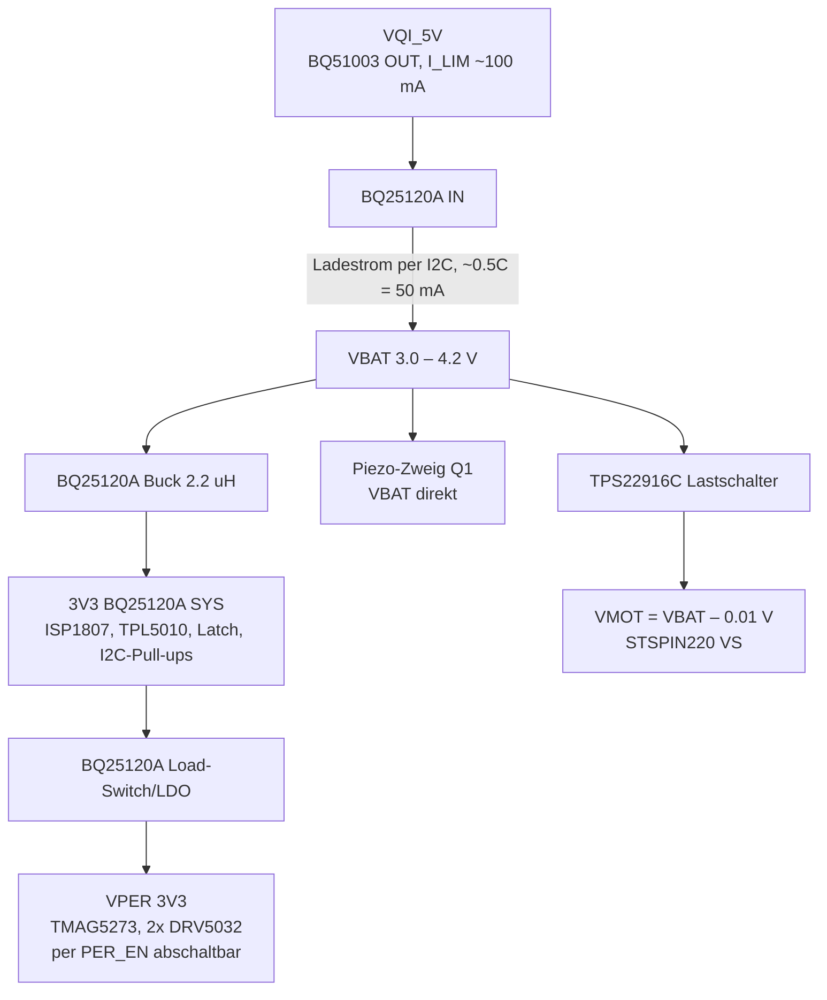

> **TEST ONLY - NOT FOR HUMAN USE.** OpenPatch is a test project, not a medical device; never wear or use it on a person (see `../DISCLAIMER.md`).

## KiCad / fab status (English, newest first)

* **KiCad 10 project:** `kicad/` (board generated by script from the netlist + `mechanical/out/OP-100.layout.json`; see `kicad/FOOTPRINT-VERIFICATION.md`). Fab packages: `fab/jlcpcb/`, `fab/pcbway/`; cost: `fab/COST.md`; order guides: `fab/jlcpcb/ORDER.md`, `fab/pcbway/ORDER.md`.
* **ISP1807 footprint is now VERIFIED** (Insight Eagle library + datasheet R19), see `footprints/ISP1807.md`. The German remarks below that call it "unverified" or "placeholder" are obsolete.
* **Netlist ECOs** (datasheet-verified, applied only to the fab netlist `kicad/netlist-fab.json`; the SKiDL sources are unchanged): BQ51003 -> BQ51013B (VQFN), BQ25120A -> MCP73832 + XC6206 LDO, TPS22916 -> discrete high-side switch with **dock interlock** (new dock Hall DRV5032 `U13`), STSPIN220 sense/TOFF resistors added, TPL5010 interval **2 s (R50 = 6.8k)**, buzzer removed, lean parts removed. Full list: `kicad/eco_netlist.py` (`ECO`). Pin map for firmware: `pin-assignment.md` (updated, English).
* The remainder of this file is the original German design-stage text and still describes the SKiDL netlist (BQ25120A etc.).

---

# OpenPatch – Elektronik (OP-100, Rev A Entwurf)

> **Experimentelles DIY-Gerät, KEIN Medizinprodukt.** Diese Elektronik ist ein Entwurf auf Schaltplan-/Netzlistenebene. Sie wurde weder gefertigt noch getestet. Alles, was eine Insulinabgabe steuert, braucht unabhängige Verifikation, Risikoanalyse (ISO 14971-Denkweise) und Tests, bevor es an einen Menschen geht. Quelle der Parameter: `../spec/design-parameters.md` (Stand mit CAD-Verifikation: Qi-Spule Ø17.6 mm, Akku max. 3.2 × 19.8 × 17.2 mm / 302020-Klasse) und `../mechanical/out/OP-100.layout.json`.

**Geometrie-Konsequenz (wichtig):** Die Platine ist nicht mehr die große L-Fläche, sondern nur **17.1 × 29 mm** rechts neben Reservoir/Motor. Z-Stack (Mechanik): Boden 0–0.9 | LiPo 1.05–4.25 | PCB 4.9–5.5 | Bauteile oben 5.5–6.55 | Qi-Spule 6.55–7.15 | Deckel ab 7.6. Daraus: oben unter der Spule max. **1.05 mm**, unten über dem Akku (y ≥ 13.7) max. **0.5 mm**, unten über dem Kanülen-Turm (y < 13.7) **gar keine** Bauteile.

## 0. Dateien

| Datei | Inhalt |
|---|---|
| `schematic/build.py` | Schaltplan als Code (SKiDL 3.0, ohne KiCad-Bibliotheken) → `openpatch-op100.net` (KiCad-Netzliste), `netlist.json`, `bom.csv`, Pin-Tabelle |
| `schematic/parts_db.py` | Teiledatenbank: MPN, LCSC-Nr., Preis, Verifikationsstatus |
| `schematic/check_netlist.py` | Designregel-Prüfung der Netzliste inkl. Sicherheits-Invarianten (39 Checks, `checks-report.txt`) |
| `layout/geometry.py`, `layout/board_outline.py` / `board-outline.dxf` | PCB-Umriss, **berechnet aus `mechanical/out/OP-100.layout.json` + `mechanical/params.json`** (nur gelesen): 17.1 × 29.0 mm Rechteck (x 23.4–40.5, y 1.5–30.5, Ecken R2.5) mit L-förmiger Aussparung 3.25 × 3.1 mm an der Ecke (23.4/1.5) für den Kanülen-Turm; Referenz-Layer: Gehäuse, Reservoir, Motor/Spindel, Qi-Spule Ø17.6, Akku, Piezo, Nadel, Antennen-Keepout. Koordinaten = Mechanik-Frame (x Länge, y Breite) |
| `layout/placement_plan.py` / `placement-plan.svg` | Bestückungsplan Oberseite/Unterseite (Blockniveau) mit Höhenzonen aus dem Mechanik-Stack |
| `footprints/ISP1807.md`, `footprints/custom-footprints.md` | Footprint-Hinweise (ISP1807-Padgeometrie noch aus Datenblatt zu übernehmen), Liste der zu zeichnenden Footprints |
| `bom.csv`, `cost-pcbway.md` | Stückliste, Kostenschätzung |

Neu bauen: `make all` (venv: `UV_HTTP_TIMEOUT=300 uv venv .venv && uv pip install --python .venv/bin/python -r requirements.txt`).

> **Rev-A-Entscheidung (Nutzer bestätigt):** MCU/Funk = **Insight SiP ISP1807(-LR)**-Modul (nRF52840-SiP, 8 × 8 × 1 mm, integrierte Antenne + 32 MHz/32.768 kHz-Quarze) statt blankem nRF54L15 – kein RF-Matching, keine Quarze auf der Platine. Spec (`design-parameters.md`) muss nachgezogen werden (dort steht noch nRF54L15 / Fallback nRF52833).

**Wichtige Einschränkung der Netzliste:** KiCad ist nicht installiert, daher sind die Symbole *funktional*. Nur beim ISP1807 sind Pad-Nummern echt (aus einem Community-Symbol, **nicht** gegen das Insight-Datenblatt verifiziert – das PDF war nicht lesbar). Bei allen anderen ICs ist „Pin-Nr.“ = Pinname und muss beim Symbol-/Footprint-Bau auf das Ball-/Pin-Mapping des Datenblatts abgebildet werden. Footprints: überwiegend echte KiCad-Namen (`Capacitor_SMD:C_0402_1005Metric` …), eigene `OpenPatch:*` siehe `footprints/custom-footprints.md`; ISP1807 siehe `footprints/ISP1807.md`.

## 1. Blockdiagramm

```mermaid
flowchart LR
  subgraph QI[Laden]
    COIL[Qi-Rx-Spule O20] --> BQ51[BQ51003<br/>Qi-Empfänger 5 V]
    BQ51 -->|VQI_5V| BQ25[BQ25120A<br/>Lader + Buck + LS/LDO + I2C]
  end
  CELL[(LiPo 302030<br/>mit PCM)] --> RP[Q2 PFET<br/>Verpolschutz]
  RP -->|VBAT| BQ25
  BQ25 -->|3V3| MCU
  BQ25 -->|LS/LDO = VPER 3V3| HALL
  subgraph SAFE[Sicherheitspfad]
    WDT[TPL5010<br/>Watchdog]
    LATCH[U6 D-FF Latch<br/>Q = MOT_ALLOW]
    SW[U7 Lastschalter]
  end
  MCU[ISP1807 (nRF52840)<br/>BLE + Logik] -- ARM_CLK / KILL_N --> LATCH
  WDT -- RSTn: CLR# + nRESET --> LATCH
  WDT -- RSTn --> MCU
  MCU -- WDT_DONE <-- WAKE --> WDT
  LATCH --> SW
  RP -->|VBAT| SW
  SW -->|VMOT| DRV[STSPIN220<br/>Mikroschritt]
  MCU -- STCK/DIR/MODE/STBY --> DRV
  DRV --> MOT[Ø6 Stepper<br/>+ Getriebe + Spindel]
  MOT -. Magnet .-> HALL
  subgraph HALL[Förderverifikation]
    TMAG[TMAG5273 I2C<br/>Pfad A: Winkel]
    DRV5[2x DRV5032<br/>Pfad B: QDEC]
  end
  TMAG -- I2C --> MCU
  DRV5 -- HALL_A/B --> MCU
  MCU --> BUZ[Piezo via Q1]
  BTN[Taster + ESD] --> MCU
  MCU --- ANT[pi-Netz + Chipantenne]
```

## 2. Versorgungsbaum und Energie



| Verbraucher | Näherung (Schätzung, nicht gemessen) |
|---|---|
| ISP1807 (nRF52840) Schlafen + BLE-Advertising/Connected 1 s | 10 – 30 µA (Größenordnung nRF52840, Modul nicht gemessen) |
| BQ25120A Ruhestrom, TPL5010 (35 nA), Latch | ~1 – 3 µA |
| Hall-Sensoren (duty-cycled) | 1 – 5 µA |
| VBAT-Messteiler 2.5 MΩ | 1.7 µA (dauerhaft) |
| Motor: ~3 V × 100 mA × ~10 ms/Schritt ≈ 3 mJ/Schritt | ≈ 0.2 J pro IE ≈ 0.7 mAh bei 40 IE/Tag |
| Gesamt-Mittelwert (Ziel) | 50 – 130 µA + Motor ≈ 2 – 3.5 mAh/Tag; bei der **realistisch passenden Zelle ~35 – 45 mAh** (siehe 6) ⇒ **ca. 8 – 18 Tage** pro Ladung (Rechnung, nicht gemessen). Im DASH-Modus mit häufiger BLE-Verbindung eher 7 – 10 Tage; Ladestrom ≤ 0.5 C ≈ 20 mA |

Warum 3V3 (BQ25120A SYS auf 3.3 V per I2C, folgt bei VBAT < 3.4 V im Dropout der Batterie): ISP1807 verträgt 1.7 – 5.5 V an VCC_NRF, 3.3 V passt aber zu TMAG5273 (≤ 3.6 V), STSPIN220-Logikpegeln und der nRF52840-TX-Leistung; der interne DC/DC des SiP arbeitet effizient ab ~2.5 V. Der Treiber läuft direkt aus VBAT (VMOT), nicht aus 3V3.

## 3. Sicherheits-Interlock

**Prinzip:** Der Motor kann sich nur bewegen, wenn **beide** voneinander unabhängige Pfade freigeben:

| Pfad | Mechanismus | Fail-Safe-Zustand |
|---|---|---|
| 1 – **MCU-Enable** | `MOT_STBY` (P2.06) High → STSPIN220 aus Standby; 100 kΩ Pulldown R72 | MCU resettet/hängt → Pin hochohmig → Treiber in Standby |
| 2 – **Watchdog-Pfad (hardwareunabhängig vom Code)** | TPL5010 hält über RSTn den Latch U6 gelöscht; nur eine steigende Flanke `ARM_CLK` setzt `MOT_ALLOW` → Lastschalter U7 verbindet VBAT → VMOT (STSPIN220 VS) | Watchdog läuft ab → RSTn → CLR# (Diode D2) → Q = 0 → VMOT stromlos (U7 mit Output-Discharge); gleichzeitig nRESET am MCU |

Logik: `VMOT_an = ARM_CLK_gesetzt AND NOT(WDT_RSTn) AND NOT(KILL_N) AND SYS_ok`; `Bewegung = VMOT_an AND MOT_STBY=High`.

Details und Begründung:

1. **Latch statt Level.** `D` und `PRE#` sind fest an SYS, nur `CLK` setzt. Ein hängendes `ARM_CLK`-Pin kann das Latch also nicht gegen den Watchdog halten. CLR# dominiert.
2. **Power-On-Zustand = AUS.** C52 (100 nF) + R52 (100 kΩ) halten CLR# beim Hochlauf zunächst low; Pulldown R53 (100 kΩ) hält `MOT_ALLOW` bei SYS-Verlust (Brown-out/Akku leer) auf Low (Q des Latch ist dann undefiniert).
3. **Watchdog-Intervall 100 ms** (R50 gemäß TPL5010-Tabelle – Wert bitte aus dem Datenblatt wählen und nachmessen). Worst-Case-Überförderung bei hängender CPU: Schrittrate × 0.1 s × 0.0131 IE/Schritt. Beispiel 300 Schritte/s → 0.4 IE. **Das ist die Obergrenze des Hardware-Schutzes, nicht der Firmware-Limits (10 IE Bolus etc.)**; die Firmware muss die Schrittrate hart begrenzen (≤ ~2 IE/min Soll, Hardware kann mehr).
4. **DONE nur CPU-bedient.** Solange der Motor armiert ist, darf `WDT_DONE` nicht von einem Hardware-Peripheral (GRTC/PPI) erzeugt werden, sondern nur nach erfolgreichem Plausibilitätscheck der Motor-Regelschleife (Schrittzähler, Dosisbudget, Encoder). Im Leerlauf (VMOT aus) darf PPI bedienen, um Strom zu sparen.
5. **Kein Pfad für „Motor an“ aus einem GPIO allein:** Ein MCU-Pin kann `MOT_ALLOW` nicht setzen (nur das Latch-Q). `check_netlist.py` prüft das (Q-Quelle, kein direkter MCU-Treiber, VS nur an VMOT).
6. `MOT_EN_FAULT` ist **kein** fail-safe-Enable (STSPIN220 hat dort einen internen Pull-up laut Datenblatt-Verständnis – bitte verifizieren). Er wird nur gelesen (Fault) und kann zusätzlich per Low sperren.

**Zweiter Weg zur Förderverifikation (unabhängig vom Treiber):**

| | Pfad A | Pfad B |
|---|---|---|
| Sensor | TMAG5273A1 (3D-Hall, I2C 0x35) | 2 × DRV5032FA (omnipolar, Push-Pull) |
| Auswertung | Absolutwinkel der Spindel, CPU liest I2C | **QDEC-Peripheral zählt CPU-unabhängig** (HALL_A/B) |
| Auflösung | 12 bit/U → < 0.01 IE | 4 Zustände/U ≈ 0.65 IE/Zählung (grob, aber unabhängig) |
| Prüft | Δ(Sollschritte vs. Winkel) → Förder-/Okklusions-/Schlupf-Alarm (>10 % über 1 IE) | „Bewegt sich überhaupt?“, Richtung, Überlauf-Erkennung bei CPU-Hänger |

Spindel: 200 Schritte/U ≈ 2.6 IE/U (0.35 mm × 74.6 mm²). Pfad B liefert also ~4 Zählungen pro 2.6 IE. Ein fehlender Zählimpuls über > 1.3 IE = Alarm.

**Akku leer / Brown-out:**

| Schwelle | Aktion |
|---|---|
| 3.55 V (~20 %) | Warnung (BLE + Summer) |
| 3.40 V (~10 %) | Alarm, Bolus gesperrt, Basal läuft weiter |
| 3.25 V (~5 %) | „Pod-Ende“-Alarm, Förderung kontrolliert beenden, Latch-Clear |
| BQ25120A-UVLO (~3.0 V, programmierbar) | SYS bricht ein → Latch-Versorgung weg → R53 zieht `MOT_ALLOW` low → VMOT aus |
| PCM der Zelle (~2.5 V) | letzte Hardware-Grenze, nur Zellschutz |
| nRF52840-BOR | Reset → Pins hochohmig → Pfad 1 und 2 aus |

Offen: Ein *selbst versorgter* Alarm beim Totalausfall (leere Zelle) fehlt – ohne Strom piept nichts. Option für Rev B: kleiner Supercap + separater Summer-Treiber am TPL5010-RSTn.

## 4. Pin-Belegung ISP1807 (Modul-Pads)

Versorgung/Sonderpads: VCC_NRF 26 → 3V3 (+ 100 nF + 4.7 µF); VSS 1, 7, 14, 16, 18, 21, 23, 24, 25, 31 → GND; RESET = P0.18 (13) ← TPL5010 RSTn + TC2030; SWDIO 28, SWDCLK 30 → J1 (TC2030); OUT_MOD 22 → R90 0 Ω → OUT_ANT 20; D+/D-/VBUS (8, 10, 12) offen; NFC-Pads P0.09/P0.10 offen; Pads 65–78 NC. **26 GPIO-Funktionen belegt (23 Signale + RESET + SWD)**, 20 weitere GPIO-Pads frei.

<!-- PINTABLE:START -->
| Modul-Pad | Pad-Nr. | Signal | Richtung | Funktion |
|---|---|---|---|---|
| P0.15 | 37 | `BTN_N` | in | Taster, Wake aus System-OFF (GPIO SENSE) |
| P0.17 | 27 | `QI_CHG_N` | in | BQ51003 CHG (open drain), Qi-Feld erkannt/Laden, Wake |
| P0.13 | 29 | `BQ_INT` | in | BQ25120A INT (open drain), Wake |
| P0.14 | 5 | `WDT_WAKE` | in | TPL5010 WAKE-Puls (GPIOTE-Interrupt) |
| P0.16 | 9 | `LATCH_Q_MON` | in | Rueck-Lesen des Sicherheits-Latch Q (MOT_ALLOW) |
| P0.26 | 6 | `I2C_SDA` | io | I2C (TWIM): BQ25120A (0x6A), TMAG5273 (0x35), 4.7k Pull-up nach 3V3 |
| P0.27 | 39 | `I2C_SCL` | io | I2C |
| P0.20 | 15 | `ARM_CLK` | out | Takt-Eingang Sicherheits-Latch (steigende Flanke = ARM) |
| P0.22 | 17 | `KILL_N` | out(od) | Open-Drain, Low = Latch loeschen (MCU-Pfad 'Motor aus') |
| P0.24 | 19 | `PER_EN` | out | BQ25120A LSCTRL -> VPER (Hall-Sensoren) schalten |
| P1.02 | 49 | `HALL_A` | in | DRV5032 #1 -> QDEC A (CPU-unabhaengig zaehlend) |
| P1.06 | 50 | `HALL_B` | in | DRV5032 #2 -> QDEC B |
| P0.04/AIN2 | 35 | `VMOT_SENSE` | ain | SAADC AIN2: Teiler 1.5M/1M auf VMOT (Rail-Check, Lastschalter-Test) |
| P0.05/AIN3 | 36 | `VBAT_SENSE` | ain | SAADC AIN3: Teiler 1.5M/1M auf VBAT (Redundanz zu BQ25120A-VBMON) |
| P0.08 | 32 | `TMAG_INT` | in | TMAG5273 INT (Data-Ready) |
| P0.06 | 34 | `WDT_DONE` | out | TPL5010 DONE (nur CPU-bedient, NICHT per PPI, solange Motor armed!) |
| P0.23 | 47 | `BUZ_PWM` | out | Piezo-Treiber (Gate Q1), PWM |
| P0.19 | 45 | `MOT_STCK` | out | STSPIN220 STCK/MODE3 (Step-Takt, PWM/GPIOTE) |
| P0.21 | 11 | `MOT_DIR` | out | STSPIN220 DIR/MODE4 |
| P1.15 | 51 | `MOT_MODE1` | out | STSPIN220 MODE1 |
| P1.14 | 52 | `MOT_MODE2` | out | STSPIN220 MODE2 |
| P1.13 | 53 | `MOT_STBY` | out | STSPIN220 STBY/RESET: High = Treiber aktiv (MCU-Enable, 100k Pulldown R72 -> fail-safe) |
| P1.05 | 54 | `MOT_EN_FAULT` | io(od) | STSPIN220 EN/FAULT: Fault lesen / optional per Low sperren (Treiber-intern Pull-up -> NICHT fail-safe) |
| P0.18/RESET | 13 | `NRST` | io | TPL5010 RSTn (Watchdog-Reset) + TC2030-Pad; P0.18 muss als RESET konfiguriert sein (UICR PSELRESET) |
| SWDIO | 28 | `SWDIO` | io | SWD (J1 TC2030 Pad 2) |
| SWDCLK | 30 | `SWDCLK` | in | SWD (J1 TC2030 Pad 4) |
| OUT_MOD / OUT_ANT | 22 / 20 | `RF_LINK` | rf | 0R R90 zwischen Modul-RF-Ausgang und Modul-Antenne (integrierte Antenne) |
| P0.09/NFC1 | 2 | `(frei)` | - | NC, NFC-Pad (nicht genutzt) |
| P0.10/NFC2 | 4 | `(frei)` | - | NC, NFC-Pad |
| (frei, NC) | - | - | - | 20 weitere GPIO-Pads bewusst unbeschaltet: P0.02/AIN0, P0.03/AIN1, P0.07/TRACECLK, P0.11/TRACEDATA2, P0.12/TRACEDATA1, P0.25, P0.28/AIN4, P0.29/AIN5, P0.30/AIN6, P0.31/AIN7, P1.00/TRACEDATA0, P1.01, P1.03, P1.04, P1.07, P1.08, P1.09/TRACEDATA3, P1.10, P1.11, P1.12 |
<!-- PINTABLE:END -->

Hinweise: Pad-Mapping und Funktionsmux (TWIM, QDEC, SAADC-AINs P0.02–P0.05/P0.28–P0.31, Trace-Pins) im Insight-Datenblatt/Nordic-PS prüfen. P0.18 per UICR als RESET konfigurieren. Trace/SWO-Pins (P0.07, P0.11, P0.12, P1.00, P1.09) bleiben frei.

## 5. Antenne: **im ISP1807-Modul integriert** (kein Matching, keine Quarze auf der Platine)

Vorher geplant: Chipantenne + pi-Netz + externe 32-MHz-/32-kHz-Quarze am nRF54L15. Jetzt erledigt das Modul das (Antenne, Abstimmung, beide Quarze, DC/DC-Bauteile sind im SiP; FCC-/CE-Vorqualifikation des Moduls). Auf der Platine bleibt nur eine **0-Ω-Brücke R90 zwischen OUT_MOD (Pad 22) und OUT_ANT (Pad 20)** – ob das für Variante `-LR` so vorgesehen ist, muss im Datenblatt verifiziert werden (Insight dokumentiert die Pads für externe Antenne bzw. Bypass).

**Konsequenzen für das Layout:** Antennenkante des Moduls zum freien Bereich/PCB-Rand drehen, Keepout laut Datenblatt auf **allen Lagen** (im DXF als Platzhalter 5.5 × 4.3 mm über dem Modul bei x 24.5–30, y 21.2–25.5). Kritisch bleibt die Umgebung: Spule Ø17.6 darunter-seitlich, LiPo-Folie darunter, Motor/Spindel-Metall 4.4 mm links; erwartete Reichweiteneinbuße gegenüber Referenz −3 … −6 dB. Das Spindel-Hall-Paar (y = 22.5) sitzt am selben Rand wie die Antennenzone → Konflikt, Lösung offen (Sensoren auf Flex-Fortsatz, oder Modul drehen/verschieben). Rev-A-Ziel: Reichweite ≥ 2 m am Körper.


## 6. Qi-Spule und Empfänger

* **Empfänger:** BQ51003YFPR (Qi 1.1, 5 V, WCSP) → BQ25120A (Lader 25–300 mA). Benötigte Leistung klein (Ladestrom ≤ 0.5 C ≈ 20 mA bei ~40 mAh; ILIM ≈ 100 mA via R20 = 3.16 kΩ, K_ILIM 314 A·Ω aus dem Gedächtnis – prüfen).
* **Spule:** **Ø 17.6 mm**, 0.6 mm dick (inkl. Ferritfolie), z 6.55–7.15 über der PCB, Mittelpunkt (32.2 / 9.9). Rx-Induktivität ~6 – 8 µH erreichbar. Eine fertige Würth-Rx-Spule dieser Größe konnte ich nicht verifizieren – **Würth 760308101104 ist eine TX-Spule** (Ø 20.5 mm, 6.5 µH, 2.8 mm hoch, passt nicht). Empfehlung: **Flex-PCB-Spirale** (PCBWay Flex, 2 Lagen, ~12 Windungen) + Ferritfolie (0.1–0.2 mm) zur Platinenseite; Parameter per LCR messen und Cs/Cd anpassen.
* **Resonanz:** Serien-C `Cs = 1/((2π·100 kHz)²·Ls')`. Mit Ls' = 7 µH → ~360 nF; Netzliste enthält 3 × 100 nF C0G 0805 (C20–C22 = 300 nF, passt für Ls' ≈ 8.4 µH) – für Ø17.6 vermutlich 4 × 100 nF oder 3 × 100 nF + 68 nF. 0805 ist 1.25 mm hoch → **nur außerhalb der Spulenfläche** (oben rechts bei y ≈ 19–21). Cd (C23, Start 1 nF C0G) für 1 MHz-Resonanz; RFOD (R21, Start 200 Ω). **Alle am fertigen Stack nachtunen** (Akku/Ferrit verschieben Ls). Startwerte nach TI-Anwendungsbeispiel-Logik, nicht aus dem Datenblatt kopiert.
* **Akku:** Spec: max. 3.2 × 19.8 × 17.2 mm (302020-Klasse, 40–60 mAh). Das OP-100-Layout (`bat_x = 17.4`) begrenzt die Länge allerdings auf 17.4 mm (Spule Ø17.6 + Reservoir) – ein Standard-302020 (20 × 20) passt dort **nicht**; realistisch Sonderformat ~3.0 × 16–17 × 17 mm, **~35–45 mAh**. Entweder Zelle als Sonderformat anfragen oder Layout um 2.6 mm verlängern (OP-100 → 44.6 mm, widerspricht dem 42-mm-Ziel). PCM ist Pflicht.
* **Platz:** Spule (oben) darf über der Elektronik liegen, begrenzt aber Bauteile unter ihr auf ≤ 1.05 mm: ISP1807 (1.0 mm) geht ohne Reserve, 0805-C0G und 1.1-mm-Teile (SOT-23, TMAG5273) nicht.
* **Alternative später:** NFC-WLC (ST25/PTX30W) – kleiner, aber < 0.3 W und eigenes Layout.

## 7. Schaltplan-Inhalt (Kurzliste, Referenzquellen)

* ISP1807: VCC_NRF an 3V3 mit 100 nF + 4.7 µF; Antenne/Quarze/DC/DC-Netzwerk im Modul. nRF52840 hat dort DC/DC-Option per Firmware (`NRF_POWER->DCDCEN`).
* BQ51003: Cs/Cd, Clamp 2 × 0.47 µF/25 V, Boot 2 × 10 nF, COM 2 × 22 nF, RECT 10 µF + 100 nF, OUT 10 µF + 1 µF, TS_CTRL 10 kΩ, EN1/EN2 low, CHG → P0.01. Quelle: TI BQ51003 Datenblatt „Typical Application“ (Werte aus der Erinnerung, vor Layout abgleichen).
* BQ25120A: CIN 1 µF, L 2.2 µH, CSYS 10 µF, CBAT 10 µF, CLS 1 µF, TS 10 kΩ fest (kein NTC in Rev A), I2C 4.7 kΩ. Quelle: TI SLUSBH2 „Typical Application“.
* LiPo-Schutz: gekaufte Zelle mit PCM (Pflicht, Spec; ~3.2 × 17.4 × 17.2 mm, siehe 6) **plus** optional DW01A + FS8205A (DNP, nur für Zelle ohne PCM); 0-Ω-Brücke R40. Verpolschutz-PFET Q2 an den Akku-Pads. ESD: TPD1E10B06 am Taster; SWD/Testpads TP1–TP8.
* Test/Programmierung: **Tag-Connect TC2030-IDC-NL** (J1: VTREF=3V3, SWDIO, NRESET, SWCLK, GND, SWO offen). Testpads TP1 3V3, TP2 GND, TP3 VBAT, TP4 VMOT (MOTOR_VS), TP5 VQI, TP6/TP7 HALL_A/B (Encoder), TP8/TP9 I2C SDA/SCL, TP10–TP13 Motorphasen A1/A2/B1/B2 (Ø1.0 mm). Die Pads liegen oben in der freien Zone unter der Spule; nach Gehäuse-Schließung nicht mehr erreichbar.

## 8. Offene Punkte / Risiken (ehrlich)

1. **ISP1807-Pinliste/Land-Pattern unverifiziert** (nur Community-Symbol; Datenblatt-PDF nicht lesbar). Exakte Variante (`-LR` vs. andere), OUT_MOD/OUT_ANT-Beschaltung und VBUS-Handling prüfen. Footprint `OpenPatch:ISP1807` ist noch nicht gezeichnet.
2. Pin-Mappings der anderen ICs (BQ51003/BQ25120A/STSPIN220/TPS22916/TMAG5273/DRV5032) sind funktional, Footprints teils `OpenPatch:*`.
3. Sicherheitswerte (TPL5010-R, STSPIN220-REF, Schwellen) sind Platzhalter (`r_dly`, `r_ref`).
4. **Fläche/Höhe:** ~75 Bestückungen auf 2 × 486 mm² PCB (abzüglich Piezo 81, Modul 64, Antennen-Keepout, Kanülen-Turm-Zone unten gesperrt). Bauteile ≤ 1.05 mm (oben, unter der Spule; ISP1807 mit 1.0 mm ohne Reserve) und ≤ 0.5 mm (unten über Akku) zwingen zu 0402/0201, WCSP, X2SON; SOT-23-Teile (Q1, TMAG5273, TPL5010 Thin) nur außerhalb der Spule. Fallback: Qi in Rev A weglassen oder 6 Lagen/Flex-Starr.
5. **Akku:** ~35–45 mAh statt 60–90 mAh der ursprünglichen Spec; Laufzeit ca. 8–18 Tage (nicht gesichert bei Dauer-BLE).
6. Hall-Positionen am Spindelmagnet (Spindelende x ≈ 21.7–23.3, y = 22.5, z = 4.2) kollidieren mit der Antennenzone; Mechanik muss Magnetposition bestätigen.
7. Netzteil-/Qi-Layout (BQ51003 WCSP 0.4 mm, BQ25120A DSBGA 0.4 mm, TPS22916 DSBGA) braucht Microvia-/Via-in-Pad-Prozess; PCBWay-Fähigkeit mit 0.6 mm 4L vorab klären.
8. Kein Selbsttest-Alarm bei Totalausfall der Versorgung (siehe 3).
9. Mounting-Löcher Ø1.2 im DXF sind Platzhalter; Gehäuse-Domen sind im Mechanik-Layout (noch) nicht definiert. Piezo (x 30.1–39.1, y 21.5–30.5) lässt für den Modul-Keepout nur x < 30.1.
