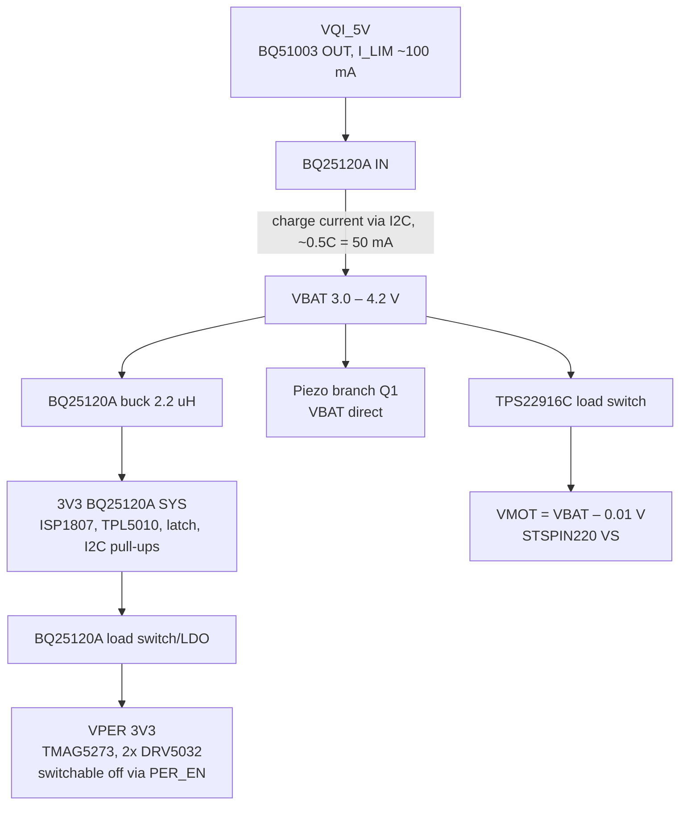

> **TEST ONLY - NOT FOR HUMAN USE.** OpenPatch is a test project, not a medical device; never wear or use it on a person (see `../DISCLAIMER.md`).

## KiCad / fab status (newest first)

* **KiCad 10 project:** `kicad/` (board generated by script from the netlist + `mechanical/out/OP-100.layout.json`; see `kicad/FOOTPRINT-VERIFICATION.md`). Fab packages: `fab/jlcpcb/`, `fab/pcbway/`; cost: `fab/COST.md`; order guides: `fab/jlcpcb/ORDER.md`, `fab/pcbway/ORDER.md`.
* **ISP1807 footprint is now VERIFIED** (Insight Eagle library + datasheet R19), see `footprints/ISP1807.md`. The remarks below that call it "unverified" or "placeholder" are obsolete.
* **Netlist ECOs** (datasheet-verified, applied only to the fab netlist `kicad/netlist-fab.json`; the SKiDL sources are unchanged): BQ51003 -> BQ51013B (VQFN), BQ25120A -> MCP73832 + XC6206 LDO, TPS22916 -> discrete high-side switch with **dock interlock** (new dock Hall DRV5032 `U13`), STSPIN220 sense/TOFF resistors added, TPL5010 interval **2 s (R50 = 6.8k)**, buzzer removed, lean parts removed. Full list: `kicad/eco_netlist.py` (`ECO`). Pin map for firmware: `pin-assignment.md` (updated).
* The remainder of this file is the original design-stage text and still describes the SKiDL netlist (BQ25120A etc.).

---

# OpenPatch - Electronics (OP-100, Rev A draft)

> **Experimental DIY device, NOT a medical device.** This electronics design is a draft at schematic/netlist level. It has neither been manufactured nor tested. Anything that controls insulin delivery needs independent verification, risk analysis (ISO 14971 mindset) and tests before it goes anywhere near a person. Source of the parameters: `../spec/design-parameters.md` (state with CAD verification: Qi coil Ø17.6 mm, battery max. 3.2 × 19.8 × 17.2 mm / 302020 class) and `../mechanical/out/OP-100.layout.json`.

**Geometry consequence (important):** The board is no longer the large L-shaped area but only **17.1 × 29 mm** to the right of the reservoir/motor. Z stack (mechanics): floor 0–0.9 | LiPo 1.05–4.25 | PCB 4.9–5.5 | components on top 5.5–6.55 | Qi coil 6.55–7.15 | lid from 7.6. This gives: on top under the coil max. **1.05 mm**, on the bottom over the battery (y ≥ 13.7) max. **0.5 mm**, on the bottom over the cannula tower (y < 13.7) **no** components at all.

## 0. Files

| File | Content |
|---|---|
| `schematic/build.py` | Schematic as code (SKiDL 3.0, without KiCad libraries) → `openpatch-op100.net` (KiCad netlist), `netlist.json`, `bom.csv`, pin table |
| `schematic/parts_db.py` | Parts database: MPN, LCSC no., price, verification status |
| `schematic/check_netlist.py` | Design rule check of the netlist including safety invariants (39 checks, `checks-report.txt`) |
| `layout/geometry.py`, `layout/board_outline.py` / `board-outline.dxf` | PCB outline, **computed from `mechanical/out/OP-100.layout.json` + `mechanical/params.json`** (read only): 17.1 × 29.0 mm rectangle (x 23.4–40.5, y 1.5–30.5, corners R2.5) with an L-shaped cutout 3.25 × 3.1 mm at the corner (23.4/1.5) for the cannula tower; reference layers: housing, reservoir, motor/spindle, Qi coil Ø17.6, battery, piezo, needle, antenna keep-out. Coordinates = mechanical frame (x length, y width) |
| `layout/placement_plan.py` / `placement-plan.svg` | Placement plan top/bottom side (block level) with height zones from the mechanical stack |
| `footprints/ISP1807.md`, `footprints/custom-footprints.md` | Footprint notes (ISP1807 pad geometry still to be taken from the datasheet), list of footprints still to be drawn |
| `bom.csv`, `cost-pcbway.md` | Bill of materials, cost estimate |

Rebuild: `make all` (venv: `UV_HTTP_TIMEOUT=300 uv venv .venv && uv pip install --python .venv/bin/python -r requirements.txt`).

> **Rev A decision (confirmed by the user):** MCU/radio = **Insight SiP ISP1807(-LR)** module (nRF52840 SiP, 8 × 8 × 1 mm, integrated antenna + 32 MHz/32.768 kHz crystals) instead of a bare nRF54L15 – no RF matching, no crystals on the board. The spec (`design-parameters.md`) still has to be brought in line (it still says nRF54L15 / fallback nRF52833).

**Important limitation of the netlist:** KiCad is not installed, so the symbols are *functional*. Only for the ISP1807 are the pad numbers real (from a community symbol, **not** verified against the Insight datasheet – the PDF was not readable). For all other ICs "pin no." = pin name and must be mapped to the ball/pin mapping of the datasheet when the symbol/footprint is built. Footprints: mostly real KiCad names (`Capacitor_SMD:C_0402_1005Metric` …), custom `OpenPatch:*` see `footprints/custom-footprints.md`; ISP1807 see `footprints/ISP1807.md`.

## 1. Block diagram

```mermaid
flowchart LR
  subgraph QI[Charging]
    COIL[Qi Rx coil O20] --> BQ51[BQ51003<br/>Qi receiver 5 V]
    BQ51 -->|VQI_5V| BQ25[BQ25120A<br/>charger + buck + LS/LDO + I2C]
  end
  CELL[(LiPo 302030<br/>with PCM)] --> RP[Q2 PFET<br/>reverse-polarity protection]
  RP -->|VBAT| BQ25
  BQ25 -->|3V3| MCU
  BQ25 -->|LS/LDO = VPER 3V3| HALL
  subgraph SAFE[Safety path]
    WDT[TPL5010<br/>watchdog]
    LATCH[U6 D flip-flop latch<br/>Q = MOT_ALLOW]
    SW[U7 load switch]
  end
  MCU[ISP1807 (nRF52840)<br/>BLE + logic] -- ARM_CLK / KILL_N --> LATCH
  WDT -- RSTn: CLR# + nRESET --> LATCH
  WDT -- RSTn --> MCU
  MCU -- WDT_DONE <-- WAKE --> WDT
  LATCH --> SW
  RP -->|VBAT| SW
  SW -->|VMOT| DRV[STSPIN220<br/>microstepping]
  MCU -- STCK/DIR/MODE/STBY --> DRV
  DRV --> MOT[Ø6 stepper<br/>+ gearbox + leadscrew]
  MOT -. magnet .-> HALL
  subgraph HALL[Delivery verification]
    TMAG[TMAG5273 I2C<br/>path A: angle]
    DRV5[2x DRV5032<br/>path B: QDEC]
  end
  TMAG -- I2C --> MCU
  DRV5 -- HALL_A/B --> MCU
  MCU --> BUZ[Piezo via Q1]
  BTN[Button + ESD] --> MCU
  MCU --- ANT[pi network + chip antenna]
```

## 2. Supply tree and energy



| Consumer | Approximation (estimate, not measured) |
|---|---|
| ISP1807 (nRF52840) sleep + BLE advertising/connected 1 s | 10 – 30 µA (order of magnitude of the nRF52840, module not measured) |
| BQ25120A quiescent current, TPL5010 (35 nA), latch | ~1 – 3 µA |
| Hall sensors (duty-cycled) | 1 – 5 µA |
| VBAT measurement divider 2.5 MΩ | 1.7 µA (permanent) |
| Motor: ~3 V × 100 mA × ~10 ms/step ≈ 3 mJ/step | ≈ 0.2 J per U ≈ 0.7 mAh at 40 U/day |
| Total average (target) | 50 – 130 µA + motor ≈ 2 – 3.5 mAh/day; with the **realistically fitting cell ~35 – 45 mAh** (see 6) ⇒ **about 8 – 18 days** per charge (calculation, not measured). In DASH mode with frequent BLE connection rather 7 – 10 days; charge current ≤ 0.5 C ≈ 20 mA |

Why 3V3 (BQ25120A SYS set to 3.3 V via I2C, follows the battery in dropout when VBAT < 3.4 V): the ISP1807 tolerates 1.7 – 5.5 V on VCC_NRF, but 3.3 V suits the TMAG5273 (≤ 3.6 V), the STSPIN220 logic levels and the nRF52840 TX power; the internal DC/DC of the SiP works efficiently from ~2.5 V. The driver runs directly from VBAT (VMOT), not from 3V3.

## 3. Safety interlock

**Principle:** The motor can only move if **both** mutually independent paths enable it:

| Path | Mechanism | Fail-safe state |
|---|---|---|
| 1 – **MCU enable** | `MOT_STBY` (P2.06) high → STSPIN220 leaves standby; 100 kΩ pull-down R72 | MCU resets/hangs → pin high-impedance → driver in standby |
| 2 – **Watchdog path (hardware, independent of the code)** | TPL5010 keeps the latch U6 cleared via RSTn; only a rising edge on `ARM_CLK` sets `MOT_ALLOW` → load switch U7 connects VBAT → VMOT (STSPIN220 VS) | Watchdog expires → RSTn → CLR# (diode D2) → Q = 0 → VMOT de-energised (U7 with output discharge); at the same time nRESET on the MCU |

Logic: `VMOT_on = ARM_CLK_set AND NOT(WDT_RSTn) AND NOT(KILL_N) AND SYS_ok`; `movement = VMOT_on AND MOT_STBY=High`.

Details and rationale:

1. **Latch instead of level.** `D` and `PRE#` are tied to SYS, only `CLK` sets the latch. A stuck `ARM_CLK` pin therefore cannot hold the latch against the watchdog. CLR# dominates.
2. **Power-on state = OFF.** C52 (100 nF) + R52 (100 kΩ) initially hold CLR# low at start-up; pull-down R53 (100 kΩ) holds `MOT_ALLOW` low when SYS is lost (brown-out/battery empty), because the latch Q is then undefined.
3. **Watchdog interval 100 ms** (R50 per the TPL5010 table – please pick the value from the datasheet and measure it). Worst-case over-delivery with a hung CPU: step rate × 0.1 s × 0.0131 U/step. Example 300 steps/s → 0.4 U. **This is the upper bound of the hardware protection, not of the firmware limits (10 U bolus etc.)**; the firmware must hard-limit the step rate (≤ ~2 U/min target, the hardware can do more).
4. **DONE serviced by the CPU only.** As long as the motor is armed, `WDT_DONE` must not be generated by a hardware peripheral (GRTC/PPI) but only after a successful plausibility check of the motor control loop (step counter, dose budget, encoder). When idle (VMOT off) PPI may service it to save power.
5. **No "motor on" path from a GPIO alone:** An MCU pin cannot set `MOT_ALLOW` (only the latch Q can). `check_netlist.py` checks this (Q source, no direct MCU driver, VS only on VMOT).
6. `MOT_EN_FAULT` is **not** a fail-safe enable (the STSPIN220 has an internal pull-up there according to our reading of the datasheet – please verify). It is only read (fault) and can additionally block by driving low.

**Second way to verify delivery (independent of the driver):**

| | Path A | Path B |
|---|---|---|
| Sensor | TMAG5273A1 (3D Hall, I2C 0x35) | 2 × DRV5032FA (omnipolar, push-pull) |
| Evaluation | Absolute angle of the spindle, CPU reads I2C | **QDEC peripheral counts independently of the CPU** (HALL_A/B) |
| Resolution | 12 bit/rev → < 0.01 U | 4 states/rev ≈ 0.65 U/count (coarse, but independent) |
| Checks | Δ(commanded steps vs. angle) → delivery/occlusion/slip alarm (>10 % over 1 U) | "Is it moving at all?", direction, overrun detection when the CPU hangs |

Spindle: 200 steps/rev ≈ 2.6 U/rev (0.35 mm × 74.6 mm²). Path B therefore delivers ~4 counts per 2.6 U. A missing count pulse over > 1.3 U = alarm.

**Battery empty / brown-out:**

| Threshold | Action |
|---|---|
| 3.55 V (~20 %) | Warning (BLE + buzzer) |
| 3.40 V (~10 %) | Alarm, bolus blocked, basal continues |
| 3.25 V (~5 %) | "End of pod" alarm, finish delivery in a controlled way, latch clear |
| BQ25120A UVLO (~3.0 V, programmable) | SYS collapses → latch supply gone → R53 pulls `MOT_ALLOW` low → VMOT off |
| PCM of the cell (~2.5 V) | last hardware limit, cell protection only |
| nRF52840 BOR | Reset → pins high-impedance → paths 1 and 2 off |

Open: A *self-powered* alarm on total failure (empty cell) is missing – without power nothing beeps. Option for Rev B: small supercap + separate buzzer driver on the TPL5010 RSTn.

## 4. Pin assignment ISP1807 (module pads)

Supply/special pads: VCC_NRF 26 → 3V3 (+ 100 nF + 4.7 µF); VSS 1, 7, 14, 16, 18, 21, 23, 24, 25, 31 → GND; RESET = P0.18 (13) ← TPL5010 RSTn + TC2030; SWDIO 28, SWDCLK 30 → J1 (TC2030); OUT_MOD 22 → R90 0 Ω → OUT_ANT 20; D+/D-/VBUS (8, 10, 12) open; NFC pads P0.09/P0.10 open; pads 65–78 NC. **26 GPIO functions used (23 signals + RESET + SWD)**, 20 further GPIO pads free.

<!-- PINTABLE:START -->
| Module pad | Pad no. | Signal | Direction | Function |
|---|---|---|---|---|
| P0.15 | 37 | `BTN_N` | in | Button, wake from System OFF (GPIO SENSE) |
| P0.17 | 27 | `QI_CHG_N` | in | BQ51003 CHG (open drain), Qi field detected/charging, wake |
| P0.13 | 29 | `BQ_INT` | in | BQ25120A INT (open drain), wake |
| P0.14 | 5 | `WDT_WAKE` | in | TPL5010 WAKE pulse (GPIOTE interrupt) |
| P0.16 | 9 | `LATCH_Q_MON` | in | Read-back of the safety latch Q (MOT_ALLOW) |
| P0.26 | 6 | `I2C_SDA` | io | I2C (TWIM): BQ25120A (0x6A), TMAG5273 (0x35), 4.7k pull-up to 3V3 |
| P0.27 | 39 | `I2C_SCL` | io | I2C |
| P0.20 | 15 | `ARM_CLK` | out | Clock input of the safety latch (rising edge = ARM) |
| P0.22 | 17 | `KILL_N` | out(od) | Open-drain, low = clear latch (MCU path 'motor off') |
| P0.24 | 19 | `PER_EN` | out | BQ25120A LSCTRL -> switch VPER (Hall sensors) |
| P1.02 | 49 | `HALL_A` | in | DRV5032 #1 -> QDEC A (counts independently of the CPU) |
| P1.06 | 50 | `HALL_B` | in | DRV5032 #2 -> QDEC B |
| P0.04/AIN2 | 35 | `VMOT_SENSE` | ain | SAADC AIN2: 1.5M/1M divider on VMOT (rail check, load switch test) |
| P0.05/AIN3 | 36 | `VBAT_SENSE` | ain | SAADC AIN3: 1.5M/1M divider on VBAT (redundancy to BQ25120A VBMON) |
| P0.08 | 32 | `TMAG_INT` | in | TMAG5273 INT (Data-Ready) |
| P0.06 | 34 | `WDT_DONE` | out | TPL5010 DONE (CPU-serviced only, NOT via PPI while the motor is armed!) |
| P0.23 | 47 | `BUZ_PWM` | out | Piezo driver (gate of Q1), PWM |
| P0.19 | 45 | `MOT_STCK` | out | STSPIN220 STCK/MODE3 (step clock, PWM/GPIOTE) |
| P0.21 | 11 | `MOT_DIR` | out | STSPIN220 DIR/MODE4 |
| P1.15 | 51 | `MOT_MODE1` | out | STSPIN220 MODE1 |
| P1.14 | 52 | `MOT_MODE2` | out | STSPIN220 MODE2 |
| P1.13 | 53 | `MOT_STBY` | out | STSPIN220 STBY/RESET: high = driver active (MCU enable, 100k pull-down R72 -> fail-safe) |
| P1.05 | 54 | `MOT_EN_FAULT` | io(od) | STSPIN220 EN/FAULT: read fault / optionally disable by driving low (internal driver pull-up -> NOT fail-safe) |
| P0.18/RESET | 13 | `NRST` | io | TPL5010 RSTn (watchdog reset) + TC2030 pad; P0.18 must be configured as RESET (UICR PSELRESET) |
| SWDIO | 28 | `SWDIO` | io | SWD (J1 TC2030 Pad 2) |
| SWDCLK | 30 | `SWDCLK` | in | SWD (J1 TC2030 Pad 4) |
| OUT_MOD / OUT_ANT | 22 / 20 | `RF_LINK` | rf | 0R R90 between module RF output and module antenna (integrated antenna) |
| P0.09/NFC1 | 2 | `(free)` | - | NC, NFC pad (unused) |
| P0.10/NFC2 | 4 | `(free)` | - | NC, NFC pad |
| (free, NC) | - | - | - | 20 further GPIO pads deliberately left unconnected: P0.02/AIN0, P0.03/AIN1, P0.07/TRACECLK, P0.11/TRACEDATA2, P0.12/TRACEDATA1, P0.25, P0.28/AIN4, P0.29/AIN5, P0.30/AIN6, P0.31/AIN7, P1.00/TRACEDATA0, P1.01, P1.03, P1.04, P1.07, P1.08, P1.09/TRACEDATA3, P1.10, P1.11, P1.12 |
<!-- PINTABLE:END -->

Notes: Check the pad mapping and function mux (TWIM, QDEC, SAADC AINs P0.02–P0.05/P0.28–P0.31, trace pins) against the Insight datasheet/Nordic PS. Configure P0.18 as RESET via UICR. Trace/SWO pins (P0.07, P0.11, P0.12, P1.00, P1.09) stay free.

## 5. Antenna: **integrated in the ISP1807 module** (no matching, no crystals on the board)

Previously planned: chip antenna + pi network + external 32 MHz/32 kHz crystals on the nRF54L15. Now the module takes care of this (antenna, tuning, both crystals and DC/DC components are in the SiP; FCC/CE pre-qualification of the module). Only a **0 Ω bridge R90 between OUT_MOD (pad 22) and OUT_ANT (pad 20)** remains on the board – whether this is intended for the `-LR` variant must be verified in the datasheet (Insight documents the pads for an external antenna or bypass).

**Consequences for the layout:** Turn the antenna edge of the module towards the free area/PCB edge, keep-out per datasheet on **all layers** (in the DXF a placeholder of 5.5 × 4.3 mm above the module at x 24.5–30, y 21.2–25.5). The surroundings remain critical: coil Ø17.6 below and to the side, LiPo foil below, motor/spindle metal 4.4 mm to the left; expected range loss compared with the reference −3 … −6 dB. The spindle Hall pair (y = 22.5) sits on the same edge as the antenna zone → conflict, solution open (sensors on a flex extension, or rotate/move the module). Rev A target: range ≥ 2 m on the body.


## 6. Qi coil and receiver

* **Receiver:** BQ51003YFPR (Qi 1.1, 5 V, WCSP) → BQ25120A (charger 25–300 mA). Required power is small (charge current ≤ 0.5 C ≈ 20 mA at ~40 mAh; ILIM ≈ 100 mA via R20 = 3.16 kΩ, K_ILIM 314 A·Ω from memory – verify).
* **Coil:** **Ø 17.6 mm**, 0.6 mm thick (incl. ferrite foil), z 6.55–7.15 above the PCB, centre (32.2 / 9.9). Rx inductance ~6 – 8 µH is achievable. I could not verify a ready-made Würth Rx coil of this size – **Würth 760308101104 is a TX coil** (Ø 20.5 mm, 6.5 µH, 2.8 mm tall, does not fit). Recommendation: **flex PCB spiral** (PCBWay Flex, 2 layers, ~12 turns) + ferrite foil (0.1–0.2 mm) towards the board side; measure the parameters with an LCR meter and adjust Cs/Cd.
* **Resonance:** Series C `Cs = 1/((2π·100 kHz)²·Ls')`. With Ls' = 7 µH → ~360 nF; the netlist contains 3 × 100 nF C0G 0805 (C20–C22 = 300 nF, fits Ls' ≈ 8.4 µH) – for Ø17.6 probably 4 × 100 nF or 3 × 100 nF + 68 nF. 0805 is 1.25 mm tall → **only outside the coil area** (top right at y ≈ 19–21). Cd (C23, start 1 nF C0G) for 1 MHz resonance; RFOD (R21, start 200 Ω). **Re-tune all of them on the finished stack** (battery/ferrite shift Ls). Start values follow the logic of the TI application example, not copied from the datasheet.
* **Battery:** Spec: max. 3.2 × 19.8 × 17.2 mm (302020 class, 40–60 mAh). However, the OP-100 layout (`bat_x = 17.4`) limits the length to 17.4 mm (coil Ø17.6 + reservoir) – a standard 302020 (20 × 20) does **not** fit there; realistically a special format ~3.0 × 16–17 × 17 mm, **~35–45 mAh**. Either request the cell as a special format or lengthen the layout by 2.6 mm (OP-100 → 44.6 mm, contradicts the 42 mm target). PCM is mandatory.
* **Space:** The coil (on top) may lie above the electronics, but limits components below it to ≤ 1.05 mm: ISP1807 (1.0 mm) just fits with no margin, 0805 C0G and 1.1 mm parts (SOT-23, TMAG5273) do not.
* **Alternative for later:** NFC WLC (ST25/PTX30W) – smaller, but < 0.3 W and its own layout.

## 7. Schematic content (short list, reference sources)

* ISP1807: VCC_NRF on 3V3 with 100 nF + 4.7 µF; antenna/crystals/DC-DC network in the module. The nRF52840 has a DC/DC option there via firmware (`NRF_POWER->DCDCEN`).
* BQ51003: Cs/Cd, clamp 2 × 0.47 µF/25 V, boot 2 × 10 nF, COM 2 × 22 nF, RECT 10 µF + 100 nF, OUT 10 µF + 1 µF, TS_CTRL 10 kΩ, EN1/EN2 low, CHG → P0.01. Source: TI BQ51003 datasheet "Typical Application" (values from memory, compare before layout).
* BQ25120A: CIN 1 µF, L 2.2 µH, CSYS 10 µF, CBAT 10 µF, CLS 1 µF, TS fixed 10 kΩ (no NTC in Rev A), I2C 4.7 kΩ. Source: TI SLUSBH2 "Typical Application".
* LiPo protection: purchased cell with PCM (mandatory, spec; ~3.2 × 17.4 × 17.2 mm, see 6) **plus** optional DW01A + FS8205A (DNP, only for a cell without PCM); 0 Ω bridge R40. Reverse-polarity protection PFET Q2 at the battery pads. ESD: TPD1E10B06 at the button; SWD/test pads TP1–TP8.
* Test/programming: **Tag-Connect TC2030-IDC-NL** (J1: VTREF=3V3, SWDIO, NRESET, SWCLK, GND, SWO open). Test pads TP1 3V3, TP2 GND, TP3 VBAT, TP4 VMOT (MOTOR_VS), TP5 VQI, TP6/TP7 HALL_A/B (encoder), TP8/TP9 I2C SDA/SCL, TP10–TP13 motor phases A1/A2/B1/B2 (Ø1.0 mm). The pads are on top in the free zone under the coil; no longer reachable once the housing is closed.

## 8. Open points / risks (honest)

1. **ISP1807 pin list/land pattern unverified** (community symbol only; datasheet PDF not readable). Check the exact variant (`-LR` vs. others), the OUT_MOD/OUT_ANT wiring and the VBUS handling. Footprint `OpenPatch:ISP1807` has not been drawn yet.
2. Pin mappings of the other ICs (BQ51003/BQ25120A/STSPIN220/TPS22916/TMAG5273/DRV5032) are functional, footprints partly `OpenPatch:*`.
3. Safety values (TPL5010 R, STSPIN220 REF, thresholds) are placeholders (`r_dly`, `r_ref`).
4. **Area/height:** ~75 placements on 2 × 486 mm² PCB (minus piezo 81, module 64, antenna keep-out, cannula tower zone on the bottom blocked). Components ≤ 1.05 mm (top, under the coil; ISP1807 at 1.0 mm with no margin) and ≤ 0.5 mm (bottom over the battery) force 0402/0201, WCSP, X2SON; SOT-23 parts (Q1, TMAG5273, TPL5010 thin) only outside the coil. Fallback: omit Qi in Rev A or 6 layers/rigid-flex.
5. **Battery:** ~35–45 mAh instead of the 60–90 mAh of the original spec; runtime about 8–18 days (not assured with continuous BLE).
6. Hall positions at the spindle magnet (spindle end x ≈ 21.7–23.3, y = 22.5, z = 4.2) collide with the antenna zone; mechanics must confirm the magnet position.
7. Power supply/Qi layout (BQ51003 WCSP 0.4 mm, BQ25120A DSBGA 0.4 mm, TPS22916 DSBGA) needs a microvia/via-in-pad process; clarify PCBWay capability with 0.6 mm 4L in advance.
8. No self-test alarm on total loss of power (see 3).
9. Mounting holes Ø1.2 in the DXF are placeholders; housing domes are (not yet) defined in the mechanical layout. The piezo (x 30.1–39.1, y 21.5–30.5) leaves only x < 30.1 for the module keep-out.
