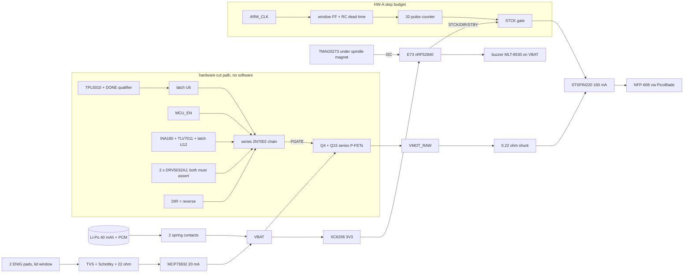

> TEST ONLY - NOT FOR HUMAN USE (see ../../DISCLAIMER.md). OpenPatch is a test project, not a medical device. This board is never worn, never used on a person or animal. **Water only: never insulin or any other drug, not even for bench tests into containers** (decision 2026-11-19).

# OpenPatch v0.1.0 integrated pod board (all electronics inside the pod, no controller board)

Companion of the bench pair (`../bench/`): the bench controller + pod sensor board stay the test fixture; this board is the version with **battery, charger, radio, driver, interlock, HW-A step budget, buzzer, button, LED and sensors on one 4-layer 0.8 mm PCB** that lives in the pod tail.
Architecture and feasibility: `../../docs/v010/ARCHITECTURE.md` (calc scripts in `docs/v010/calc/`). This directory is the implementation (scripted netlist, board, sim, fab package).

## Status (2026-11-19)

| Item | Result |
|---|---|
| Netlist | `design/netlist.py` -> `netlist.json`, `v010.net` (KiCad netlist), ERC: no floating nets (one intentional single-pin net `OC_TRIP`) |
| Board | 46.7 x 29.0 mm, R2.5, 4 layers 0.8 mm (JLC04081H-3313 class), see `board/` |
| Routing / DRC | see section "Layout result" below (filled from the last run) |
| Sim (ngspice) | `sim/switch_oc_results.md`, `sim/hwa_results.md`, `sim/hwa_mc_results.txt` and plots |
| Docs | `INTERLOCK.md` (truth table, HW-A, failure modes), `FMEA.md` (component -> failure -> readback -> diag code), `FIRMWARE-PINMAP.md`, `COST.md`, `ORDER.md` |
| Mechanical interface | `board.layout.json`, `fab/jlcpcb/openpatch-v010.step`, renders |

**Deliberate deviations from the architecture / proposal (all flagged for the coordinator):**

1. **Board is 46.7 mm long, not 38.7 mm** (tail 30 mm instead of 22 mm; pod OP-100 = 47.0 + 30 = **77 x 32 x 8.5 mm**, 21 cm3, still 28 % below the DASH 29.4 cm3). The architecture's part count (~76) grew to 185 placements with the final bench interlock (series gate chain with OC leg, DONE qualifier, DOCK/OC test hooks), the second series switch, the redundant dock hall, HW-A (4 gates, 4 flip-flops, counter) and the battery sense/NTC: a 38.7 mm board needs a placed-area fill of about 1.0 on both sides (`tools/areas.py`), the same failure mode the 17.1 x 29 mm board had.
2. **Frozen-item positions are re-derived from the current CAD** (`mechanical/out/bench/OP-100.mech.json`: `x_r1` 25.8, needle y 11.2, dock hall pod (43.8, 11.2), TMAG pod (30.2, 22.5)), not from `board-outline-proposal.json` (x_r1 25.0, needle y 11.5, dock hall x 41.7 with an inconsistent y). Board origin in the pod: `x_r1 + 2.6`, y 1.5 (bench sensor board frame x, one common origin offset).
3. **Gear pair 16:20 (0.003951 U/step)** is used for the dose numbers (spec section 4 final), not the architecture's 18:18; HW-A numbers are also given for 18:18.
4. Battery-dependent thrust: the direct-from-cell motor supply gives only 2.4 V at the motor for a 3.1 V cell with 4 ohm internal resistance (sim case A2): the firmware must refuse motor starts below about 3.4 V open circuit; the optional boost (U8 block, DNP) exists for the thrust test.
5. 20 mA charge, no fuel gauge, buzzer on VBAT (90 mA peak, about 0.4 V sag on a 40 mAh cell): the buzzer duty must be short.

## Block diagram

## Power budget update (estimates; measure with a PPK2 on the first board)

Idle (sleep, docked, BLE advertising off): MCU System ON + RTC 3.0, TPL5010 + 2 s wake 0.2, LDO 1.0, TMAG5273 sleep 0.5, 2 x DRV5032AJ 3.2 (1.6 each, datasheet), dock pull-ups 2 x 0.7 (4.7 M), over-current reference 1.6 (1M/1.1M), comparator 0.4, charger standby 0.5 to 5, HW-A logic 1 (typical, **datasheet maxima add up to about 28 uA: VERIFY**), PCM/self-discharge 1.7 = **about 15 to 19 uA** (architecture: 8 uA). Idle-current savings made in this design: VREF divider fed from `MOT_STBY`, `PGATE_MON` without external pull-up, VBAT divider and NTC switched by `SENSE_EN`, motor-side parts powered only through the switch.
Motor burst, BLE and everything else as in `docs/v010/calc/power.py`: with 17 uA idle the budget is **about 3.6 mAh/day** (3.4 before) -> about 7.4 days on 27 mAh usable (40 mAh x 0.85 x 0.8), 72 h requirement 10.8 mAh met. Two series P-FETs add 2 x 60 mohm (about 40 mV at 0.3 A) and the 0.22 ohm shunt 66 mV at 0.3 A.

## Directory

| Path | Content |
|---|---|
| `design/netlist.py` | single source of the circuit (parts, pins, nets, LCSC numbers); `python3 design/netlist.py` |
| `board/params.json`, `board/build_board.py` | parametric outline, zones, fixed placements; builds `board/v010.kicad_pcb` (KiCad python), then `../bench/tools/route.py` (Freerouting) |
| `board/v010.kicad_pcb`, `.kicad_pro` | placed, routed, filled board |
| `footprints/V010.pretty` | spring contact and charge pad footprints (the E73, DRV5032 X2SON, buzzer and NPTH footprints come from `../bench/footprints/Bench.pretty`, unmodified) |
| `sim/` | ngspice decks, results, plots (`run_switch_oc.py`, `run_hwa.py`, `hwa_mc.py`) |
| `fab/jlcpcb/` | Gerber + drill zip, BOM, CPL, NOT-ASSEMBLED, renders, STEP; `fab/bom_prices.csv` |
| `tools/` | `jlcq.py` (JLC lookup with retries), `cost.py`, `export_fab.py`, `gen_fmea.py`, `gen_layout.py`, `areas.py` |
| `board.layout.json` | outline, zone heights, battery bay, pads, connectors, component list for the mechanical owner |

Reproduce: `python3 design/netlist.py; cd board; /usr/bin/python3 build_board.py; /usr/bin/python3 ../../bench/tools/route.py v010.kicad_pcb prep|route 12|import|finish|fix; python3 ../tools/export_fab.py` (Freerouting jar: `electronics/tools/freerouting-2.2.4.jar`, git-ignored; ngspice 42 for `sim/`).
