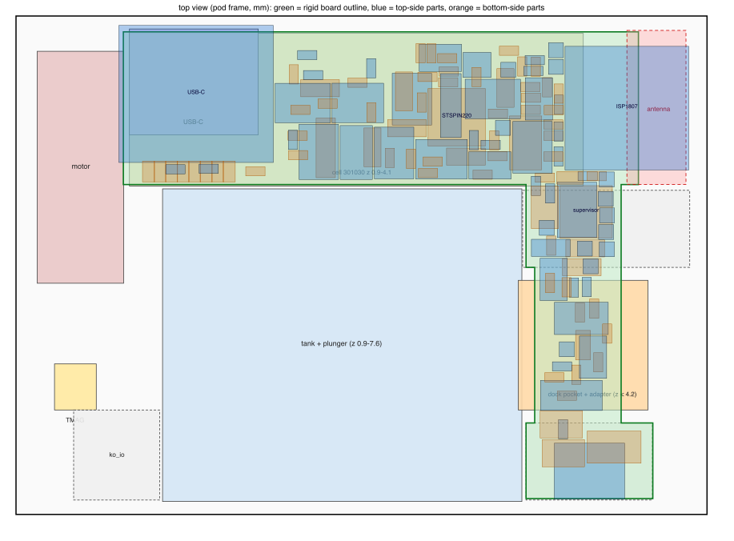
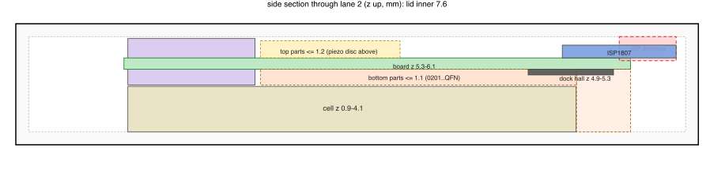

> TEST ONLY - NOT FOR HUMAN USE (see ../../../DISCLAIMER.md). Water only, never worn.

# FIT-CHECK: one board for the v0.1.0 cup pod (OP-100, mechanics commit a12ff14)

Sources: `mechanical/out/v010-cup/OP-100.mech.json` and the CAD bodies (`solidcraft-cli eval`, regenerated into a scratch dir, identical to the committed `.mech.json`). Geometry constants: `cupgeom.py`. Sketches: `fit_top.png`, `fit_side.png` (`fit_sketch.py`).

## Verdict: **FITS ONLY IF** (4 conditions)

One rigid 6-layer board carries every active part (ISP1807, supervisor, driver, charger, USB-C, halls, LED, button, piezo pads). It does **not** fit as a pure rigid board because the TMAG position and the motor tabs cannot be reached in a flat plane.

1. **Board plane z 5.3 to 6.1 (0.8 mm, 6 layers, ENIG)**. Underside 5.3 = `ko_dock_board` z 5.3 (the dock hall hangs below it, 4.9 to 5.3). Free height: **bottom 1.1 mm** over the cell (cell top 4.1, 0.1 clearance; 0201 to QFN 0.9 pass, SOT-23-5/6 do not) and over the dock adapter (top 4.2); full height in the side zones; **top 1.5 mm** to the lid (7.6), 1.2 mm under the piezo disc.
2. **Outline = L/U shape, 528 mm2** (`cupgeom.OUTLINE_POD`): west block + lane-2 body x 7.45 to 43.2 (35.8 x 10.6), a tab through `side_b` (x 35.4 to 42.0, y 17.15 to 22.9) and a 6 mm corridor over the dock pocket roof (x 36 to 42, y 6.35 to 17.15, dock hall centred on the magnet axis at (39.36, 11.75)), ending in the `side_a` block (x 35.4 to 44.2, y 1.1 to 6.35: side-actuated button toward the -Y wall). Needs from the mechanics: **a slot >= 7 x 1.2 mm in the lane divider at x 35.4 to 42, y 22.5 to 22.8 above z 5.0** (divider height at x > 35 is not in the data: VERIFY), board edge 0.2 mm from the motor surface at x 7.45 (motor radius 3 at the plane: surface x <= 7.28).
3. **ISP1807 at the east tip**, centre (42.4, 28.2), antenna half toward +X overhanging the board edge (board ends at x 43.2, copper/part keep-out x >= 42.4); cell ends at x 39.37, 3 mm from the antenna; nothing metal within 10 mm: the piezo disc goes over x 17 to 27, **not** over the module.
4. **TMAG5273 and the 4 motor tabs on a REAR flex strip (separate 2-layer FPC, 14 parts, `netlist_v4_rear.json`)**, pressed onto 8 ENIG pads (0.8 pitch, bottom side, west edge) by foam: no connector. Why: the transverse motor (x 1.47 to 7.47, y 16 to 32, z 1.25 to 7.25) closes the west side; the rod, bush, collar and gear B (y 9 to 14.5, z 1.55 to 6.95) close the south passage at x > 5.7 for every plane between z 1.55 and 6.95, and the tank (z 0.9 to 7.6) closes the rest. A rigid tab would have to cross the rod axis at z 5.0 (TMAG board z 4.975 to 5.575). A strip can climb the 2.7 mm channel x 7.47 to 10.17, pass over the bush at z > 5.8 and drop to the TMAG at x 2.7 to 5.6, y 7.5 to 10.4; length about 27 mm. Motor tabs (x 2.2 to 6.8, y 25.4 to 28.8, z 0.45 to 1.25) go through the 0.4 mm gap beside the cell. **Mechanics must route and glue the strip; JLC FPC or rigid-flex quote needed.**

Other mechanical requests: USB-C must be a **mid-mount receptacle in a board-edge notch** (body z 4.2 to 7.46 straddles the plane; the proxy `TYPE-C-31-M-12` is top-mount and would collide with the cell; no mid-mount part verified at JLC); receptacle centre x 12.5 (+0.16 against `ko_usb`); cell leads to two pads at the east end bottom side (lead position VERIFY); piezo spring pads 1.0 high vs disc at 7.3 (preload VERIFY); button actuator hole in the -Y wall at x 39.8, status RGB LED at (32, 31.2) under the clear lid.

## Area: courtyard sum per block vs outline (placed, zero overlap, `fit_table.txt`)

| block | parts | top mm2 | bottom mm2 | sum |
|---|---|---|---|---|
| USB-C receptacle + ESD/TVS/CC | 9 | 124 | 10 | 135 (receptacle is 104 of it, mostly the notch) |
| ISP1807 + decoupling | 4 | 76 | 1 | 76 |
| UI (RGB LED, button, piezo pads, bridge) | 13 | 56 | 5 | 61 |
| motor switch + supervisor leg + hall chain | 19 | 41 | 17 | 58 |
| STSPIN220 driver | 14 | 2 | 35 | 36 |
| over-current | 14 | 20 | 11 | 31 |
| TPL5010 + latch | 9 | 21 | 10 | 31 |
| supervisor | 7 | 6 | 17 | 23 |
| LDO, cell pads, charger, REAR pads, SWD, TP, dock | 35 | 38 | 43 | 81 |
| **total (130 parts)** | | **384** | **148** | **532** |

Outline 528 mm2, two-sided capacity about 1050 mm2 (less 64 mm2 of bottom side under the module for its via-in-pad), **fill about 0.5**. The same part set as v3 on MAIN + POWER needed about 1100 mm2 of courtyard (v3 MAIN failed at fill 1.0 on 4 layers).

## What would not fit / minimal split if condition 2 or 4 fails
Everything except TMAG and motor link already sits on one board. If the mechanics cannot give the lane-divider slot, the dock leg becomes a **sensor tab board** (one hall, 2 pull-ups) on 4 spring pads: smaller than the REAR strip problem but it needs a vertical link through the divider anyway.

## Can the angle magnet move to a spot the main board reaches? (check 2026-11-20, answer: **no**, keep the REAR strip)

The main board can only exist where a 0.8 mm board plane plus parts fits: lane 2 (y >= 22.8), the east legs beside the tank (x >= 35.4) and the channel x 7.45 to 10.2 (y 14.5 to 22.9). Every rotating part lies outside that set:
* **Gear B / rod** (axis y 11.75, z 4.25, x 5.7 to 21.9): inside lane 1; its surroundings are the tank (z 0.9 to 7.6, x >= 10.17), the bush/collar (z up to 5.75) and the lid. The free band above gear B is z 6.95 to 7.6 = 0.65 mm: no board.
* **Gear A and the motor shaft** (axis y, x 4.47, z 4.25, gear A y 12.95 to 15.15, top z 6.95): same 0.65 mm band above, the motor body (x 1.47 to 7.47, z 1.25 to 7.25, y 16 to 32) west and north of it. A magnet on gear A's top face would need the sensor at z >= 7.0 (lid at 7.6); on its south end face the sensor would sit at y < 12.95 in lane 1, the same unreachable region as the current TMAG.
* **Motor rear**: the NFP-608 has no rear shaft (the CAD shows only a non-rotating rear boss at y 32.15 to 32.85), so there is nothing to carry a magnet at the lane-2 end of the motor.
* A board tab cannot cross the rod axis in any plane between z 1.55 and 6.95 (see condition 4), and the channel x 7.45 to 10.2 ends at the bush/collar (z 2.75 to 5.75, y 10.2 to 13.3).

**Mechanical changes that would make the strip unnecessary (not feasible without redesign):** (a) a rotating element in lane 2, e.g. a second shaft or a magnet carried through the lane divider on a rod extension (the rod end ends at gear B on purpose, closed tank); (b) a motor with a rear shaft whose end faces lane 2 (x 3.2 to 5.8, y 32.9) with the magnet there and the TMAG on a west extension of the board at x 7.45 (the board edge is 1.7 mm away, would need the board to wrap around the motor's rear: z 2.95 to 5.55 at x 3 to 6 is free below the board plane only if the board steps down 1 mm); (c) sensorless angle (step counting + stall current from `I_SENSE`), dropping the TMAG: this loses the independent delivery verification the safety concept uses. Keep the strip; request (b) from the mechanics only if a motor with a rear shaft exists.

## STATUS 2026-11-20: the verdict above is now **DOES NOT FIT (as specified), routing not converged**

The "fits only if" verdict was based on the first part set (116 parts, no boost, no motor socket, piezo pads on the lid). The coordinator's later decisions added the 5 V boost (TPS61023 + 1 uH + 3 x 47 uF + 10 uF), the 8.0 x 4 mm motor socket J1 (2.8 mm tall: only the side_a block), the RGB LED, two 2 x 3 mm cell-lead pads, an on-board 5 x 5 x 2.0 mm sounder (only the side_b block) and the side button. Results with `place_cup.py` (simulated annealing, 6 seeds x 1.5 M moves, KiCad pad-envelope boxes) and Freerouting 2.2.4 on 6 layers (In1 GND plane, In2 to In4 signal):

| Part set | Placement | Routing |
|---|---|---|
| 130 parts (boost, LED, J1, no sounder on board), margin 0.1 | zero overlap (seed 5: 0.17 mm2 incl. margin) | 40 passes, 16 min: **139 of 299 connections unrouted** (114 signal connections on 59 nets, rest GND), DRC 36 to 42 copper-edge errors from stitching vias |
| same, routing margin 0.38 mm | no legal placement (5 to 25 mm2 overlap) | not run |
| 132 parts with on-board sounder and J1, margin 0.2 | no legal placement (5 to 8 mm2 overlap): the 2.0 mm tall parts (J1, sounder) only fit the two side blocks, which are 8.8 x 5.35 and 6.6 x 5.75 mm | not run |

So the lane-2 body (35.8 x 10.6 mm, 6 layers, all passives 0201) is routable only for the first, smaller part set, and not with the current autorouter. **Levers that were not exhausted**: (1) widen the outline: side_b to x 46.7 (ko_side_b allows x 35.16 to 46.76, 11.6 mm instead of 6.6) and side_a to the same, which also gives the sounder and J1 room; (2) give the board the 2.7 mm east of the aux box (x 44.4 to 47.06) if the antenna moves to the leg; (3) swap parts to fewer, larger-pitch passives only after a placement that routes; (4) a hand-guided pass: pre-route power (`VBAT`, `VMOT_RAW`, `VMOT_PRE`, `VMOT`, `3V3`) as pours/wide tracks on In3/In4 before Freerouting; (5) split the board again (POWER strip with boost + switches + charger, about 150 mm2, on the dock leg) as in the three-board design, keeping MAIN with ISP1807 + supervisor + driver. Nothing was exported to `cup/fab/` and no DRC-0 board exists: **the green fallback is the v3 design (`board/`), which also did not route**. The scripts (`place_cup.py`, `build_cup.py`, `flow_cup.sh`, `run_sa.sh`, `fit_sketch.py`) reproduce all numbers; the shrink step was not attempted because there is no green version to shrink.
