# Assembly-feasibility and DFM report, bench pod OP-100

> **TEST PROJECT: NOT A MEDICAL DEVICE. WATER ONLY. Never worn, never filled with insulin or any drug** (see `DISCLAIMER.md`). Generated by `mechanical/check_assembly.py`; do not edit by hand.

* CAD: `out/bench/OP-100.sc` sha256 `1c2aff056d54`, 42 bodies, meshes standard quality; sweep step 0.1 mm; run 2026-11-19
* Rules: `dfm_rules.json` (vendor numbers with sources and retrieval date), sequence: `assembly_sequence.json`
* Overlap criterion: boolean-intersection volume > 1e-4 mm3 (as `check.py`); a grazing overlap (thinnest side <= 0.15 mm) is reported as *marginal*

## 1. Summary (the honest answer)

**Can the parts be assembled? Not as the CAD and the build guide stand.** The final assembled state is clean (`check.py`), but replaying the documented order with real insertion paths gives **6 blocked step(s)** of 29 (1 more are grazing/marginal), **0 tool-access failure(s)** (0 tight), **13 of 20 order files with a feature below the process hard floor**, and **8 fit(s) that fail and 6 at risk** as printed (Monte Carlo, project tolerances).

| area | result |
|---|---|
| step M4 Carriage sub-assembly lowered onto the rail, then slid -Y so the shim  | **BLOCKED** by `bottom` at 6.00 mm before the CAD position |
| step M5 Gear B + sleeve lowered into the gear plane | **BLOCKED** by `bottom` at 3.10 mm before the CAD position |
| step M6 Leadscrew inserted from the dock end through far bush, nut, sleeve, dr | **BLOCKED** by `bottom` at 28.00 mm before the CAD position |
| step M8 Gear A slid onto the motor D-shaft from the dry end | **BLOCKED** by `bottom` at 2.00 mm before the CAD position |
| step M16 Dock insert slid into the dock window from the +X mouth until the dete | **BLOCKED** by `bottom` at 16.70 mm before the CAD position |
| step A1 Dock magnet d2x1 glued into the rear lug pocket of the dummy head | **BLOCKED** by `cannula_adapter` at 1.60 mm before the CAD position |
| DFM bottom (MJF) | **9 distinct FAIL**, worst: wall 0.05 mm < hard floor 0.5 mm (MJF); slot/channel width 0.18 mm < hard floor 0.8 mm (MJF): cannot be reliably printed |
| DFM top (MJF) | **4 distinct FAIL**, worst: wall 0.05 mm < hard floor 0.5 mm (MJF); slot/channel width 0.20 mm < hard floor 0.8 mm (MJF): cannot be reliably printed |
| DFM carriage (SLA) | **3 distinct FAIL**, worst: zero-thickness skin (0.001 mm): coincident or tangent faces, e.g. a bore tangent; zero-thickness skin (0.003 mm): coincident or tangent faces, e.g. a bore tangent |
| DFM plunger_core (SLA) | **3 distinct FAIL**, worst: wall 0.05 mm < hard floor 0.4 mm (SLA); wall 0.19 mm < hard floor 0.4 mm (SLA) |
| DFM end_cap (SLA) | **8 distinct FAIL**, worst: zero-thickness skin (0.000 mm): coincident or tangent faces, e.g. a bore tangent; zero-thickness skin (0.001 mm): coincident or tangent faces, e.g. a bore tangent |
| DFM thrust_sleeve (SLA) | **1 distinct FAIL**, worst: wall 0.19 mm < hard floor 0.4 mm (SLA) |
| DFM cannula_adapter (SLA) | **10 distinct FAIL**, worst: wall 0.21 mm < hard floor 0.4 mm (SLA); wall 0.22 mm < hard floor 0.4 mm (SLA) |
| DFM insert_v01 (SLA) | **1 distinct FAIL**, worst: wall 0.37 mm < hard floor 0.4 mm (SLA) |
| DFM insert_v10 (SLA) | **3 distinct FAIL**, worst: wall 0.37 mm < hard floor 0.4 mm (SLA); slot/channel width 0.32 mm < hard floor 0.5 mm (SLA): cannot be reliably printed |
| DFM dock_fixture (MJF) | **4 distinct FAIL**, worst: wall 0.48 mm < hard floor 0.5 mm (MJF); slot/channel width 0.13 mm < hard floor 0.8 mm (MJF): cannot be reliably printed |
| DFM OP-100_reservoir_cnc (CNC_PP) | **7 distinct FAIL**, worst: wall 0.65 mm < hard floor 1.0 mm (CNC_PP); wall 0.66 mm < hard floor 1.0 mm (CNC_PP) |
| DFM OP-200_reservoir_cnc (CNC_PP) | **8 distinct FAIL**, worst: wall 0.66 mm < hard floor 1.0 mm (CNC_PP); wall 0.67 mm < hard floor 1.0 mm (CNC_PP) |
| DFM OP-70_reservoir_cnc (CNC_PP) | **7 distinct FAIL**, worst: wall 0.63 mm < hard floor 1.0 mm (CNC_PP); wall 0.67 mm < hard floor 1.0 mm (CNC_PP) |
| fit F12 fill septum plug d4.0 in cap bore d4.2 (needs radi | **FAIL** project: 0 % in window; vendor: 14 % |
| fit F13 duckbill valve d3.0 in cap pocket d3.04 | **FAIL** project: 5 % in window; vendor: 46 % |
| fit F14 valve plug (Y) in cap slot | **FAIL** project: 67 % in window; vendor: 21 % |
| fit F15 valve plug (X) in cap slot | **FAIL** project: 67 % in window; vendor: 21 % |
| fit F17 M1.6 rod in thrust sleeve ID 1.64 (printed d1.6 bo | **FAIL** project: 1 % in window; vendor: 27 % |
| fit F18 M1.6 rod in thrust collar ID 1.64 (printed) | **FAIL** project: 1 % in window; vendor: 27 % |
| fit F22 M1.2 thread-forming screw pilot d1.0 in the bottom | **FAIL** project: 46 % in window; vendor: 24 % |
| fit F23 M1.2 board screw pilot d1.0 in the board boss (MJF | **FAIL** project: 47 % in window; vendor: 24 % |

What was **not** checked (limits of this tool): flexible parts (motor lead wires, FFC cable bending, silicone seals) are rigid meshes or absent; no friction/force model (press-in forces); purchased parts are the CAD stand-ins (motor, gears are tip-circle cylinders, thread not modelled); the lid-screw head is not a body; vendor numbers are a snapshot of their web pages.

## 2. Assembly sequence: insertion paths

Each part moves from outside to its CAD position along the path in `assembly_sequence.json` (increment 0.1 mm); `s` = distance still to travel. Engagement overlaps with the intended mating part (press zone / snap arms / stretched rings) are tolerated and listed under *events*.

| step | what (build guide) | tool | status | first collision / notes |
|---|---|---|---|---|
| P1 | Rear seal ring A stretched over the core into the rear groove (03.2 (route B)) | tweezers (stretch by hand) | OK |  elastic ring stretch over plunger_core (overlap 13.37 mm3) |
| P2 | Front seal ring B stretched over the core into the front groove (03.2 (route B)) | tweezers (stretch by hand) | OK |  elastic ring stretch over plunger_core (overlap 12.2016 mm3) |
| P3 | Printed nose disc glued on the plunger front face (03.3) | tweezers | OK |  |
| C1 | M1.6 nut dropped into the carriage hex pocket (04.1) | tweezers | OK |  |
| C2 | Steel tongue shim glued into the carriage pocket (04.2) | tweezers | OK |  |
| G1 | Thrust sleeve into gear B (carriage side) (03/06.2) | tweezers | OK |  |
| R1 | Plunger (core + rings + nose) pushed into the reservoir from the open dry end (05.5) | finger | OK |  |
| R2 | End cap spigot pressed into the reservoir port (05.4) | finger | OK |  |
| R3 | Fill septum plug pressed into the cap side bore (05.4) | tweezers | OK |  |
| R4 | Duckbill valve dropped into the open cap slot and pressed into its pocket (05.2) | tweezers | OK |  press zone end_cap: overlap 0.7963 mm3 over the last 0.30 mm |
| R5 | Valve plug pressed into the slot (flush with the cap top) (ASSEMBLY B4) | tweezers | OK |  press zone end_cap: overlap 0.3547 mm3 over the last 0.60 mm |
| M1 | Dry bush pressed into the dry-end bearing bore (06.1) | tweezers | OK |  |
| M2 | Far bush pressed into the wet-end bearing bore (06.1) | tweezers | OK |  |
| M3 | Reservoir sub-assembly (reservoir, plunger, cap, septum, valve) lowered into the shell (06.1) | finger | OK |  |
| M4 | Carriage sub-assembly lowered onto the rail, then slid -Y so the shim enters the plunger socket (06.2) | tweezers | **BLOCKED** | `bottom` 6.00->0.20 mm, max 1.990 mm3 at x 4.5..9.1, y 22.05..26.8, z 1.1..2.12 no feasible straight or lift-and-slide path found 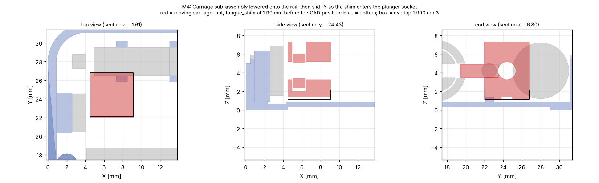 |
| M5 | Gear B + sleeve lowered into the gear plane (06.2) | tweezers | **BLOCKED** | `bottom` 3.10->0.60 mm, max 0.300 mm3 at x 1.95..2.55, y 21.5..23.5, z 5.34..6.38 no feasible straight or lift-and-slide path found 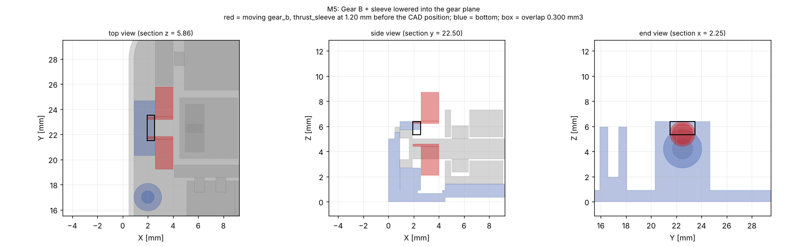 |
| M6 | Leadscrew inserted from the dock end through far bush, nut, sleeve, dry bush (06.2) | pin vise | **BLOCKED** | `bottom` 28.00->5.40 mm, max 6.353 mm3 at x 32.0..47.0, y 21.7..23.3, z 3.4..5.0 no feasible straight or lift-and-slide path found 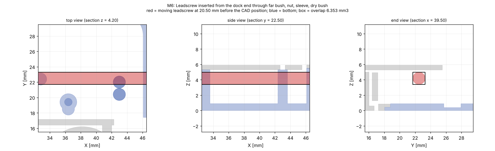 |
| M7 | Motor (gearbox, shaft, boss, terminal block, pins) laid into the three cradles (06.3) | tweezers | OK |  |
| M8 | Gear A slid onto the motor D-shaft from the dry end (06.3) | tweezers | **BLOCKED** | `bottom` 2.00->0.20 mm, max 7.141 mm3 at x 0.6..2.0, y 25.31..30.71, z 1.5..5.5 no feasible straight or lift-and-slide path found press zone gear_b: overlap 1.0854 mm3 over the last 1.30 mm 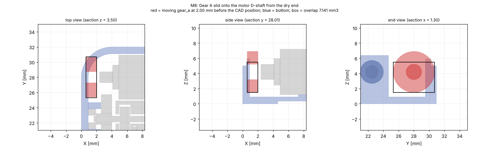 |
| M9 | Thrust collar slid on the rod end (06.4) | tweezers | OK |  |
| M10 | Spindle magnet glued on the rod end face (06.4) | tweezers (non-magnetic) | OK |  |
| M11 | Needle + hub pressed into the cap guard tube from the dock mouth (06.5) | tweezers | OK |  press zone end_cap: overlap 0.0053 mm3 over the last 3.30 mm |
| M12 | Pod sensor board lowered onto posts and locating pins (07.2) | tweezers | OK |  |
| M13 | FFC cable pushed into the ZIF connector (flip lock) from the +X side (07.4) | tweezers | OK |  |
| M14 | Gasket laid on the bottom tongue (08.2) | tweezers | OK |  flexible part crosses the path (overlap 0.72 mm3): must be threaded/lifted by hand |
| M15 | Lid lowered straight down (FFC cable through its slot) (08.3) | finger | OK |  flexible part crosses the path (overlap 0.734 mm3): must be threaded/lifted by hand |
| M16 | Dock insert slid into the dock window from the +X mouth until the detents click (09.3) | finger | **BLOCKED** | `bottom` 16.70->1.60 mm, max 0.096 mm3 at x 32.95..33.45, y 3.73..18.67, z 0.5..0.75; `top` 16.70->16.00 mm, max 0.113 mm3 at x 46.95..47.0, y 5.25..17.15, z 5.01..5.2 (grazing); `hall_dock` 14.00->12.30 mm, max 0.315 mm3 at x 43.55..44.3, y 10.5..11.9, z 4.9..5.2 no feasible straight or lift-and-slide path found press zone bottom: overlap 0.0957 mm3 over the last 1.50 mm 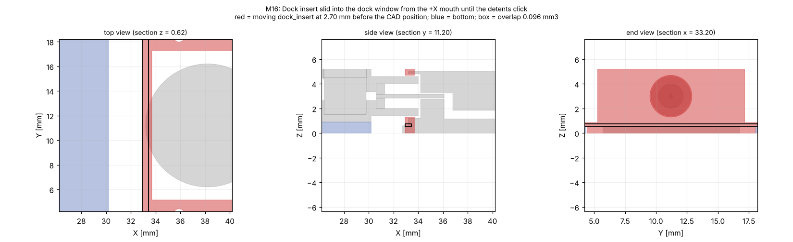 |
| A1 | Dock magnet d2x1 glued into the rear lug pocket of the dummy head (09.1) | tweezers | **BLOCKED** | `cannula_adapter` 1.60->0.20 mm, max 0.248 mm3 at x 42.8..43.2, y 10.45..11.95, z 4.4..5.0 no feasible straight or lift-and-slide path found 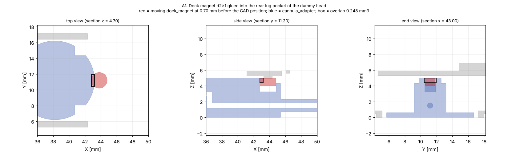 |
| D1 | Dock: dummy head pushed into the pod mouth, snap arms spread and latch behind the dome (09.4) | finger | marginal | `bottom` 13.70->3.80 mm, max 0.025 mm3 at x 46.95..47.0, y 6.2..16.2, z 4.95..5.0 (grazing); `hall_dock` 11.10->0.10 mm, max 0.154 mm3 at x 43.25..44.35, y 10.5..11.9, z 4.9..5.0 (grazing) snap: deflection [1.808, 1.808] mm, arm strain 1.88 % vs 2 % (SLA_TOUGH); CAD travel 1.908 mm = 1.98 % 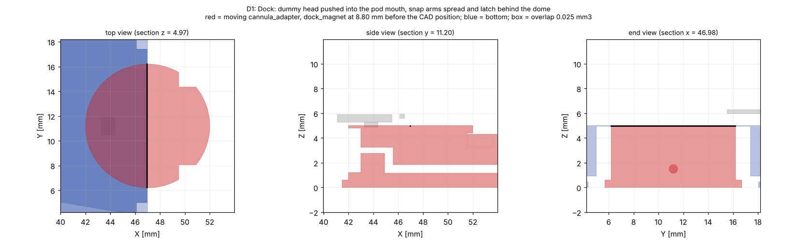 |

### 2a. Proposed re-ordering tested with the same engine

**X1: Re-ordering inside the current CAD: gear A on the shaft before the motor is lowered (meshing from above), dock insert before the board, gasket before the FFC cable**

| step | status | notes |
|---|---|---|
| M7x Motor with gear A already pressed on the shaft, lowered into the cradles and mes | OK |  |
| M9 Thrust collar slid on the rod end | OK |  |
| M10 Spindle magnet glued on the rod end face | OK |  |
| M11 Needle + hub pressed into the cap guard tube from the dock mouth | OK |  |
| M16 Dock insert slid into the dock window from the +X mouth until the detents click | **BLOCKED** | `bottom` 16.70 mm, 0.096 mm3 |
| M12 Pod sensor board lowered onto posts and locating pins | OK |  |
| M14 Gasket laid on the bottom tongue | OK |  |
| M13 FFC cable pushed into the ZIF connector (flip lock) from the +X side | OK |  |
| M15 Lid lowered straight down (FFC cable through its slot) | OK |  |
| A1 Dock magnet d2x1 glued into the rear lug pocket of the dummy head | **BLOCKED** | `cannula_adapter` 1.60 mm, 0.248 mm3 |
| D1 Dock: dummy head pushed into the pod mouth, snap arms spread and latch behind th | marginal | `bottom` 13.70 mm, 0.025 mm3; `hall_dock` 11.10 mm, 0.154 mm3 |

## 3. Tool and finger access

Screwdriver model: tip D1.5 / D2.0 x 2.0 mm, shaft D3.0 up to 15.0 mm above the head, handle D12.0 beyond; must stay free when tilted 10 deg in 8 directions. Tweezers: cone half angle 10 deg, tip D0.6, length 10.0 mm, apex on the trailing face of the part, approach opposite the insertion direction, tilted up to 45 deg allowed. ZIF: lever swing box above the connector rear edge + tweezer approach.

| item | status | detail |
|---|---|---|
| P3 Printed nose disc glued on the plunger front face | OK | free cone half angle 30 deg (need 10); blockers: - |
| C1 M1.6 nut dropped into the carriage hex pocket | OK | free cone half angle 20 deg (need 10); blockers: carriage |
| C2 Steel tongue shim glued into the carriage pocket | OK | free cone half angle 30 deg (need 10); blockers: - |
| G1 Thrust sleeve into gear B (carriage side) | OK | free cone half angle 30 deg (need 10); blockers: - |
| R3 Fill septum plug pressed into the cap side bore | OK | free cone half angle 30 deg (need 10); blockers: - |
| R4 Duckbill valve dropped into the open cap slot and pressed in | OK | free cone half angle 30 deg (need 10); blockers: - |
| R5 Valve plug pressed into the slot (flush with the cap top) | OK | free cone half angle 30 deg (need 10); blockers: - |
| M1 Dry bush pressed into the dry-end bearing bore | OK | free cone half angle 30 deg (need 10); blockers: - |
| M2 Far bush pressed into the wet-end bearing bore | OK | free cone half angle 20 deg (need 10); blockers: bottom |
| M8 Gear A slid onto the motor D-shaft from the dry end | OK | free cone half angle 30 deg (need 10); blockers: - |
| M9 Thrust collar slid on the rod end | OK | free cone half angle 30 deg (need 10); blockers: - |
| M10 Spindle magnet glued on the rod end face | OK | free cone half angle 20 deg (need 10); blockers: bottom |
| M11 Needle + hub pressed into the cap guard tube from the dock m | OK | free cone half angle 30 deg (need 10); blockers: - |
| M13 FFC ZIF flip-lock actuator and cable entry | OK | lever box blockers: -; free tweezer approach 45 deg |
| M14 Gasket laid on the bottom tongue | OK | free cone half angle 30 deg (need 10); blockers: - |
| A1 Dock magnet d2x1 glued into the rear lug pocket of the dummy | OK | free cone half angle 30 deg (need 10); blockers: - |
| S-lid-1 lid screw 1 (dry end) | OK | seat z 8.4, free tilt tip1.5 20 deg / tip2.0 20 deg (need 10), min tip length that clears: 0.25 mm; blockers: - |
| S-lid-2 lid screw 2 (dry end) | OK | seat z 8.4, free tilt tip1.5 20 deg / tip2.0 20 deg (need 10), min tip length that clears: 0.25 mm; blockers: - |
| S-lid-3 lid screw 3 (dry end) | OK | seat z 8.4, free tilt tip1.5 20 deg / tip2.0 20 deg (need 10), min tip length that clears: 0.25 mm; blockers: - |
| S-lid-4 lid screw 4 (beside the board) | OK | seat z 8.4, free tilt tip1.5 20 deg / tip2.0 20 deg (need 10), min tip length that clears: 0.25 mm; blockers: - |
| S-board board screw M1.2 x 4 (before the lid) | OK | seat z 6.4, free tilt tip1.5 20 deg / tip2.0 20 deg (need 10), min tip length that clears: 0.25 mm; blockers: - |

## 4. DFM against the vendor rules

Wall thickness = inward ray from 60 000 surface samples to the first opposite surface (vendor table value interpolated by part footprint; hard floor = below this the feature is not reliably producible). Void width = outward ray; round holes/channels are separated from slots by sampling the cross-section; depth along the axis. CNC: section ring curvature and axial depth.

| part | process | extents [mm] | min wall | % wall < vendor | vendor / floor | flagged voids | verdict |
|---|---|---|---|---|---|---|---|
| bottom | MJF | 47.0 x 32.0 x 6.38 | 0.00 | 95.0 | 1.42 / 0.5 | 12 | **FAIL** |
| top | MJF | 47.0 x 32.0 x 3.39 | 0.05 | 97.7 | 1.42 / 0.5 | 12 | **FAIL** |
| carriage | SLA | 4.6 x 4.8 x 6.2 | 0.00 | 19.3 | 0.53 / 0.4 | 7 | **FAIL** |
| plunger_core | SLA | 3.8 x 15.6 x 4.6 | 0.05 | 12.5 | 0.71 / 0.4 | 12 | **FAIL** |
| reservoir | SLA | 21.7 x 17.6 x 6.6 | 0.63 | 16.6 | 0.85 / 0.4 | 0 | warn |
| end_cap | SLA | 10.2 x 13.2 x 4.3 | 0.00 | 51.6 | 0.81 / 0.4 | 12 | **FAIL** |
| coupler | SLA | 5.6 x 3.0 x 3.0 | 0.50 | 0.3 | 0.50 / 0.4 | 0 | warn |
| plunger_nose | SLA | 0.7 x 15.6 x 4.6 | 0.74 | 0.0 | 0.71 / 0.4 | 0 | OK |
| valve_plug | SLA | 3.48 x 3.12 x 0.68 | 0.72 | 0.0 | 0.50 / 0.4 | 0 | OK |
| thrust_sleeve | SLA | 2.05 x 2.0 x 2.0 | 0.19 | 100.0 | 0.50 / 0.4 | 0 | **FAIL** |
| thrust_collar | SLA | 1.0 x 2.4 x 2.4 | 0.39 | 89.5 | 0.50 / 0.4 | 0 | warn |
| cannula_adapter | SLA | 17.7 x 11.0 x 5.0 | 0.21 | 28.9 | 0.82 / 0.4 | 12 | **FAIL** |
| mould_lower | SLA | 15.8 x 28.3 x 8.5 | 0.96 | 0.0 | 0.86 / 0.4 | 12 | warn |
| mould_upper | SLA | 15.8 x 28.3 x 6.0 | 0.96 | 0.0 | 0.86 / 0.4 | 12 | warn |
| insert_v01 | SLA | 16.7 x 15.1 x 5.2 | 0.00 | 68.0 | 0.83 / 0.4 | 0 | **FAIL** |
| insert_v10 | SLA | 16.7 x 15.1 x 5.2 | 0.01 | 68.1 | 0.83 / 0.4 | 3 | **FAIL** |
| dock_fixture | MJF | 18.8 x 21.2 x 2.9 | 0.48 | 56.6 | 1.27 / 0.5 | 4 | **FAIL** |
| OP-100_reservoir_cnc | CNC_PP | 21.7 x 17.6 x 6.6 | 0.65 | 87.4 | 1.50 / 1.0 | 0 | **FAIL** |
| OP-200_reservoir_cnc | CNC_PP | 35.1 x 17.6 x 6.6 | 0.66 | 92.2 | 1.50 / 1.0 | 0 | **FAIL** |
| OP-70_reservoir_cnc | CNC_PP | 17.7 x 17.6 x 6.6 | 0.63 | 84.7 | 1.50 / 1.0 | 0 | **FAIL** |

### 4a. Violations with location (pod coordinates of the mesh)

**bottom** (MJF, qty 1)

* FAIL: wall 0.05 mm < hard floor 0.5 mm (MJF) at [47.0, 17.11, 4.96] and 13 more place(s), e.g. [19.85, 26.76, 0.35] (434 samples)
* FAIL: slot/channel width 0.18 mm < hard floor 0.8 mm (MJF): cannot be reliably printed/machined as drawn; drill or wire it at [0.98, 4.79, 4.71]
* FAIL: slot/channel width 0.26 mm < hard floor 0.8 mm (MJF): cannot be reliably printed/machined as drawn; drill or wire it at [1.09, 3.38, 2.72] and 1 more place(s), e.g. [2.38, 22.75, 0.78]
* FAIL: slot/channel width 0.33 mm < hard floor 0.8 mm (MJF): cannot be reliably printed/machined as drawn; drill or wire it at [1.14, 3.29, 3.66]
* FAIL: slot/channel width 0.35 mm < hard floor 0.8 mm (MJF): cannot be reliably printed/machined as drawn; drill or wire it at [1.15, 3.26, 5.3]
* FAIL: slot/channel width 0.47 mm < hard floor 0.8 mm (MJF): cannot be reliably printed/machined as drawn; drill or wire it at [36.28, 18.68, 0.69] and 2 more place(s), e.g. [46.31, 4.13, 0.69]
* FAIL: slot/channel width 0.55 mm < hard floor 0.8 mm (MJF): cannot be reliably printed/machined as drawn; drill or wire it at [19.28, 26.75, 0.67]
* FAIL: slot/channel width 0.58 mm < hard floor 0.8 mm (MJF): cannot be reliably printed/machined as drawn; drill or wire it at [35.81, 18.27, 0.69] and 1 more place(s), e.g. [46.7, 18.26, 0.68]
* FAIL: slot/channel width 0.67 mm < hard floor 0.8 mm (MJF): cannot be reliably printed/machined as drawn; drill or wire it at [18.31, 26.82, 0.64]
* WARN: 95.0 % of the wall samples thinner than the vendor value 1.42 mm for a 39 mm part (min 0.00 mm)

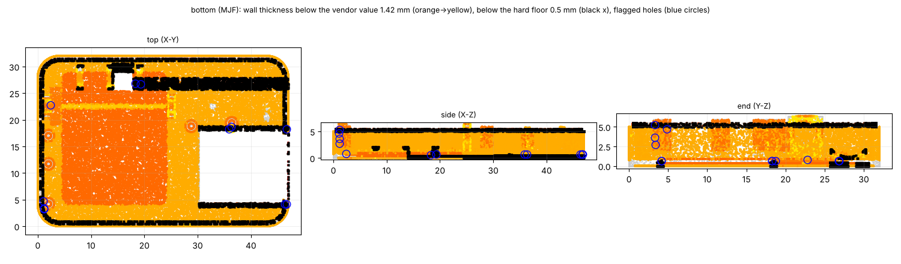

**top** (MJF, qty 1)

* FAIL: wall 0.05 mm < hard floor 0.5 mm (MJF) at [47.0, 12.35, 5.18] and 13 more place(s), e.g. [46.95, 6.34, 5.45] (225 samples)
* FAIL: slot/channel width 0.20 mm < hard floor 0.8 mm (MJF): cannot be reliably printed/machined as drawn; drill or wire it at [1.08, 3.3, 7.21]
* FAIL: slot/channel width 0.24 mm < hard floor 0.8 mm (MJF): cannot be reliably printed/machined as drawn; drill or wire it at [18.47, 24.3, 8.25] and 2 more place(s), e.g. [14.47, 24.18, 8.19]
* FAIL: slot/channel width 0.29 mm < hard floor 0.8 mm (MJF): cannot be reliably printed/machined as drawn; drill or wire it at [11.82, 24.28, 8.27]
* WARN: 97.7 % of the wall samples thinner than the vendor value 1.42 mm for a 39 mm part (min 0.05 mm)
* WARN: hole width 1.40 mm < vendor minimum 1.5 mm (MJF); post-drill/ream it at [1.99, 11.7, 6.73] and 5 more place(s), e.g. [28.8, 18.8, 7.18]
* WARN: slot/channel width 1.40 mm < vendor minimum 1.5 mm (MJF); post-drill/ream it at [1.99, 4.2, 7.23]

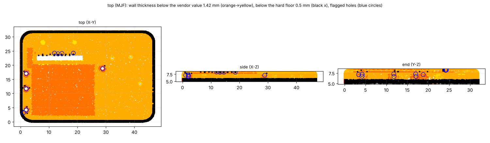

**carriage** (SLA, qty 2)

* FAIL: zero-thickness skin (0.001 mm): coincident or tangent faces, e.g. a bore tangent to an outer face; the slicer will drop or crack it (SLA) at [6.69, 21.6, 4.51] (316 samples)
* FAIL: zero-thickness skin (0.003 mm): coincident or tangent faces, e.g. a bore tangent to an outer face; the slicer will drop or crack it (SLA) at [6.82, 21.6, 3.89] (228 samples)
* FAIL: wall 0.24 mm < hard floor 0.4 mm (SLA) at [6.68, 20.88, 4.0] and 1 more place(s), e.g. [6.45, 20.69, 4.46] (323 samples)
* WARN: zero-thickness skin (0.001 mm): coincident or tangent faces, e.g. a bore tangent to an outer face; the slicer will drop or crack it (SLA) at [7.02, 21.6, 3.89] (39 samples)
* WARN: zero-thickness skin (0.004 mm): coincident or tangent faces, e.g. a bore tangent to an outer face; the slicer will drop or crack it (SLA) at [7.03, 21.6, 4.52] (49 samples)
* WARN: 19.3 % of the wall samples thinner than the vendor value 0.53 mm for a 5 mm part (min 0.00 mm)
* WARN: slot/channel width 0.55 mm < vendor minimum 1.0 mm (SLA); post-drill/ream it at [7.11, 21.25, 4.2] and 3 more place(s), e.g. [6.95, 20.75, 4.7]
* WARN: slot/channel width 0.67 mm < vendor minimum 1.0 mm (SLA); post-drill/ream it at [7.11, 20.3, 4.2] and 1 more place(s), e.g. [6.95, 20.28, 4.71]
* WARN: slot/channel width 0.78 mm < vendor minimum 1.0 mm (SLA); post-drill/ream it at [6.9, 21.24, 4.23]

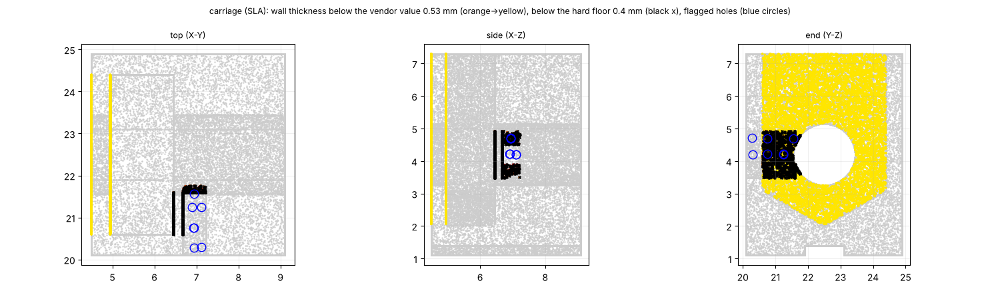

**plunger_core** (SLA, qty 2)

* FAIL: wall 0.05 mm < hard floor 0.4 mm (SLA) at [6.55, 18.87, 4.95] and 3 more place(s), e.g. [7.35, 18.85, 4.85] (626 samples)
* FAIL: wall 0.19 mm < hard floor 0.4 mm (SLA) at [7.11, 18.84, 5.05] (11 samples)
* FAIL: wall 0.22 mm < hard floor 0.4 mm (SLA) at [6.76, 18.83, 5.07] (25 samples)
* WARN: 12.5 % of the wall samples thinner than the vendor value 0.71 mm for a 8 mm part (min 0.05 mm)
* WARN: slot/channel width 0.53 mm < vendor minimum 1.0 mm (SLA); post-drill/ream it at [6.95, 17.75, 3.48]
* WARN: slot/channel width 0.55 mm < vendor minimum 1.0 mm (SLA); post-drill/ream it at [7.8, 5.17, 5.95]
* WARN: slot/channel width 0.56 mm < vendor minimum 1.0 mm (SLA); post-drill/ream it at [6.1, 18.45, 3.66] and 1 more place(s), e.g. [6.95, 18.74, 3.48]
* WARN: slot/channel width 0.57 mm < vendor minimum 1.0 mm (SLA); post-drill/ream it at [7.8, 17.3, 5.94] and 1 more place(s), e.g. [7.8, 18.46, 3.67]
* WARN: slot/channel width 0.59 mm < vendor minimum 1.0 mm (SLA); post-drill/ream it at [6.1, 5.1, 5.95]
* WARN: slot/channel width 0.60 mm < vendor minimum 1.0 mm (SLA); post-drill/ream it at [6.1, 17.33, 5.95]
* WARN: slot/channel width 0.62 mm < vendor minimum 1.0 mm (SLA); post-drill/ream it at [6.1, 4.67, 2.63]
* WARN: slot/channel width 0.65 mm < vendor minimum 1.0 mm (SLA); post-drill/ream it at [6.1, 4.1, 3.2] and 1 more place(s), e.g. [7.8, 4.13, 3.16]
* WARN: slot/channel width 0.66 mm < vendor minimum 1.0 mm (SLA); post-drill/ream it at [6.1, 4.15, 5.29]

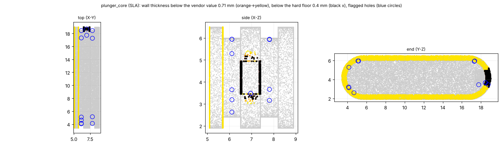

**reservoir** (SLA, qty 1)

* WARN: 16.6 % of the wall samples thinner than the vendor value 0.85 mm for a 20 mm part (min 0.63 mm)

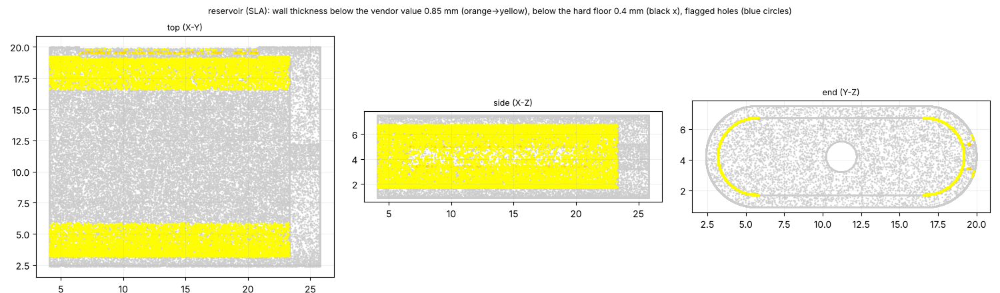

**end_cap** (SLA, qty 2)

* FAIL: zero-thickness skin (0.000 mm): coincident or tangent faces, e.g. a bore tangent to an outer face; the slicer will drop or crack it (SLA) at [27.95, 1.95, 0.9] and 5 more place(s), e.g. [28.03, 3.15, 0.9] (1258 samples)
* FAIL: zero-thickness skin (0.001 mm): coincident or tangent faces, e.g. a bore tangent to an outer face; the slicer will drop or crack it (SLA) at [25.8, 10.29, 2.82] (155 samples)
* FAIL: zero-thickness skin (0.003 mm): coincident or tangent faces, e.g. a bore tangent to an outer face; the slicer will drop or crack it (SLA) at [26.4, 10.19, 3.18] and 1 more place(s), e.g. [25.8, 10.25, 3.19] (334 samples)
* FAIL: slot/channel width 0.36 mm < hard floor 0.5 mm (SLA): cannot be reliably printed/machined as drawn; drill or wire it at [26.09, 11.53, 3.6]
* FAIL: slot/channel width 0.42 mm < hard floor 0.5 mm (SLA): cannot be reliably printed/machined as drawn; drill or wire it at [27.12, 8.92, 2.95]
* FAIL: slot/channel width 0.46 mm < hard floor 0.5 mm (SLA): cannot be reliably printed/machined as drawn; drill or wire it at [27.12, 8.94, 3.06]
* FAIL: hole width 0.70 mm < vendor minimum 1.0 mm (SLA); post-drill/ream it; depth/width 4.0 > 3 (vendor hole table) at [28.01, 6.78, 3.0]
* FAIL: hole width 0.70 mm < vendor minimum 1.0 mm (SLA); post-drill/ream it; depth/width 7.2 > 3 (vendor hole table) at [24.76, 11.2, 4.2]
* WARN: zero-thickness skin (0.000 mm): coincident or tangent faces, e.g. a bore tangent to an outer face; the slicer will drop or crack it (SLA) at [26.4, 11.02, 3.73] (62 samples)
* WARN: zero-thickness skin (0.001 mm): coincident or tangent faces, e.g. a bore tangent to an outer face; the slicer will drop or crack it (SLA) at [26.4, 11.38, 4.37] and 2 more place(s), e.g. [27.91, 4.08, 0.9] (141 samples)
* WARN: zero-thickness skin (0.002 mm): coincident or tangent faces, e.g. a bore tangent to an outer face; the slicer will drop or crack it (SLA) at [25.8, 9.6, 3.18] (86 samples)
* WARN: 51.6 % of the wall samples thinner than the vendor value 0.81 mm for a 12 mm part (min 0.00 mm)
* WARN: slot/channel width 0.60 mm < vendor minimum 1.0 mm (SLA); post-drill/ream it at [25.93, 11.3, 3.6]
* WARN: slot/channel width 0.68 mm < vendor minimum 1.0 mm (SLA); post-drill/ream it at [26.24, 11.2, 3.32]
* WARN: slot/channel width 0.69 mm < vendor minimum 1.0 mm (SLA); post-drill/ream it at [26.14, 11.19, 3.71] and 1 more place(s), e.g. [26.29, 9.25, 3.0]
* WARN: hole width 0.70 mm < vendor minimum 1.0 mm (SLA); post-drill/ream it at [27.67, 9.21, 3.0] and 1 more place(s), e.g. [27.99, 8.7, 3.0]
* WARN: slot/channel width 0.70 mm < vendor minimum 1.0 mm (SLA); post-drill/ream it at [26.11, 10.7, 2.99]

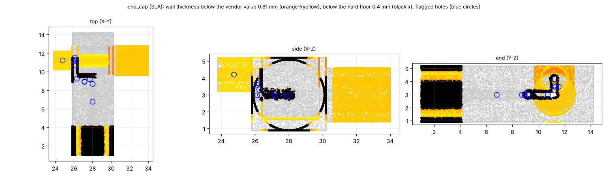

**coupler** (SLA, qty 2)

* WARN: 0.3 % of the wall samples thinner than the vendor value 0.50 mm for a 4 mm part (min 0.50 mm)

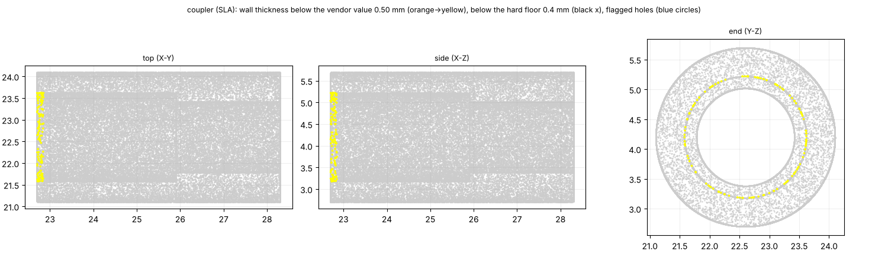

**thrust_sleeve** (SLA, qty 2)

* FAIL: wall 0.19 mm < hard floor 0.4 mm (SLA) at [3.06, 21.68, 4.19] and 13 more place(s), e.g. [2.84, 22.21, 3.43] (49838 samples)
* WARN: 100.0 % of the wall samples thinner than the vendor value 0.50 mm for a 2 mm part (min 0.19 mm)

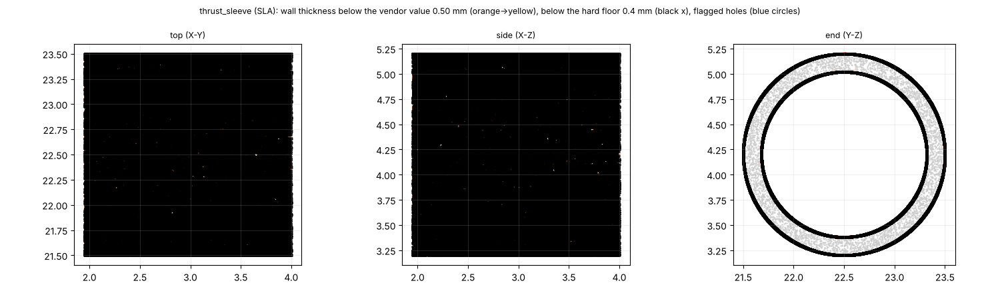

**thrust_collar** (SLA, qty 2)

* WARN: 89.5 % of the wall samples thinner than the vendor value 0.50 mm for a 2 mm part (min 0.39 mm)

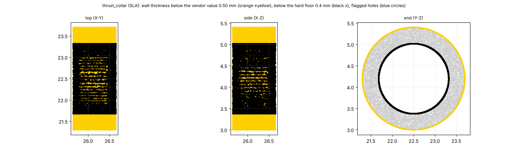

**cannula_adapter** (SLA, qty 2)

* FAIL: wall 0.21 mm < hard floor 0.4 mm (SLA) at [34.01, 11.19, 4.8] and 3 more place(s), e.g. [33.53, 11.24, 4.8] (201 samples)
* FAIL: wall 0.22 mm < hard floor 0.4 mm (SLA) at [33.88, 10.99, 5.0] and 3 more place(s), e.g. [33.49, 10.99, 4.79] (225 samples)
* FAIL: slot/channel width 0.35 mm < hard floor 0.5 mm (SLA): cannot be reliably printed/machined as drawn; drill or wire it at [36.43, 10.9, 2.07]
* FAIL: hole width 0.50 mm < vendor minimum 1.0 mm (SLA); post-drill/ream it; depth/width 4.1 > 3 (vendor hole table) at [34.75, 11.2, 3.01]
* FAIL: hole width 0.57 mm < vendor minimum 1.0 mm (SLA); post-drill/ream it; depth/width 3.7 > 3 (vendor hole table) at [36.63, 11.3, 2.15]
* FAIL: hole width 0.70 mm < vendor minimum 1.0 mm (SLA); post-drill/ream it; depth/width 6.7 > 3 (vendor hole table) at [40.78, 11.2, 1.49]
* FAIL: hole width 0.70 mm < vendor minimum 1.0 mm (SLA); post-drill/ream it; depth/width 3.0 > 3 (vendor hole table) at [36.43, 11.21, 2.23]
* FAIL: hole width 0.70 mm < vendor minimum 1.0 mm (SLA); post-drill/ream it; depth/width 17.4 > 3 (vendor hole table) at [48.24, 11.2, 1.5]
* FAIL: hole width 0.70 mm < vendor minimum 1.0 mm (SLA); post-drill/ream it; depth/width 8.1 > 3 (vendor hole table) at [41.77, 11.2, 1.51]
* FAIL: hole width 0.70 mm < vendor minimum 1.0 mm (SLA); post-drill/ream it; depth/width 13.1 > 3 (vendor hole table) at [45.25, 11.2, 1.5]
* WARN: 28.9 % of the wall samples thinner than the vendor value 0.82 mm for a 14 mm part (min 0.21 mm)
* WARN: slot/channel width 0.51 mm < vendor minimum 1.0 mm (SLA); post-drill/ream it at [36.69, 11.19, 2.99]
* WARN: slot/channel width 0.68 mm < vendor minimum 1.0 mm (SLA); post-drill/ream it at [36.37, 11.2, 1.37]
* WARN: slot/channel width 0.69 mm < vendor minimum 1.0 mm (SLA); post-drill/ream it at [36.4, 11.2, 2.76]
* WARN: hole width 0.70 mm < vendor minimum 1.0 mm (SLA); post-drill/ream it at [37.76, 11.2, 1.49]

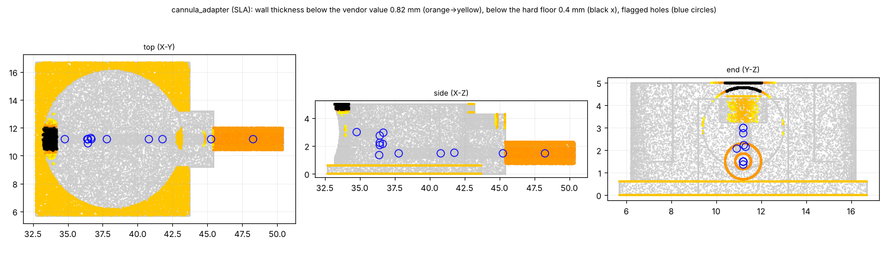

**mould_lower** (SLA, qty 1)

* WARN: slot/channel width 0.63 mm < vendor minimum 1.0 mm (SLA); post-drill/ream it at [8.7, 11.22, 3.41] and 1 more place(s), e.g. [8.7, 17.87, 3.41]
* WARN: slot/channel width 0.64 mm < vendor minimum 1.0 mm (SLA); post-drill/ream it at [8.7, 15.26, 3.41]
* WARN: slot/channel width 0.65 mm < vendor minimum 1.0 mm (SLA); post-drill/ream it at [7.0, 18.36, 3.42]
* WARN: slot/channel width 0.66 mm < vendor minimum 1.0 mm (SLA); post-drill/ream it at [7.0, 6.32, 4.89]
* WARN: slot/channel width 0.68 mm < vendor minimum 1.0 mm (SLA); post-drill/ream it at [8.7, 11.8, 3.43]
* WARN: slot/channel width 0.70 mm < vendor minimum 1.0 mm (SLA); post-drill/ream it at [8.7, 15.72, 3.44]
* WARN: slot/channel width 0.71 mm < vendor minimum 1.0 mm (SLA); post-drill/ream it at [8.7, 18.75, 3.44]
* WARN: slot/channel width 0.73 mm < vendor minimum 1.0 mm (SLA); post-drill/ream it at [8.7, 10.21, 3.45]
* WARN: slot/channel width 0.79 mm < vendor minimum 1.0 mm (SLA); post-drill/ream it at [8.7, 22.09, 5.28]
* WARN: slot/channel width 0.88 mm < vendor minimum 1.0 mm (SLA); post-drill/ream it at [8.7, 6.38, 4.85]
* WARN: slot/channel width 0.98 mm < vendor minimum 1.0 mm (SLA); post-drill/ream it at [8.7, 20.8, 3.78]

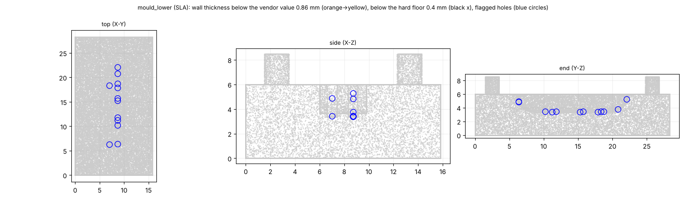

**mould_upper** (SLA, qty 1)

* WARN: hole width 0.50 mm < vendor minimum 1.0 mm (SLA); post-drill/ream it at [8.7, 7.65, 9.22] and 3 more place(s), e.g. [8.7, 7.65, 11.24]
* WARN: slot/channel width 0.50 mm < vendor minimum 1.0 mm (SLA); post-drill/ream it at [8.7, 7.65, 8.72] and 2 more place(s), e.g. [6.99, 7.65, 8.73]
* WARN: slot/channel width 0.61 mm < vendor minimum 1.0 mm (SLA); post-drill/ream it at [8.7, 10.78, 8.6]
* WARN: slot/channel width 0.62 mm < vendor minimum 1.0 mm (SLA); post-drill/ream it at [8.7, 14.68, 8.6]
* WARN: slot/channel width 0.65 mm < vendor minimum 1.0 mm (SLA); post-drill/ream it at [8.7, 19.75, 8.58]
* WARN: slot/channel width 0.66 mm < vendor minimum 1.0 mm (SLA); post-drill/ream it at [8.7, 15.35, 8.58]
* WARN: slot/channel width 0.67 mm < vendor minimum 1.0 mm (SLA); post-drill/ream it at [8.7, 17.21, 8.58]

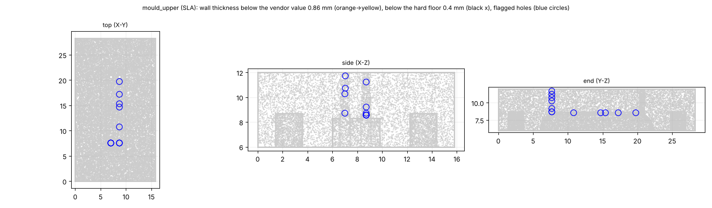

**insert_v01** (SLA, qty -)

* FAIL: wall 0.37 mm < hard floor 0.4 mm (SLA) at [7.85, 5.13, 3.42] and 6 more place(s), e.g. [7.85, 5.2, 2.64] (818 samples)
* WARN: zero-thickness skin (0.002 mm): coincident or tangent faces, e.g. a bore tangent to an outer face; the slicer will drop or crack it (SLA) at [7.09, 3.65, 0.88] (31 samples)
* WARN: zero-thickness skin (0.007 mm): coincident or tangent faces, e.g. a bore tangent to an outer face; the slicer will drop or crack it (SLA) at [7.72, 18.74, 0.84] (62 samples)
* WARN: 68.0 % of the wall samples thinner than the vendor value 0.83 mm for a 16 mm part (min 0.00 mm)

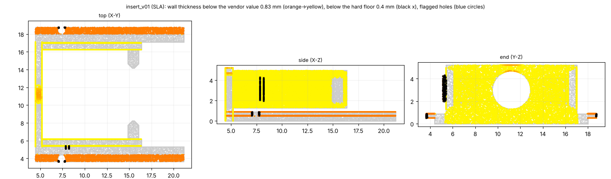

**insert_v10** (SLA, qty -)

* FAIL: wall 0.37 mm < hard floor 0.4 mm (SLA) at [9.15, 5.02, 4.14] and 9 more place(s), e.g. [8.8, 5.02, 3.55] (1143 samples)
* FAIL: slot/channel width 0.32 mm < hard floor 0.5 mm (SLA): cannot be reliably printed/machined as drawn; drill or wire it at [9.3, 5.16, 4.22]
* FAIL: slot/channel width 0.37 mm < hard floor 0.5 mm (SLA): cannot be reliably printed/machined as drawn; drill or wire it at [9.3, 5.15, 3.18] and 1 more place(s), e.g. [9.3, 5.14, 3.64]
* WARN: zero-thickness skin (0.006 mm): coincident or tangent faces, e.g. a bore tangent to an outer face; the slicer will drop or crack it (SLA) at [7.08, 18.75, 0.58] (47 samples)
* WARN: zero-thickness skin (0.008 mm): coincident or tangent faces, e.g. a bore tangent to an outer face; the slicer will drop or crack it (SLA) at [7.08, 3.65, 0.63] (23 samples)
* WARN: 68.1 % of the wall samples thinner than the vendor value 0.83 mm for a 16 mm part (min 0.01 mm)

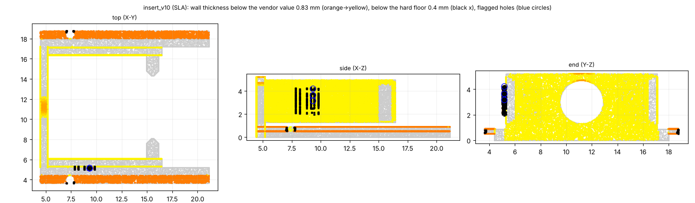

**dock_fixture** (MJF, qty -)

* FAIL: wall 0.48 mm < hard floor 0.5 mm (MJF) at [15.92, 18.16, 0.45] and 13 more place(s), e.g. [7.95, 18.13, 0.45] (2794 samples)
* FAIL: slot/channel width 0.13 mm < hard floor 0.8 mm (MJF): cannot be reliably printed/machined as drawn; drill or wire it at [7.34, 3.67, 0.6] and 1 more place(s), e.g. [7.37, 18.73, 0.63]
* FAIL: slot/channel width 0.16 mm < hard floor 0.8 mm (MJF): cannot be reliably printed/machined as drawn; drill or wire it at [7.53, 18.72, 0.61]
* FAIL: slot/channel width 0.69 mm < hard floor 0.8 mm (MJF): cannot be reliably printed/machined as drawn; drill or wire it at [5.78, 3.93, 0.61]
* WARN: 56.6 % of the wall samples thinner than the vendor value 1.27 mm for a 20 mm part (min 0.48 mm)

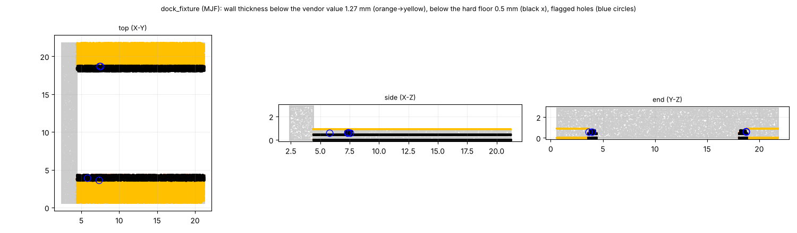

**OP-100_reservoir_cnc** (CNC_PP, qty 2)

* FAIL: wall 0.65 mm < hard floor 1.0 mm (CNC_PP) at [14.12, 19.87, 5.0] (79 samples)
* FAIL: wall 0.66 mm < hard floor 1.0 mm (CNC_PP) at [9.76, 19.87, 3.4] and 1 more place(s), e.g. [17.04, 19.86, 3.4] (56 samples)
* FAIL: wall 0.67 mm < hard floor 1.0 mm (CNC_PP) at [15.69, 19.86, 3.4] and 2 more place(s), e.g. [11.82, 19.86, 5.0] (162 samples)
* FAIL: wall 0.68 mm < hard floor 1.0 mm (CNC_PP) at [9.25, 19.85, 5.0] and 1 more place(s), e.g. [7.59, 19.85, 5.0] (121 samples)
* FAIL: wall 0.69 mm < hard floor 1.0 mm (CNC_PP) at [13.42, 19.85, 3.4] (36 samples)
* FAIL: wall 0.70 mm < hard floor 1.0 mm (CNC_PP) at [10.88, 19.84, 5.0] and 3 more place(s), e.g. [12.79, 19.84, 5.0] (236 samples)
* FAIL: wall 0.71 mm < hard floor 1.0 mm (CNC_PP) at [17.8, 19.84, 5.0] (59 samples)
* WARN: 87.4 % of the wall samples thinner than the vendor value 1.50 mm for a 20 mm part (min 0.65 mm)
* WARN: pocket depth/D = 4.0 (best 2-3 x D, >= 5 x D special)

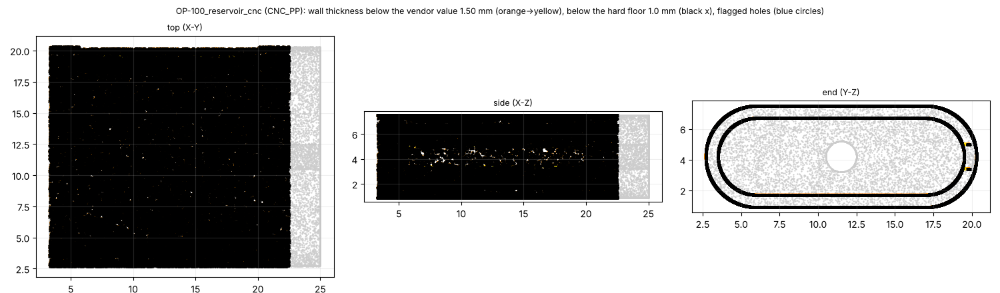

**OP-200_reservoir_cnc** (CNC_PP, qty 2)

* FAIL: wall 0.66 mm < hard floor 1.0 mm (CNC_PP) at [36.84, 19.87, 3.4] and 1 more place(s), e.g. [32.25, 19.86, 3.4] (37 samples)
* FAIL: wall 0.67 mm < hard floor 1.0 mm (CNC_PP) at [35.58, 19.86, 3.4] and 2 more place(s), e.g. [43.39, 19.86, 5.0] (87 samples)
* FAIL: wall 0.68 mm < hard floor 1.0 mm (CNC_PP) at [31.12, 19.86, 5.0] and 1 more place(s), e.g. [48.43, 19.85, 5.0] (81 samples)
* FAIL: wall 0.69 mm < hard floor 1.0 mm (CNC_PP) at [44.33, 19.85, 5.0] and 2 more place(s), e.g. [54.44, 19.84, 5.0] (110 samples)
* FAIL: wall 0.70 mm < hard floor 1.0 mm (CNC_PP) at [46.24, 19.84, 5.0] and 2 more place(s), e.g. [55.19, 19.84, 5.0] (92 samples)
* FAIL: wall 0.71 mm < hard floor 1.0 mm (CNC_PP) at [42.97, 19.83, 3.4] (19 samples)
* FAIL: internal corner radius 2.39 mm < 3.76 mm required for a 32.6 mm deep pocket (R >= H/10 + 0.5, JLCCNC); tool D = 4.8 mm gives depth/D = 6.8
* FAIL: pocket depth 32.6 mm = 6.8 x tool D 4.8: needs a special long-reach tool (>= 5 x D)
* WARN: 92.2 % of the wall samples thinner than the vendor value 1.50 mm for a 25 mm part (min 0.66 mm)

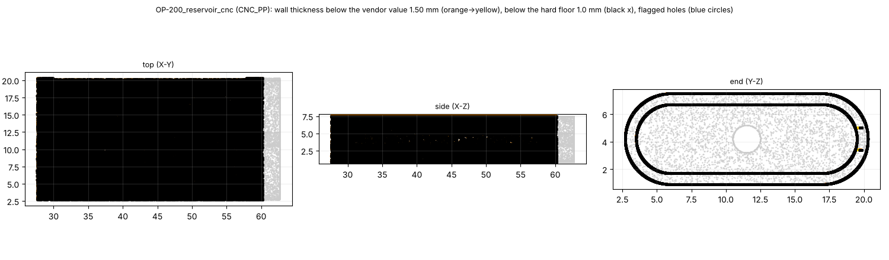

**OP-70_reservoir_cnc** (CNC_PP, qty 2)

* FAIL: wall 0.63 mm < hard floor 1.0 mm (CNC_PP) at [8.72, 19.88, 5.0] (63 samples)
* FAIL: wall 0.67 mm < hard floor 1.0 mm (CNC_PP) at [15.77, 19.86, 3.4] and 1 more place(s), e.g. [6.6, 19.86, 3.4] (76 samples)
* FAIL: wall 0.68 mm < hard floor 1.0 mm (CNC_PP) at [9.94, 19.85, 5.0] (73 samples)
* FAIL: wall 0.69 mm < hard floor 1.0 mm (CNC_PP) at [11.53, 19.85, 5.0] and 3 more place(s), e.g. [12.07, 19.85, 5.0] (265 samples)
* FAIL: wall 0.70 mm < hard floor 1.0 mm (CNC_PP) at [10.98, 19.84, 5.0] and 2 more place(s), e.g. [12.66, 19.84, 3.4] (173 samples)
* FAIL: wall 0.71 mm < hard floor 1.0 mm (CNC_PP) at [14.58, 19.84, 5.0] (75 samples)
* FAIL: wall 0.72 mm < hard floor 1.0 mm (CNC_PP) at [14.57, 19.83, 3.4] and 1 more place(s), e.g. [7.71, 19.83, 5.0] (109 samples)
* WARN: 84.7 % of the wall samples thinner than the vendor value 1.50 mm for a 18 mm part (min 0.63 mm)
* WARN: pocket depth/D = 3.2 (best 2-3 x D, >= 5 x D special)

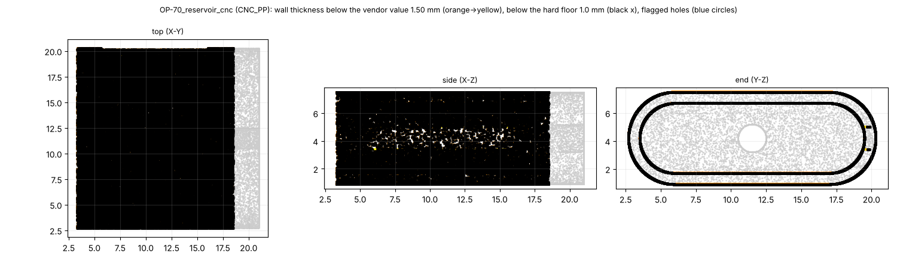

### 4b. Parts that cannot be made as drawn

* `bottom` (MJF): wall 0.05 mm < hard floor 0.5 mm (MJF) at [47.0, 17.11, 4.96]
* `bottom` (MJF): slot/channel width 0.18 mm < hard floor 0.8 mm (MJF): cannot be reliably printed/machined as drawn; drill or wire it at [0.98, 4.79, 4.71]
* `bottom` (MJF): slot/channel width 0.26 mm < hard floor 0.8 mm (MJF): cannot be reliably printed/machined as drawn; drill or wire it at [1.09, 3.38, 2.72]
* `bottom` (MJF): slot/channel width 0.33 mm < hard floor 0.8 mm (MJF): cannot be reliably printed/machined as drawn; drill or wire it at [1.14, 3.29, 3.66]
* `bottom` (MJF): slot/channel width 0.35 mm < hard floor 0.8 mm (MJF): cannot be reliably printed/machined as drawn; drill or wire it at [1.15, 3.26, 5.3]
* `bottom` (MJF): slot/channel width 0.47 mm < hard floor 0.8 mm (MJF): cannot be reliably printed/machined as drawn; drill or wire it at [36.28, 18.68, 0.69]
* `bottom` (MJF): slot/channel width 0.55 mm < hard floor 0.8 mm (MJF): cannot be reliably printed/machined as drawn; drill or wire it at [19.28, 26.75, 0.67]
* `bottom` (MJF): slot/channel width 0.58 mm < hard floor 0.8 mm (MJF): cannot be reliably printed/machined as drawn; drill or wire it at [35.81, 18.27, 0.69]
* `bottom` (MJF): slot/channel width 0.67 mm < hard floor 0.8 mm (MJF): cannot be reliably printed/machined as drawn; drill or wire it at [18.31, 26.82, 0.64]
* `top` (MJF): wall 0.05 mm < hard floor 0.5 mm (MJF) at [47.0, 12.35, 5.18]
* `top` (MJF): slot/channel width 0.20 mm < hard floor 0.8 mm (MJF): cannot be reliably printed/machined as drawn; drill or wire it at [1.08, 3.3, 7.21]
* `top` (MJF): slot/channel width 0.24 mm < hard floor 0.8 mm (MJF): cannot be reliably printed/machined as drawn; drill or wire it at [18.47, 24.3, 8.25]
* `top` (MJF): slot/channel width 0.29 mm < hard floor 0.8 mm (MJF): cannot be reliably printed/machined as drawn; drill or wire it at [11.82, 24.28, 8.27]
* `carriage` (SLA): zero-thickness skin (0.001 mm): coincident or tangent faces, e.g. a bore tangent to an outer face; the slicer will drop or crack it (SLA) at [6.69, 21.6, 4.51]
* `carriage` (SLA): zero-thickness skin (0.003 mm): coincident or tangent faces, e.g. a bore tangent to an outer face; the slicer will drop or crack it (SLA) at [6.82, 21.6, 3.89]
* `carriage` (SLA): wall 0.24 mm < hard floor 0.4 mm (SLA) at [6.68, 20.88, 4.0]
* `plunger_core` (SLA): wall 0.05 mm < hard floor 0.4 mm (SLA) at [6.55, 18.87, 4.95]
* `plunger_core` (SLA): wall 0.19 mm < hard floor 0.4 mm (SLA) at [7.11, 18.84, 5.05]
* `plunger_core` (SLA): wall 0.22 mm < hard floor 0.4 mm (SLA) at [6.76, 18.83, 5.07]
* `end_cap` (SLA): zero-thickness skin (0.000 mm): coincident or tangent faces, e.g. a bore tangent to an outer face; the slicer will drop or crack it (SLA) at [27.95, 1.95, 0.9]
* `end_cap` (SLA): zero-thickness skin (0.001 mm): coincident or tangent faces, e.g. a bore tangent to an outer face; the slicer will drop or crack it (SLA) at [25.8, 10.29, 2.82]
* `end_cap` (SLA): zero-thickness skin (0.003 mm): coincident or tangent faces, e.g. a bore tangent to an outer face; the slicer will drop or crack it (SLA) at [26.4, 10.19, 3.18]
* `end_cap` (SLA): slot/channel width 0.36 mm < hard floor 0.5 mm (SLA): cannot be reliably printed/machined as drawn; drill or wire it at [26.09, 11.53, 3.6]
* `end_cap` (SLA): slot/channel width 0.42 mm < hard floor 0.5 mm (SLA): cannot be reliably printed/machined as drawn; drill or wire it at [27.12, 8.92, 2.95]
* `end_cap` (SLA): slot/channel width 0.46 mm < hard floor 0.5 mm (SLA): cannot be reliably printed/machined as drawn; drill or wire it at [27.12, 8.94, 3.06]
* `end_cap` (SLA): hole width 0.70 mm < vendor minimum 1.0 mm (SLA); post-drill/ream it; depth/width 4.0 > 3 (vendor hole table) at [28.01, 6.78, 3.0]
* `end_cap` (SLA): hole width 0.70 mm < vendor minimum 1.0 mm (SLA); post-drill/ream it; depth/width 7.2 > 3 (vendor hole table) at [24.76, 11.2, 4.2]
* `thrust_sleeve` (SLA): wall 0.19 mm < hard floor 0.4 mm (SLA) at [3.06, 21.68, 4.19]
* `cannula_adapter` (SLA): wall 0.21 mm < hard floor 0.4 mm (SLA) at [34.01, 11.19, 4.8]
* `cannula_adapter` (SLA): wall 0.22 mm < hard floor 0.4 mm (SLA) at [33.88, 10.99, 5.0]
* `cannula_adapter` (SLA): slot/channel width 0.35 mm < hard floor 0.5 mm (SLA): cannot be reliably printed/machined as drawn; drill or wire it at [36.43, 10.9, 2.07]
* `cannula_adapter` (SLA): hole width 0.50 mm < vendor minimum 1.0 mm (SLA); post-drill/ream it; depth/width 4.1 > 3 (vendor hole table) at [34.75, 11.2, 3.01]
* `cannula_adapter` (SLA): hole width 0.57 mm < vendor minimum 1.0 mm (SLA); post-drill/ream it; depth/width 3.7 > 3 (vendor hole table) at [36.63, 11.3, 2.15]
* `cannula_adapter` (SLA): hole width 0.70 mm < vendor minimum 1.0 mm (SLA); post-drill/ream it; depth/width 6.7 > 3 (vendor hole table) at [40.78, 11.2, 1.49]
* `cannula_adapter` (SLA): hole width 0.70 mm < vendor minimum 1.0 mm (SLA); post-drill/ream it; depth/width 3.0 > 3 (vendor hole table) at [36.43, 11.21, 2.23]
* `cannula_adapter` (SLA): hole width 0.70 mm < vendor minimum 1.0 mm (SLA); post-drill/ream it; depth/width 17.4 > 3 (vendor hole table) at [48.24, 11.2, 1.5]
* `cannula_adapter` (SLA): hole width 0.70 mm < vendor minimum 1.0 mm (SLA); post-drill/ream it; depth/width 8.1 > 3 (vendor hole table) at [41.77, 11.2, 1.51]
* `cannula_adapter` (SLA): hole width 0.70 mm < vendor minimum 1.0 mm (SLA); post-drill/ream it; depth/width 13.1 > 3 (vendor hole table) at [45.25, 11.2, 1.5]
* `insert_v01` (SLA): wall 0.37 mm < hard floor 0.4 mm (SLA) at [7.85, 5.13, 3.42]
* `insert_v10` (SLA): wall 0.37 mm < hard floor 0.4 mm (SLA) at [9.15, 5.02, 4.14]
* `insert_v10` (SLA): slot/channel width 0.32 mm < hard floor 0.5 mm (SLA): cannot be reliably printed/machined as drawn; drill or wire it at [9.3, 5.16, 4.22]
* `insert_v10` (SLA): slot/channel width 0.37 mm < hard floor 0.5 mm (SLA): cannot be reliably printed/machined as drawn; drill or wire it at [9.3, 5.15, 3.18]
* `dock_fixture` (MJF): wall 0.48 mm < hard floor 0.5 mm (MJF) at [15.92, 18.16, 0.45]
* `dock_fixture` (MJF): slot/channel width 0.13 mm < hard floor 0.8 mm (MJF): cannot be reliably printed/machined as drawn; drill or wire it at [7.34, 3.67, 0.6]
* `dock_fixture` (MJF): slot/channel width 0.16 mm < hard floor 0.8 mm (MJF): cannot be reliably printed/machined as drawn; drill or wire it at [7.53, 18.72, 0.61]
* `dock_fixture` (MJF): slot/channel width 0.69 mm < hard floor 0.8 mm (MJF): cannot be reliably printed/machined as drawn; drill or wire it at [5.78, 3.93, 0.61]
* `OP-100_reservoir_cnc` (CNC_PP): wall 0.65 mm < hard floor 1.0 mm (CNC_PP) at [14.12, 19.87, 5.0]
* `OP-100_reservoir_cnc` (CNC_PP): wall 0.66 mm < hard floor 1.0 mm (CNC_PP) at [9.76, 19.87, 3.4]
* `OP-100_reservoir_cnc` (CNC_PP): wall 0.67 mm < hard floor 1.0 mm (CNC_PP) at [15.69, 19.86, 3.4]
* `OP-100_reservoir_cnc` (CNC_PP): wall 0.68 mm < hard floor 1.0 mm (CNC_PP) at [9.25, 19.85, 5.0]
* `OP-100_reservoir_cnc` (CNC_PP): wall 0.69 mm < hard floor 1.0 mm (CNC_PP) at [13.42, 19.85, 3.4]
* `OP-100_reservoir_cnc` (CNC_PP): wall 0.70 mm < hard floor 1.0 mm (CNC_PP) at [10.88, 19.84, 5.0]
* `OP-100_reservoir_cnc` (CNC_PP): wall 0.71 mm < hard floor 1.0 mm (CNC_PP) at [17.8, 19.84, 5.0]
* `OP-200_reservoir_cnc` (CNC_PP): wall 0.66 mm < hard floor 1.0 mm (CNC_PP) at [36.84, 19.87, 3.4]
* `OP-200_reservoir_cnc` (CNC_PP): wall 0.67 mm < hard floor 1.0 mm (CNC_PP) at [35.58, 19.86, 3.4]
* `OP-200_reservoir_cnc` (CNC_PP): wall 0.68 mm < hard floor 1.0 mm (CNC_PP) at [31.12, 19.86, 5.0]
* `OP-200_reservoir_cnc` (CNC_PP): wall 0.69 mm < hard floor 1.0 mm (CNC_PP) at [44.33, 19.85, 5.0]
* `OP-200_reservoir_cnc` (CNC_PP): wall 0.70 mm < hard floor 1.0 mm (CNC_PP) at [46.24, 19.84, 5.0]
* `OP-200_reservoir_cnc` (CNC_PP): wall 0.71 mm < hard floor 1.0 mm (CNC_PP) at [42.97, 19.83, 3.4]
* `OP-200_reservoir_cnc` (CNC_PP): internal corner radius 2.39 mm < 3.76 mm required for a 32.6 mm deep pocket (R >= H/10 + 0.5, JLCCNC); tool D = 4.8 mm gives depth/D = 6.8
* `OP-200_reservoir_cnc` (CNC_PP): pocket depth 32.6 mm = 6.8 x tool D 4.8: needs a special long-reach tool (>= 5 x D)
* `OP-70_reservoir_cnc` (CNC_PP): wall 0.63 mm < hard floor 1.0 mm (CNC_PP) at [8.72, 19.88, 5.0]
* `OP-70_reservoir_cnc` (CNC_PP): wall 0.67 mm < hard floor 1.0 mm (CNC_PP) at [15.77, 19.86, 3.4]
* `OP-70_reservoir_cnc` (CNC_PP): wall 0.68 mm < hard floor 1.0 mm (CNC_PP) at [9.94, 19.85, 5.0]
* `OP-70_reservoir_cnc` (CNC_PP): wall 0.69 mm < hard floor 1.0 mm (CNC_PP) at [11.53, 19.85, 5.0]
* `OP-70_reservoir_cnc` (CNC_PP): wall 0.70 mm < hard floor 1.0 mm (CNC_PP) at [10.98, 19.84, 5.0]
* `OP-70_reservoir_cnc` (CNC_PP): wall 0.71 mm < hard floor 1.0 mm (CNC_PP) at [14.58, 19.84, 5.0]
* `OP-70_reservoir_cnc` (CNC_PP): wall 0.72 mm < hard floor 1.0 mm (CNC_PP) at [14.57, 19.83, 3.4]

## 5. Fit classes and process tolerance

Gap g = hole - shaft measured on the CAD meshes (negative = interference). Monte Carlo (40 000 draws): hole = nominal + bias + N(0, tol/k), shaft = nominal + N(0, tol/k); 'project' = tolerances the CAD/sim assume, 'vendor' = tolerances the vendor guide quotes. The window is the range of g where the pair works as intended (class defaults in `dfm_rules.json`). Post-processing = what has to be done to the part when the as-printed probability is poor; the last column says whether the build guide mentions it.

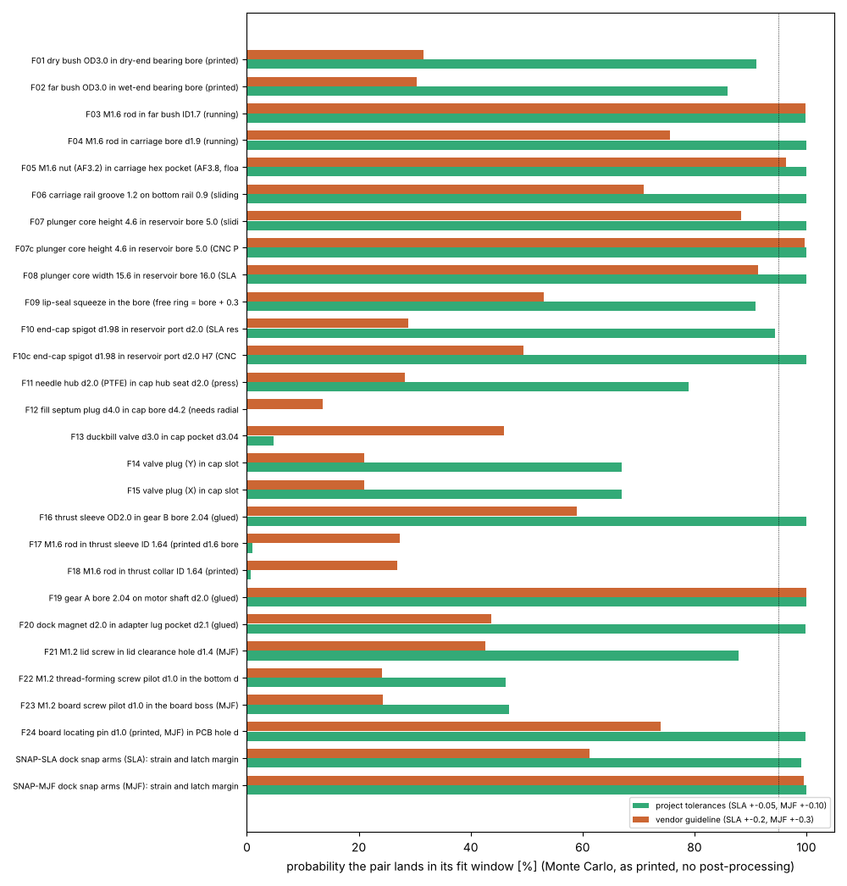

| id | pair | class | g nominal | window | project: ok / tight / loose | vendor: ok / tight / loose | status | post-processing needed | in guide |
|---|---|---|---|---|---|---|---|---|---|
| F01 | dry bush OD3.0 in dry-end bearing bore (printed) | transition | 0.046 | -0.05..0.1 | 91 / 9 / 0 % | 32 / 56 / 12 % | risk (vendor: **FAIL**) | vendor: 56 % too tight -> drill the bore to d3.05 by hand vendor: 12 % too loose -> one drop of CA on the bush OD | yes |
| F02 | far bush OD3.0 in wet-end bearing bore (printed) | transition | 0.037 | -0.05..0.1 | 86 / 14 / 0 % | 30 / 59 / 11 % | risk (vendor: **FAIL**) | project: 14 % too tight -> drill the bore to d3.05 by hand vendor: 59 % too tight -> drill the bore to d3.05 by hand vendor: 11 % too loose -> one drop of CA on the bush OD | yes |
| F03 | M1.6 rod in far bush ID1.7 (running) | running | 0.101 | 0.05..0.4 | 100 / 0 / 0 % | 100 / 0 / 0 % | OK (vendor: OK) | - | - |
| F04 | M1.6 rod in carriage bore d1.9 (running) | running | 0.303 | 0.05..0.4 | 100 / 0 / 0 % | 76 / 13 / 12 % | OK (vendor: risk) | vendor: 13 % too tight -> drill d1.9 vendor: 12 % too loose -> adhesive / shim / oversize the mating part | yes |
| F05 | M1.6 nut (AF3.2) in carriage hex pocket (AF3.8, float by design) | float | 0.6 | 0.1..0.8 | 100 / 0 / 0 % | 96 / 0 / 3 % | OK (vendor: OK) | - | - |
| F06 | carriage rail groove 1.2 on bottom rail 0.9 (sliding) | float | 0.3 | 0.1..0.8 | 100 / 0 / 0 % | 71 / 29 / 0 % | OK (vendor: **FAIL**) | vendor: 29 % too tight -> file the rail flanks | yes |
| F07 | plunger core height 4.6 in reservoir bore 5.0 (sliding, SLA reservoir) | float | 0.4 | 0.1..0.8 | 100 / 0 / 0 % | 88 / 11 / 0 % | OK (vendor: risk) | vendor: 11 % too tight -> hone the bore with a wrapped dowel / sand the core | yes |
| F07c | plunger core height 4.6 in reservoir bore 5.0 (CNC PP reservoir) | float | 0.4 | 0.1..0.8 | 100 / 0 / 0 % | 100 / 0 / 0 % | OK (vendor: OK) | - | - |
| F08 | plunger core width 15.6 in reservoir bore 16.0 (SLA reservoir, measured at z-1.0) | float | 0.437 | 0.1..0.8 | 100 / 0 / 0 % | 91 / 8 / 1 % | OK (vendor: risk) | - | - |
| F09 | lip-seal squeeze in the bore (free ring = bore + 0.3, from params seal.free_oversize) | squeeze | -0.3 | -0.4..-0.05 | 91 / 9 / 0 % | 53 / 45 / 2 % | risk (vendor: **FAIL**) | vendor: 45 % too tight -> ream / drill / sand to size | - |
| F10 | end-cap spigot d1.98 in reservoir port d2.0 (SLA reservoir) | transition | 0.018 | -0.05..0.1 | 94 / 6 / 0 % | 29 / 53 / 18 % | risk (vendor: **FAIL**) | vendor: 53 % too tight -> ream the port with a 2.0 drill by hand vendor: 18 % too loose -> reprint the cap / O-ring / UV adhesive | yes |
| F10c | end-cap spigot d1.98 in reservoir port d2.0 H7 (CNC PP reservoir) | transition | 0.018 | -0.05..0.1 | 100 / 0 / 0 % | 49 / 28 / 23 % | OK (vendor: **FAIL**) | vendor: 28 % too tight -> ream the port with a 2.0 drill by hand vendor: 23 % too loose -> reprint the cap / O-ring / UV adhesive | yes |
| F11 | needle hub d2.0 (PTFE) in cap hub seat d2.0 (press) | press | 0.001 | -0.12..-0.01 | 79 / 0 / 21 % | 28 / 40 / 32 % | risk (vendor: **FAIL**) | project: 21 % too loose -> UV adhesive drop (water test only) / flanged silicone hub vendor: 40 % too tight -> ream the seat with a 2.0 drill vendor: 32 % too loose -> UV adhesive drop (water test only) / flanged silicone hub | yes |
| F12 | fill septum plug d4.0 in cap bore d4.2 (needs radial squeeze) | squeeze | 0.2 | -0.4..-0.05 | 0 / 0 / 100 % | 14 / 0 / 86 % | **FAIL** (vendor: **FAIL**) | project: 100 % too loose -> punch a 4.2 mm plug / reduce the bore to d3.8 so the plug is squeezed vendor: 86 % too loose -> punch a 4.2 mm plug / reduce the bore to d3.8 so the plug is squeezed | yes |
| F13 | duckbill valve d3.0 in cap pocket d3.04 | squeeze | 0.042 | -0.4..-0.05 | 5 / 0 / 95 % | 46 / 1 / 53 % | **FAIL** (vendor: **FAIL**) | project: 95 % too loose -> pocket d2.8-2.9 for a silicone body (squeeze) or O-ring vendor: 53 % too loose -> pocket d2.8-2.9 for a silicone body (squeeze) or O-ring | **NO** |
| F14 | valve plug (Y) in cap slot | press | -0.08 | -0.12..-0.01 | 67 / 33 / 0 % | 21 / 59 / 20 % | **FAIL** (vendor: **FAIL**) | project: 33 % too tight -> sand the plug vendor: 59 % too tight -> sand the plug vendor: 20 % too loose -> CA drop / silicone sealant | - |
| F15 | valve plug (X) in cap slot | press | -0.08 | -0.12..-0.01 | 67 / 33 / 0 % | 21 / 59 / 20 % | **FAIL** (vendor: **FAIL**) | project: 33 % too tight -> sand the plug vendor: 59 % too tight -> sand the plug vendor: 20 % too loose -> CA drop / silicone sealant | - |
| F16 | thrust sleeve OD2.0 in gear B bore 2.04 (glued) | glued | 0.042 | -0.02..0.15 | 100 / 0 / 0 % | 59 / 27 / 14 % | OK (vendor: **FAIL**) | vendor: 27 % too tight -> use the brass tube sleeve (ground) vendor: 14 % too loose -> Loctite 638 (gap fill 0.25) | yes |
| F17 | M1.6 rod in thrust sleeve ID 1.64 (printed d1.6 bore) | running | 0.041 | 0.05..0.4 | 1 / 99 / 0 % | 27 / 72 / 0 % | **FAIL** (vendor: **FAIL**) | project: 99 % too tight -> use the brass tube sleeve / drill d1.7 vendor: 72 % too tight -> use the brass tube sleeve / drill d1.7 | yes |
| F18 | M1.6 rod in thrust collar ID 1.64 (printed) | running | 0.039 | 0.05..0.4 | 1 / 99 / 0 % | 27 / 73 / 0 % | **FAIL** (vendor: **FAIL**) | project: 99 % too tight -> use the brass tube collar / drill d1.7 vendor: 73 % too tight -> use the brass tube collar / drill d1.7 | yes |
| F19 | gear A bore 2.04 on motor shaft d2.0 (glued) | glued | 0.039 | -0.02..0.15 | 100 / 0 / 0 % | 100 / 0 / 0 % | OK (vendor: OK) | - | - |
| F20 | dock magnet d2.0 in adapter lug pocket d2.1 (glued) | glued | 0.1 | 0.0..0.2 | 100 / 0 / 0 % | 44 / 45 / 11 % | OK (vendor: **FAIL**) | vendor: 45 % too tight -> open the pocket with a 2.1 drill vendor: 11 % too loose -> CA drop | yes |
| F21 | M1.2 lid screw in lid clearance hole d1.4 (MJF) | clearance | 0.192 | 0.1..0.6 | 88 / 12 / 0 % | 43 / 57 / 0 % | risk (vendor: **FAIL**) | project: 12 % too tight -> drill d1.4 by hand vendor: 57 % too tight -> drill d1.4 by hand | yes |
| F22 | M1.2 thread-forming screw pilot d1.0 in the bottom dome (MJF) | pilot | d 0.997 | 0.95..1.1 | 46 / 54 / 0 % | 24 / 69 / 7 % | **FAIL** (vendor: **FAIL**) | project: 54 % too tight -> drill d1.0 by hand vendor: 69 % too tight -> drill d1.0 by hand | yes |
| F23 | M1.2 board screw pilot d1.0 in the board boss (MJF) | pilot | d 0.997 | 0.95..1.1 | 47 / 53 / 0 % | 24 / 69 / 7 % | **FAIL** (vendor: **FAIL**) | project: 53 % too tight -> drill d1.0 by hand vendor: 69 % too tight -> drill d1.0 by hand | yes |
| F24 | board locating pin d1.0 (printed, MJF) in PCB hole d1.2 | running | 0.208 | 0.05..0.4 | 100 / 0 / 0 % | 74 / 16 / 10 % | OK (vendor: **FAIL**) | vendor: 16 % too tight -> file the pin / drill the PCB hole vendor: 10 % too loose -> adhesive / shim / oversize the mating part | yes |
| SNAP-SLA | dock snap arms (SLA): strain and latch margin | snap | 1.908 | 0.3..None | 99 / 1 / 0 % | 61 / 39 / 0 % | OK (vendor: **FAIL**) | - | - |
| SNAP-MJF | dock snap arms (MJF): strain and latch margin | snap | 1.908 | 0.3..None | 100 / 0 / 0 % | 100 / 0 / 0 % | OK (vendor: OK) | - | - |

* dock snap arms (SLA): strain and latch margin: strain mean/p99 project 1.9/2.0 %, vendor 1.92/2.58 % vs limit 2 %.
* dock snap arms (MJF): strain and latch margin: strain mean/p99 project 1.91/2.11 %, vendor 1.95/2.9 % vs limit 3 %.

## 6. Fix proposals for the CAD owner (nothing was changed in the CAD)

* **M4 (Carriage sub-assembly lowered onto the rail, then slid -Y so):** Verified by two extra sweeps: lowered straight down the carriage itself is free, but the shim (z 3.5..4.9, y 17.5..21.5) hits the reservoir wall above the arm slot (the slot is a closed window z 3.4..5.0, wall above it up to z 7.5) and the plunger top; sliding the carriage in from +Y is impossible because the cradle/lane wall at y 24.9..26.9 (z <= 2.12) leaves no room. No order fixes this. Make the arm slot open to the top (slot cut from the reservoir top face down to z 3.4; the CNC drawing is frozen, so decide before ordering), or glue the shim into the plunger socket and give the carriage a top-open pocket, or move to the push-rod concept of docs/REVIEW-2026-11-19.md (no carriage, no shim).
* **M5 (Gear B + sleeve lowered into the gear plane):** Gear B with its sleeve (tail x 1.95..2.6) cannot be lowered: the dry bearing block (x up to 2.55, top z 6.38) covers the sleeve tail; sliding the sleeve in afterwards is impossible (carriage bore d1.9 < sleeve OD 2.0, and only 0.5 mm between gear B and the carriage). Use open-top (U) bearing cradles or end the sleeve tail at x >= 2.6, with the thrust shoulder moved to a ring on the rod.
* **M6 (Leadscrew inserted from the dock end through far bush, nut, ):** The 25 mm rod cannot be inserted from the dock end. Rays along the rod axis (y 22.5, z 4.2) hit solid at x 0..0.9 (dry-end wall: no entry from outside), x 32.0..33.6 (board support post POST1, centre 32.8/22.4), x 42.4..43.6 (board pin / post) and the end wall x 46.1..47.0; the free cavity from the far bush (x 25.6) to the end wall (x 46.1) is 20.5 mm, shorter than the rod (25 mm), so the rod would have to pass through the end wall as well. Options: (a) through-bore in the dry-end wall: rod from outside, bush pressed in from outside afterwards, closing plug; (b) open-top (U) bearing cradles so rod + carriage + gear B + sleeve + bushes go in as one module from above (the lid pads hold it down); (c) in any case move the board posts/pins off the rod axis (y 22.5). For OP-70 (rod 21 mm) the same walls apply.
* **M8 (Gear A slid onto the motor D-shaft from the dry end):** Sliding gear A onto the shaft needs x 1.0..2.4 free next to the dry-end wall; the wall region x 0.6..2.0 overlaps (7.1 mm3). Tested alternative X1 (section 2a): fit gear A on the shaft first and lower motor + gear A together, meshing with gear B.
* **M16 (Dock insert slid into the dock window from the +X mouth unti):** Two separate collisions. (1) After the board is fitted the front block of the dock insert (z up to 5.2) hits the dock-hall chip on the board (hall_dock, z 4.9..5.3, x 43.25..44.35, 0.3 mm deep): fit the insert before the board (tested, X1), or keep the insert top <= 4.8 mm, or move the chip. (2) Even before the board (X1) a 0.25 mm collision remains: the insert's flange band at z 0.5..0.75 (y 3.7..18.7) meets a floor rib of the bottom at x 32.95..33.45 while it slides in: add a lead-in/lower the rib by 0.3 mm. Also the dock mouth has 0.05 mm skins (x 46.95..47.0, bottom z 4.95..5.0 and lid z 5.01..5.2, reported as grazing): open the mouth cleanly.
* **A1 (Dock magnet d2x1 glued into the rear lug pocket of the dummy):** The dock-magnet pocket (d2.1 at x 43.8) overlaps the dome rim: the dome edge at x 43.2 leaves a 0.4 mm lip above z 4.4 over the pocket's -X side, so the magnet cannot be dropped in vertically. Move the pocket +0.5 mm in X (or lower the dome rim there) and re-check hall alignment.
* **D1 (Dock: dummy head pushed into the pod mouth, snap arms spread):** Grazing only (0.1 mm): the dome top (z 5.0) touches the dock-hall chip underside (z 4.9). Raise the board/chip or lower the dome by 0.2 mm.
* **fit F01 (dry bush OD3.0 in dry-end bearing bore (printed)):** the process spread alone is wider than the window: no nominal works as printed; vendor: 56 % too tight -> drill the bore to d3.05 by hand
* **fit F02 (far bush OD3.0 in wet-end bearing bore (printed)):** the process spread alone is wider than the window: no nominal works as printed; project: 14 % too tight -> drill the bore to d3.05 by hand
* **fit F09 (lip-seal squeeze in the bore (free ring = bore + 0.3, f):** shift the hole by +0.05 mm in the CAD to bring 98 % of the project-tolerance spread into the window; vendor: 45 % too tight -> ream / drill / sand to size
* **fit F11 (needle hub d2.0 (PTFE) in cap hub seat d2.0 (press)):** shift the hole by -0.04 mm in the CAD to bring 98 % of the project-tolerance spread into the window; project: 21 % too loose -> UV adhesive drop (water test only) / flanged silicone hub
* **fit F12 (fill septum plug d4.0 in cap bore d4.2 (needs radial sq):** shift the hole by -0.31 mm in the CAD to bring 98 % of the project-tolerance spread into the window; project: 100 % too loose -> punch a 4.2 mm plug / reduce the bore to d3.8 so the plug is squeezed
* **fit F13 (duckbill valve d3.0 in cap pocket d3.04):** shift the hole by -0.15 mm in the CAD to bring 98 % of the project-tolerance spread into the window; project: 95 % too loose -> pocket d2.8-2.9 for a silicone body (squeeze) or O-ring
* **fit F14 (valve plug (Y) in cap slot):** shift the hole by +0.04 mm in the CAD to bring 98 % of the project-tolerance spread into the window; project: 33 % too tight -> sand the plug
* **fit F15 (valve plug (X) in cap slot):** shift the hole by +0.04 mm in the CAD to bring 98 % of the project-tolerance spread into the window; project: 33 % too tight -> sand the plug
* **fit F17 (M1.6 rod in thrust sleeve ID 1.64 (printed d1.6 bore)):** shift the hole by +0.08 mm in the CAD to bring 98 % of the project-tolerance spread into the window; project: 99 % too tight -> use the brass tube sleeve / drill d1.7
* **fit F18 (M1.6 rod in thrust collar ID 1.64 (printed)):** shift the hole by +0.08 mm in the CAD to bring 98 % of the project-tolerance spread into the window; project: 99 % too tight -> use the brass tube collar / drill d1.7
* **fit F21 (M1.2 lid screw in lid clearance hole d1.4 (MJF)):** shift the hole by +0.04 mm in the CAD to bring 98 % of the project-tolerance spread into the window; project: 12 % too tight -> drill d1.4 by hand
* **fit F22 (M1.2 thread-forming screw pilot d1.0 in the bottom dome):** the process spread alone is wider than the window: no nominal works as printed; project: 54 % too tight -> drill d1.0 by hand
* **fit F23 (M1.2 board screw pilot d1.0 in the board boss (MJF)):** the process spread alone is wider than the window: no nominal works as printed; project: 53 % too tight -> drill d1.0 by hand
* **Tolerance reality check (all printed fits).** JLC3DP quotes SLA +-0.2 mm (holes +-0.3 mm) and MJF +-0.3 mm (holes +-0.3 mm) and says holes shrink; the CAD/sim assume SLA +-0.05 and MJF +-0.10, the fab README orders +-0.1 / +-0.2. With the vendor numbers most 0.02..0.1 mm press/slip fits in section 5 are a lottery as printed. Either design to the vendor clearances (SLA 0.2 assembled / 0.5 moving, MJF 0.2-0.4 / 0.6) or make the finishing step (ream, drill, sand, brass part) an explicit build-guide step per pair, and order a bore/pin calibration coupon first to measure the real `hole_bias`.
* **End cap (SLA).** The d4.2 septum bore sits in a block of only 4.4 x 4.3 mm (x 25.8..30.2, z 0.9..5.2), i.e. 0.1 mm walls, and the bore is tangent to the cap's bottom face (bore axis z 3.0, radius 2.1, face z 0.9): zero-thickness skins over about 1300 samples, i.e. a probable hole through the cap floor. Make the block >= 5.4 mm wide and move the bore axis up >= 0.5 mm, or use a smaller plug. The d0.7 channels (up to 17 mm long, three jogs) are beyond the vendor hole table (d1.0 only to 3 mm deep): they cannot be printed or flushed; use straight drilled channels or inserted tubing.
* **Carriage / plunger core (SLA).** Sub-0.1 mm knife edges at the end of the shim pocket (carriage y 21.6) and at the plunger socket edge (z 4.85..5.05, y 18.85): remove the tiny steps; the 0.55 mm shim pocket (vendor minimum 1.0 mm) and the 0.24 mm walls beside it are below the SLA hard floor 0.4 mm: widen the carriage near the pocket or make the shim pocket a cut-out through a thicker boss.
* **MJF housings (bottom, top, dock fixture).** 0.05 mm membranes at the dock mouth (x 46.95..47.0) and at the motor floor relief (z 0.35, x 18..24, y 25..28), slots of 0.2-0.6 mm (dry-end wall at x 1.0..2.4) and 0.4-0.5 mm shell walls are below the MJF hard floor 0.5 mm; 95 % of the wall area is thinner than JLC3DP's recommended 1.4-1.5 mm. Expect the vendor DFM review to reject or thicken them: raise walls to >= 0.8 mm where space allows, delete the membranes, and keep M1.2 pilots/clearance holes (d1.0 / d1.4 < vendor minimum 1.5 mm) as drilled features (already in the build guide).
* **Thrust sleeve and collar (SLA).** Wall 0.2 mm (sleeve) and 0.4 mm (collar) are below the SLA hard floor: use the brass tube versions (the fab README already prefers them) and drop the printed files from the order.
* **CNC reservoir (PP).** Wall 0.8 mm is below the JLCCNC absolute minimum for plastics (1.0 mm; 1.5 mm recommended) on all three sizes; PCBWay's own limit was not found, ask them before the order. The arm slot (1.6 mm) needs a small end mill, the D5 tool only makes the R2.5 bore ends; OP-200's bore depth/D is 6.5 (special long-reach tool, see the CNC README).

