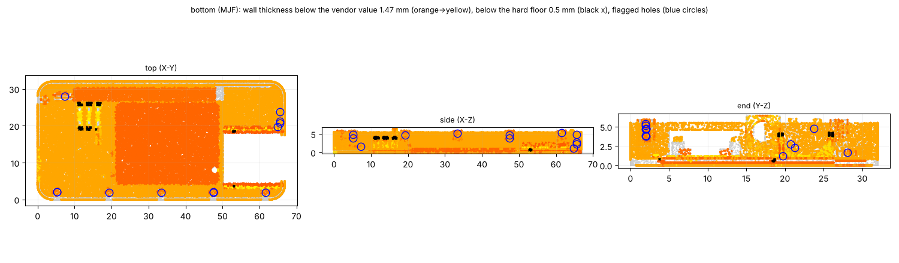
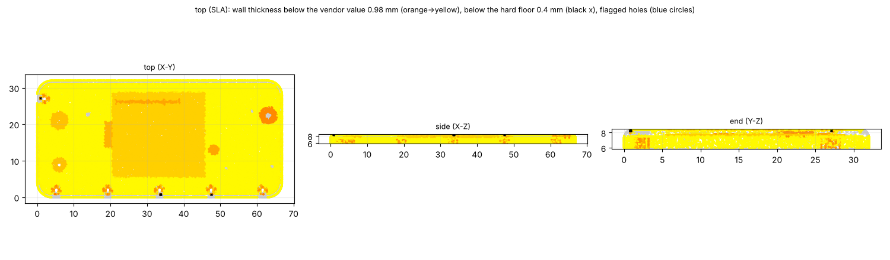
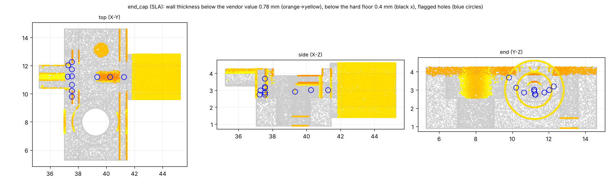
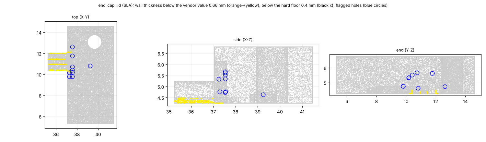
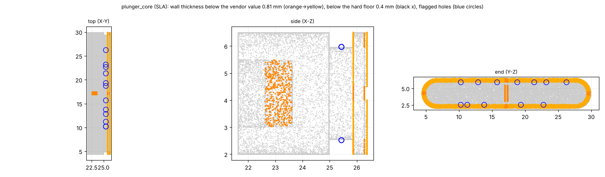
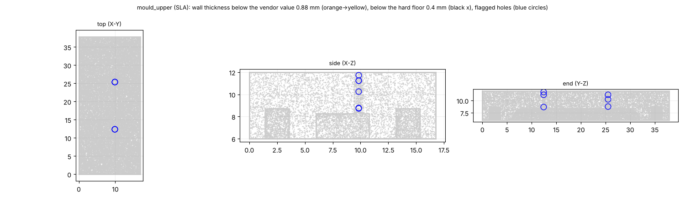
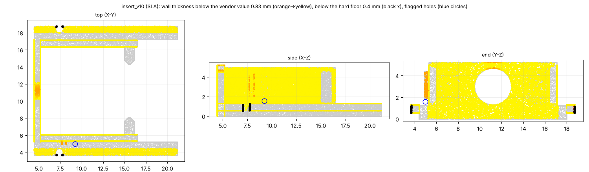
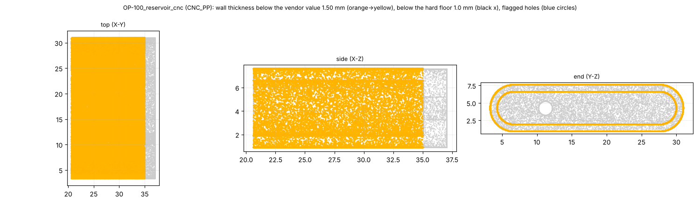
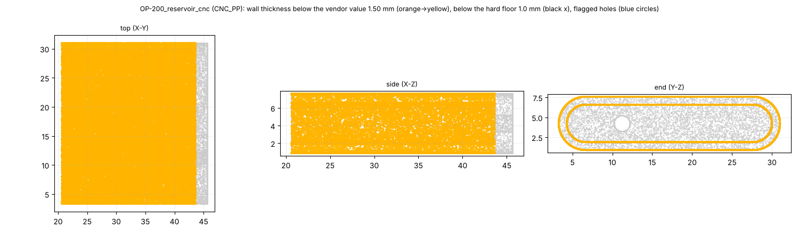
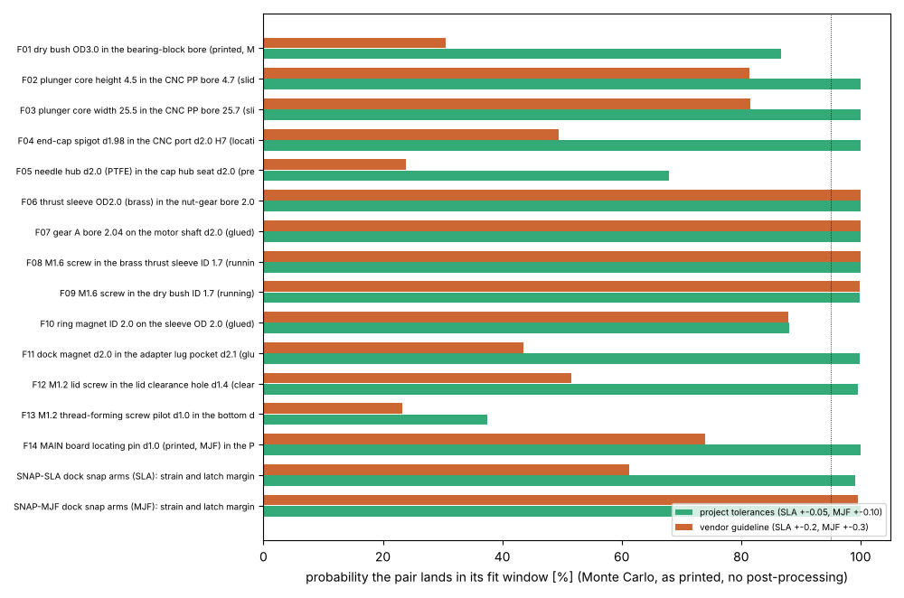

# Assembly-feasibility and DFM report, v0.1.0 integrated pod OP-200

> **TEST PROJECT: NOT A MEDICAL DEVICE. WATER ONLY. Never worn, never filled with insulin or any drug** (see `DISCLAIMER.md`). Generated by `mechanical/check_assembly.py`; do not edit by hand.

* CAD: `out/v010/OP-200.sc` sha256 `2732099442e2`, 54 bodies, meshes standard quality; sweep step 0.25 mm; run 2026-11-19
* Rules: `dfm_rules.json` (vendor numbers with sources and retrieval date), sequence: `assembly_sequence_v010.json`
* Overlap criterion: boolean-intersection volume > 1e-4 mm3 (as `check.py`); a grazing overlap (thinnest side <= 0.15 mm) is reported as *marginal*

## 1. Summary (the honest answer)

**Can the parts be assembled? Yes, in the documented order, with the documented post-processing** (every printed fit that cannot be held as printed with the vendor tolerances has a post-process step in the assembly guide). The final assembled state is clean (`check.py`); replaying the documented order with real insertion paths gives **0 blocked step(s)** of 32 (0 more are grazing/marginal), **0 tool-access failure(s)** (0 tight), **0 of 11 order files with a feature below the process hard floor**, and **2 fit(s) that fail and 2 at risk** as printed (Monte Carlo, project tolerances).

| area | result |
|---|---|
| fit F05 needle hub d2.0 (PTFE) in the cap hub seat d2.0 (p | **FAIL as printed** project: 68 % in window; vendor: 24 %; post-process documented in the assembly guide |
| fit F13 M1.2 thread-forming screw pilot d1.0 in the bottom | **FAIL as printed** project: 38 % in window; vendor: 23 %; post-process documented in the assembly guide |

What was **not** checked (limits of this tool): flexible parts (motor lead wires, FFC cable bending, silicone seals) are rigid meshes or absent; no friction/force model (press-in forces); purchased parts are the CAD stand-ins (motor, gears are tip-circle cylinders, thread not modelled); the lid-screw head is not a body; vendor numbers are a snapshot of their web pages.

## 2. Assembly sequence: insertion paths

Each part moves from outside to its CAD position along the path in `assembly_sequence.json` (increment 0.25 mm); `s` = distance still to travel. Engagement overlaps with the intended mating part (press zone / snap arms / stretched rings) are tolerated and listed under *events*.

| step | what (build guide) | tool | status | first collision / notes |
|---|---|---|---|---|
| P1 | Front seal bead ring B (cast silicone) stretched over the core into the front groove (ASSEMBLY.md) | hand (stretch over the core) | OK |  elastic ring stretch over plunger_core (overlap 15.1494 mm3) |
| C1 | O-ring 2.0 x 0.7 stretched over the spigot into the face groove of the end cap (ASSEMBLY.md) | tweezers | OK |  press zone end_cap: overlap 0.0001 mm3 over the last 0.00 mm |
| C2 | Silicone sheet gasket laid into the 0.4 mm recess of the end cap (ASSEMBLY.md) | tweezers | OK |  |
| C3 | Septum disc d3.2 x 2 dropped into the septum pocket (open top) (ASSEMBLY.md) | tweezers | OK |  |
| C4 | End cap lid lowered on the lands (clamp screws follow once the module sits in the pod) (ASSEMBLY.md) | finger | OK |  press zone end_cap: overlap 0.0238 mm3 over the last 0.25 mm press zone cap_oring: overlap 0.9083 mm3 over the last 1.50 mm press zone cap_gasket: overlap 1.5611 mm3 over the last 0.00 mm |
| R1 | Plunger (core + front bead) pushed into the reservoir from the open dry end (ASSEMBLY.md) | finger | OK |  |
| R2 | Fluid module (cap sandwich with O-ring) pressed onto the reservoir end: spigot into the port, O-ring on the end face (ASSEMBLY.md) | finger | OK |  press zone reservoir: overlap 0.7058 mm3 over the last 0.00 mm |
| M1 | Dry bush pressed into the bearing-block bore (reamed d3.05) (ASSEMBLY.md) | tweezers | OK |  |
| M2 | FPC spine laid into the floor channel (it passes UNDER the reservoir; riser at the contact shelf) (ASSEMBLY.md) | tweezers | OK |  |
| M3 | Motor (rear boss, motor, gearbox, front boss, shaft, terminal block + pins) laid into the three saddles, terminal pins facing +Y (ASSEMBLY.md) | tweezers | OK |  |
| M4 | Gear A (z16) slid onto the motor shaft from the front and glued (ASSEMBLY.md) | tweezers | OK |  |
| G1 | Thrust sleeve (brass tube) glued into the nut gear (ASSEMBLY.md) | tweezers | OK |  |
| G2 | Diametric ring magnet pushed over the rear end of the sleeve and glued (pole direction marked) (ASSEMBLY.md) | tweezers | OK |  press zone thrust_sleeve2: overlap 0.0015 mm3 over the last 1.25 mm |
| G3 | M1.6 nut glued (Loctite 638) on the front face of the nut gear (ASSEMBLY.md) | tweezers | OK |  |
| M5 | Nut-gear pack lowered into the bearing block, meshing with gear A (ASSEMBLY.md) | tweezers | OK |  press zone gear_a: overlap 1.0854 mm3 over the last 2.25 mm |
| M6 | Reservoir sub-assembly lowered and slid 1.2 mm toward -X over the nut (the nut protrudes into the bore opening) (ASSEMBLY.md) | finger | OK |  |
| M7 | Needle + hub pressed into the guard tube from the dock mouth (ASSEMBLY.md) | tweezers | OK |  press zone end_cap: overlap 0.1747 mm3 over the last 3.25 mm |
| M8 | Drive screw (the only rod) inserted from the REAR through the rear-wall hole, turned through the nut with a pin vise until the slot meets the plunger tab (ASSEMBLY.md) | pin vise | OK |  |
| M9 | Silicone stopper pressed into the rear-wall hole (ASSEMBLY.md) | tweezers | OK |  |
| M10 | USB-C gasket frame laid against the inside of the rear wall (ASSEMBLY.md) | tweezers | OK |  |
| M11 | Waterproof USB-C receptacle pushed to the rear wall (nose through the opening, flange on the gasket) (ASSEMBLY.md) | finger | OK |  |
| M12 | USB board dropped behind the receptacle (ASSEMBLY.md) | tweezers | OK |  |
| M13 | SENSOR board with the TMAG5273 lowered onto three posts / pins beside the ring magnet (ASSEMBLY.md) | tweezers | OK |  |
| M14 | Motor contact card (4 SMD spring contacts) lowered into its slot, springs wipe onto the motor pin tips (ASSEMBLY.md) | tweezers | OK |  |
| M15 | Li-Po cell on 0.6 mm foam tape, tabs up, between the two bay ribs (ASSEMBLY.md) | tweezers | OK |  |
| M16 | Dock insert slid into the dock window from the +X mouth until the detents click (before the board: the dock hall chip hangs below it) (ASSEMBLY.md) | finger | OK |  flexible part crosses the path (overlap 0.1147 mm3): must be threaded/lifted by hand |
| M17 | MAIN board (radio, button, dock hall, 2 cell springs, 8 spine springs) lowered onto the pins (ASSEMBLY.md) | tweezers | OK |  |
| M18 | Main gasket laid on the wall top (ASSEMBLY.md) | tweezers | OK |  |
| L1 | Piezo glued to the lid inner face (ePTFE vent disc and PU film glued into their recesses) (ASSEMBLY.md) | tweezers | OK |  |
| M19 | Clear lid with piezo lowered straight down (ASSEMBLY.md) | finger | OK |  |
| A1 | Dock magnet d2 x 1 glued into the rear lug pocket of the dummy head (ASSEMBLY.md) | tweezers | OK |  |
| D1 | Dock: dummy head pushed into the pod mouth, snap arms spread and latch behind the dome (ASSEMBLY.md) | finger | OK |  snap: deflection [1.808, 1.808] mm, arm strain 1.88 % vs 2 % (SLA_TOUGH); CAD travel 1.908 mm = 1.98 % |

## 3. Tool and finger access

Screwdriver model: tip D1.5 / D2.0 x 2.0 mm, shaft D3.0 up to 15.0 mm above the head, handle D12.0 beyond; must stay free when tilted 10 deg in 8 directions. Tweezers: cone half angle 10 deg, tip D0.6, length 10.0 mm, apex on the trailing face of the part, approach opposite the insertion direction, tilted up to 45 deg allowed. ZIF: lever swing box above the connector rear edge + tweezer approach.

| item | status | detail |
|---|---|---|
| C1 O-ring 2.0 x 0.7 stretched over the spigot into the face gro | OK | free cone half angle 30 deg (need 10); blockers: - |
| C2 Silicone sheet gasket laid into the 0.4 mm recess of the end | OK | free cone half angle 30 deg (need 10); blockers: - |
| C3 Septum disc d3.2 x 2 dropped into the septum pocket (open to | OK | free cone half angle 30 deg (need 10); blockers: - |
| M1 Dry bush pressed into the bearing-block bore (reamed d3.05) | OK | free cone half angle 30 deg (need 10); blockers: - |
| M2 FPC spine laid into the floor channel (it passes UNDER the r | OK | free cone half angle 30 deg (need 10); blockers: - |
| M3 Motor (rear boss, motor, gearbox, front boss, shaft, termina | OK | free cone half angle 30 deg (need 10); blockers: - |
| M4 Gear A (z16) slid onto the motor shaft from the front and gl | OK | free cone half angle 30 deg (need 10); blockers: - |
| G1 Thrust sleeve (brass tube) glued into the nut gear | OK | free cone half angle 30 deg (need 10); blockers: - |
| G2 Diametric ring magnet pushed over the rear end of the sleeve | OK | free cone half angle 30 deg (need 10); blockers: - |
| G3 M1.6 nut glued (Loctite 638) on the front face of the nut ge | OK | free cone half angle 30 deg (need 10); blockers: - |
| M5 Nut-gear pack lowered into the bearing block, meshing with g | OK | free cone half angle 30 deg (need 10); blockers: - |
| M7 Needle + hub pressed into the guard tube from the dock mouth | OK | free cone half angle 30 deg (need 10); blockers: - |
| M9 Silicone stopper pressed into the rear-wall hole | OK | free cone half angle 30 deg (need 10); blockers: - |
| M10 USB-C gasket frame laid against the inside of the rear wall | OK | free cone half angle 30 deg (need 10); blockers: - |
| M12 USB board dropped behind the receptacle | OK | free cone half angle 30 deg (need 10); blockers: - |
| M13 SENSOR board with the TMAG5273 lowered onto three posts / pi | OK | free cone half angle 30 deg (need 10); blockers: - |
| M14 Motor contact card (4 SMD spring contacts) lowered into its  | OK | free cone half angle 30 deg (need 10); blockers: - |
| M15 Li-Po cell on 0.6 mm foam tape, tabs up, between the two bay | OK | free cone half angle 30 deg (need 10); blockers: - |
| M17 MAIN board (radio, button, dock hall, 2 cell springs, 8 spin | OK | free cone half angle 30 deg (need 10); blockers: - |
| M18 Main gasket laid on the wall top | OK | free cone half angle 30 deg (need 10); blockers: - |
| L1 Piezo glued to the lid inner face (ePTFE vent disc and PU fi | OK | free cone half angle 30 deg (need 10); blockers: - |
| A1 Dock magnet d2 x 1 glued into the rear lug pocket of the dum | OK | free cone half angle 30 deg (need 10); blockers: - |
| S-cap-1 fluid sandwich clamp screw 1 | OK | seat z 7.3, free tilt tip1.5 20 deg / tip2.0 20 deg (need 10), min tip length that clears: 0.25 mm; blockers: - |
| S-lid-1 lid screw 1 | OK | seat z 8.4, free tilt tip1.5 20 deg / tip2.0 20 deg (need 10), min tip length that clears: 0.25 mm; blockers: - |
| S-lid-2 lid screw 2 | OK | seat z 8.4, free tilt tip1.5 20 deg / tip2.0 20 deg (need 10), min tip length that clears: 0.25 mm; blockers: - |
| S-lid-3 lid screw 3 | OK | seat z 8.4, free tilt tip1.5 20 deg / tip2.0 20 deg (need 10), min tip length that clears: 0.25 mm; blockers: - |
| S-lid-4 lid screw 4 | OK | seat z 8.4, free tilt tip1.5 20 deg / tip2.0 20 deg (need 10), min tip length that clears: 0.25 mm; blockers: - |
| S-lid-5 lid screw 5 | OK | seat z 8.4, free tilt tip1.5 20 deg / tip2.0 20 deg (need 10), min tip length that clears: 0.25 mm; blockers: - |
| S-lid-6 lid screw 6 | OK | seat z 8.4, free tilt tip1.5 20 deg / tip2.0 20 deg (need 10), min tip length that clears: 0.25 mm; blockers: - |

## 4. DFM against the vendor rules

Wall thickness = inward ray from 60 000 surface samples to the first opposite surface (vendor table value interpolated by part footprint; hard floor = below this the feature is not reliably producible). Void width = outward ray; round holes/channels are separated from slots by sampling the cross-section; depth along the axis. CNC: section ring curvature and axial depth.

| part | process | extents [mm] | min wall | % wall < vendor | vendor / floor | flagged voids | verdict |
|---|---|---|---|---|---|---|---|
| bottom | MJF | 66.85 x 32.0 x 6.43 | 0.48 | 90.7 | 1.47 / 0.5 | 12 | warn |
| top | SLA | 66.85 x 32.0 x 2.45 | 0.20 | 90.9 | 0.98 / 0.4 | 0 | warn |
| end_cap | SLA | 10.0 x 9.3 x 3.7 | 0.42 | 33.5 | 0.78 / 0.4 | 11 | warn |
| end_cap_lid | SLA | 6.2 x 9.3 x 2.55 | 0.53 | 0.6 | 0.66 / 0.4 | 9 | warn |
| plunger_core | SLA | 4.76 x 25.5 x 4.5 | 0.42 | 12.4 | 0.81 / 0.4 | 12 | warn |
| mould_lower | SLA | 16.76 x 37.85 x 8.5 | 1.93 | 0.0 | 0.88 / 0.4 | 0 | OK |
| mould_upper | SLA | 16.76 x 37.85 x 6.0 | 1.46 | 0.0 | 0.88 / 0.4 | 6 | warn |
| insert_v01 | SLA | 16.7 x 15.1 x 5.2 | 0.00 | 62.8 | 0.83 / 0.4 | 1 | warn |
| insert_v10 | SLA | 16.7 x 15.1 x 5.2 | 0.00 | 61.7 | 0.83 / 0.4 | 1 | warn |
| OP-100_reservoir_cnc | CNC_PP | 16.42 x 27.7 x 6.7 | 1.04 | 85.6 | 1.50 / 1.0 | 0 | warn |
| OP-200_reservoir_cnc | CNC_PP | 25.03 x 27.7 x 6.7 | 1.04 | 90.5 | 1.50 / 1.0 | 0 | warn |

### 4a. Violations with location (pod coordinates of the mesh)

**bottom** (MJF, qty 1)

* WARN: 90.7 % of the wall samples thinner than the vendor value 1.47 mm for a 46 mm part (min 0.48 mm)
* WARN: slot/channel width 0.86 mm < vendor minimum 1.5 mm (MJF); post-drill/ream it at [65.58, 20.75, 2.78] and 1 more place(s), e.g. [65.58, 21.25, 2.3]
* WARN: slot/channel width 0.91 mm < vendor minimum 1.5 mm (MJF); post-drill/ream it at [65.57, 23.76, 4.77]
* WARN: slot/channel width 0.97 mm < vendor minimum 1.5 mm (MJF); post-drill/ream it at [7.3, 28.06, 1.63]
* WARN: hole width 0.99 mm < vendor minimum 1.5 mm (MJF); post-drill/ream it at [33.37, 1.99, 5.18] and 2 more place(s), e.g. [5.19, 2.0, 4.79]
* WARN: slot/channel width 0.99 mm < vendor minimum 1.5 mm (MJF); post-drill/ream it at [64.8, 19.74, 1.18]
* WARN: hole width 1.00 mm < vendor minimum 1.5 mm (MJF); post-drill/ream it at [5.2, 2.01, 3.79] and 3 more place(s), e.g. [47.47, 2.01, 4.66]

**top** (SLA, qty 1)

* WARN: 90.9 % of the wall samples thinner than the vendor value 0.98 mm for a 46 mm part (min 0.20 mm)

**end_cap** (SLA, qty 2)

* WARN: 33.5 % of the wall samples thinner than the vendor value 0.78 mm for a 10 mm part (min 0.42 mm)
* WARN: slot/channel width 0.49 mm < vendor minimum 1.0 mm (SLA); post-drill/ream it at [37.56, 10.64, 2.86]
* WARN: slot/channel width 0.52 mm < vendor minimum 1.0 mm (SLA); post-drill/ream it at [37.55, 10.2, 3.14]
* WARN: slot/channel width 0.54 mm < vendor minimum 1.0 mm (SLA); post-drill/ream it at [37.54, 11.74, 2.86]
* WARN: slot/channel width 0.55 mm < vendor minimum 1.0 mm (SLA); post-drill/ream it at [37.54, 9.82, 3.69]
* WARN: slot/channel width 0.56 mm < vendor minimum 1.0 mm (SLA); post-drill/ream it at [37.54, 12.25, 3.2]
* WARN: slot/channel width 0.57 mm < vendor minimum 1.0 mm (SLA); post-drill/ream it at [39.33, 11.2, 2.92]
* WARN: slot/channel width 0.60 mm < vendor minimum 1.0 mm (SLA); post-drill/ream it at [37.54, 11.26, 2.76]
* WARN: slot/channel width 0.82 mm < vendor minimum 1.0 mm (SLA); post-drill/ream it at [37.29, 12.02, 2.99]
* WARN: hole width 0.90 mm < vendor minimum 1.0 mm (SLA); post-drill/ream it at [41.26, 11.2, 3.01] and 1 more place(s), e.g. [40.25, 11.2, 3.01]
* WARN: slot/channel width 0.98 mm < vendor minimum 1.0 mm (SLA); post-drill/ream it at [37.25, 11.23, 2.76]

**end_cap_lid** (SLA, qty 2)

* WARN: 0.6 % of the wall samples thinner than the vendor value 0.66 mm for a 8 mm part (min 0.53 mm)
* WARN: slot/channel width 0.54 mm < vendor minimum 1.0 mm (SLA); post-drill/ream it at [37.55, 9.8, 4.76] and 1 more place(s), e.g. [37.54, 10.41, 5.52]
* WARN: slot/channel width 0.56 mm < vendor minimum 1.0 mm (SLA); post-drill/ream it at [37.54, 10.73, 5.67] and 1 more place(s), e.g. [37.54, 10.19, 5.35]
* WARN: slot/channel width 0.57 mm < vendor minimum 1.0 mm (SLA); post-drill/ream it at [37.54, 11.77, 5.63] and 1 more place(s), e.g. [37.54, 12.61, 4.74]
* WARN: slot/channel width 0.71 mm < vendor minimum 1.0 mm (SLA); post-drill/ream it at [39.24, 10.8, 4.63]
* WARN: slot/channel width 0.80 mm < vendor minimum 1.0 mm (SLA); post-drill/ream it at [37.25, 10.17, 5.33]
* WARN: slot/channel width 0.86 mm < vendor minimum 1.0 mm (SLA); post-drill/ream it at [37.28, 9.8, 4.76]

**plunger_core** (SLA, qty 2)

* WARN: 12.4 % of the wall samples thinner than the vendor value 0.81 mm for a 11 mm part (min 0.42 mm)
* WARN: slot/channel width 0.56 mm < vendor minimum 1.0 mm (SLA); post-drill/ream it at [25.42, 11.22, 2.53] and 1 more place(s), e.g. [25.42, 15.74, 5.97]
* WARN: slot/channel width 0.57 mm < vendor minimum 1.0 mm (SLA); post-drill/ream it at [25.42, 18.76, 5.97] and 2 more place(s), e.g. [25.42, 10.27, 5.97]
* WARN: slot/channel width 0.58 mm < vendor minimum 1.0 mm (SLA); post-drill/ream it at [25.42, 10.26, 2.53] and 6 more place(s), e.g. [25.42, 22.74, 2.53]

**mould_upper** (SLA, qty 1)

* WARN: hole width 0.50 mm < vendor minimum 1.0 mm (SLA); post-drill/ream it at [9.8, 12.43, 11.27] and 1 more place(s), e.g. [9.8, 12.43, 8.74]
* WARN: slot/channel width 0.50 mm < vendor minimum 1.0 mm (SLA); post-drill/ream it at [9.8, 12.42, 11.75]
* WARN: hole width 0.80 mm < vendor minimum 1.0 mm (SLA); post-drill/ream it at [9.8, 25.42, 10.26] and 1 more place(s), e.g. [9.8, 25.42, 11.25]
* WARN: slot/channel width 0.80 mm < vendor minimum 1.0 mm (SLA); post-drill/ream it at [9.8, 25.42, 8.78]

**insert_v01** (SLA, qty -)

* WARN: zero-thickness skin (0.001 mm): coincident or tangent faces, e.g. a bore tangent to an outer face; the slicer will drop or crack it (SLA) at [7.71, 18.75, 0.65] (51 samples)
* WARN: zero-thickness skin (0.002 mm): coincident or tangent faces, e.g. a bore tangent to an outer face; the slicer will drop or crack it (SLA) at [7.09, 3.65, 0.98] (16 samples)
* WARN: zero-thickness skin (0.003 mm): coincident or tangent faces, e.g. a bore tangent to an outer face; the slicer will drop or crack it (SLA) at [7.08, 3.65, 1.01] (24 samples)
* WARN: zero-thickness skin (0.017 mm): coincident or tangent faces, e.g. a bore tangent to an outer face; the slicer will drop or crack it (SLA) at [7.08, 18.74, 1.06] (19 samples)
* WARN: 62.8 % of the wall samples thinner than the vendor value 0.83 mm for a 16 mm part (min 0.00 mm)
* WARN: slot/channel width 0.60 mm < vendor minimum 1.0 mm (SLA); post-drill/ream it at [7.86, 5.15, 1.58]

**insert_v10** (SLA, qty -)

* WARN: zero-thickness skin (0.000 mm): coincident or tangent faces, e.g. a bore tangent to an outer face; the slicer will drop or crack it (SLA) at [7.09, 18.75, 1.1] (13 samples)
* WARN: zero-thickness skin (0.001 mm): coincident or tangent faces, e.g. a bore tangent to an outer face; the slicer will drop or crack it (SLA) at [7.09, 18.75, 0.81] (39 samples)
* WARN: zero-thickness skin (0.003 mm): coincident or tangent faces, e.g. a bore tangent to an outer face; the slicer will drop or crack it (SLA) at [7.72, 3.65, 0.65] (17 samples)
* WARN: zero-thickness skin (0.006 mm): coincident or tangent faces, e.g. a bore tangent to an outer face; the slicer will drop or crack it (SLA) at [7.08, 3.65, 1.1] (14 samples)
* WARN: 61.7 % of the wall samples thinner than the vendor value 0.83 mm for a 16 mm part (min 0.00 mm)
* WARN: slot/channel width 0.60 mm < vendor minimum 1.0 mm (SLA); post-drill/ream it at [9.22, 4.96, 1.58]

**OP-100_reservoir_cnc** (CNC_PP, qty 2)

* WARN: 85.6 % of the wall samples thinner than the vendor value 1.50 mm for a 21 mm part (min 1.04 mm)
* WARN: 16 sharp inner corner samples (R < 0.5 mm), e.g. the arm slot: needs an end mill no wider than the slot (1.6 mm), not the D5 tool

**OP-200_reservoir_cnc** (CNC_PP, qty 2)

* WARN: 90.5 % of the wall samples thinner than the vendor value 1.50 mm for a 26 mm part (min 1.04 mm)
* WARN: 14 sharp inner corner samples (R < 0.5 mm), e.g. the arm slot: needs an end mill no wider than the slot (1.6 mm), not the D5 tool

### 4b. Parts that cannot be made as drawn

None.

## 5. Fit classes and process tolerance

Gap g = hole - shaft measured on the CAD meshes (negative = interference). Monte Carlo (40 000 draws): hole = nominal + bias + N(0, tol/k), shaft = nominal + N(0, tol/k); 'project' = tolerances the CAD/sim assume, 'vendor' = tolerances the vendor guide quotes. The window is the range of g where the pair works as intended (class defaults in `dfm_rules.json`). Post-processing = what has to be done to the part when the as-printed probability is poor; the last column says whether the build guide mentions it.

| id | pair | class | g nominal | window | project: ok / tight / loose | vendor: ok / tight / loose | status | post-processing needed | in guide |
|---|---|---|---|---|---|---|---|---|---|
| F01 | dry bush OD3.0 in the bearing-block bore (printed, MJF) | transition | 0.038 | -0.05..0.1 | 87 / 13 / 0 % | 30 / 58 / 11 % | risk (vendor: **FAIL**) | project: 13 % too tight -> ream the bore with a 3.05 mm drill by hand vendor: 58 % too tight -> ream the bore with a 3.05 mm drill by hand vendor: 11 % too loose -> one drop of CA on the bush OD | yes |
| F02 | plunger core height 4.5 in the CNC PP bore 4.7 (sliding) | float | 0.2 | 0.1..0.8 | 100 / 0 / 0 % | 81 / 19 / 0 % | OK (vendor: risk) | vendor: 19 % too tight -> sand the core flanges with 1500 grit on a flat stick | yes |
| F03 | plunger core width 25.5 in the CNC PP bore 25.7 (sliding) | float | 0.201 | 0.1..0.8 | 100 / 0 / 0 % | 82 / 18 / 0 % | OK (vendor: risk) | vendor: 18 % too tight -> sand the core flanges with 1500 grit on a flat stick | yes |
| F04 | end-cap spigot d1.98 in the CNC port d2.0 H7 (locating, transition) | transition | 0.02 | -0.05..0.1 | 100 / 0 / 0 % | 50 / 27 / 24 % | OK (vendor: **FAIL**) | vendor: 27 % too tight -> sand the spigot to d1.95 (1500 grit, rotate in a drill) vendor: 24 % too loose -> the O-ring seals; a drop of UV adhesive locates the cap | yes |
| F05 | needle hub d2.0 (PTFE) in the cap hub seat d2.0 (press) | press | -0.079 | -0.12..-0.01 | 68 / 32 / 0 % | 24 / 60 / 16 % | **FAIL** (vendor: **FAIL**) | project: 32 % too tight -> ream the seat with a 2.0 mm drill vendor: 60 % too tight -> ream the seat with a 2.0 mm drill vendor: 16 % too loose -> UV adhesive drop (water test only) | yes |
| F06 | thrust sleeve OD2.0 (brass) in the nut-gear bore 2.04 (glued) | glued | 0.042 | -0.02..0.15 | 100 / 0 / 0 % | 100 / 0 / 0 % | OK (vendor: OK) | - | - |
| F07 | gear A bore 2.04 on the motor shaft d2.0 (glued) | glued | 0.02 | -0.02..0.15 | 100 / 0 / 0 % | 100 / 0 / 0 % | OK (vendor: OK) | - | - |
| F08 | M1.6 screw in the brass thrust sleeve ID 1.7 (running) | running | 0.099 | 0.05..0.4 | 100 / 0 / 0 % | 100 / 0 / 0 % | OK (vendor: OK) | - | - |
| F09 | M1.6 screw in the dry bush ID 1.7 (running) | running | 0.099 | 0.05..0.4 | 100 / 0 / 0 % | 100 / 0 / 0 % | OK (vendor: OK) | - | - |
| F10 | ring magnet ID 2.0 on the sleeve OD 2.0 (glued) | glued | 0.001 | -0.02..0.15 | 88 / 12 / 0 % | 88 / 12 / 0 % | risk (vendor: risk) | project: 12 % too tight -> ream / drill / sand to size vendor: 12 % too tight -> ream / drill / sand to size | yes |
| F11 | dock magnet d2.0 in the adapter lug pocket d2.1 (glued) | glued | 0.1 | 0.0..0.2 | 100 / 0 / 0 % | 44 / 45 / 11 % | OK (vendor: **FAIL**) | vendor: 45 % too tight -> open the pocket with a 2.1 mm drill vendor: 11 % too loose -> CA drop | yes |
| F12 | M1.2 lid screw in the lid clearance hole d1.4 (clear SLA) | clearance | 0.186 | 0.1..0.6 | 100 / 0 / 0 % | 52 / 48 / 0 % | OK (vendor: **FAIL**) | vendor: 48 % too tight -> drill d1.4 by hand | yes |
| F13 | M1.2 thread-forming screw pilot d1.0 in the bottom dome (MJF) | pilot | d 0.989 | 0.95..1.1 | 38 / 62 / 0 % | 23 / 71 / 6 % | **FAIL** (vendor: **FAIL**) | project: 62 % too tight -> drill d1.0 by hand vendor: 71 % too tight -> drill d1.0 by hand | yes |
| F14 | MAIN board locating pin d1.0 (printed, MJF) in the PCB hole d1.2 | running | 0.209 | 0.05..0.4 | 100 / 0 / 0 % | 74 / 16 / 11 % | OK (vendor: **FAIL**) | vendor: 16 % too tight -> file the pin / drill the PCB hole 1.2 vendor: 11 % too loose -> adhesive / shim / oversize the mating part | yes |
| SNAP-SLA | dock snap arms (SLA): strain and latch margin | snap | 1.908 | 0.3..None | 99 / 1 / 0 % | 61 / 39 / 0 % | OK (vendor: **FAIL**) | - | - |
| SNAP-MJF | dock snap arms (MJF): strain and latch margin | snap | 1.908 | 0.3..None | 100 / 0 / 0 % | 100 / 0 / 0 % | OK (vendor: OK) | - | - |

* dock snap arms (SLA): strain and latch margin: strain mean/p99 project 1.9/2.0 %, vendor 1.92/2.58 % vs limit 2 %.
* dock snap arms (MJF): strain and latch margin: strain mean/p99 project 1.91/2.11 %, vendor 1.95/2.9 % vs limit 3 %.

## 6. Fix proposals for the CAD owner (nothing was changed in the CAD)

* **fit F01 (dry bush OD3.0 in the bearing-block bore (printed, MJF)):** the process spread alone is wider than the window: no nominal works as printed; project: 13 % too tight -> ream the bore with a 3.05 mm drill by hand
* **fit F05 (needle hub d2.0 (PTFE) in the cap hub seat d2.0 (press)):** shift the hole by +0.04 mm in the CAD to bring 98 % of the project-tolerance spread into the window; project: 32 % too tight -> ream the seat with a 2.0 mm drill
* **fit F10 (ring magnet ID 2.0 on the sleeve OD 2.0 (glued)):** shift the hole by +0.02 mm in the CAD to bring 98 % of the project-tolerance spread into the window; project: 12 % too tight -> ream / drill / sand to size
* **fit F13 (M1.2 thread-forming screw pilot d1.0 in the bottom dome):** the process spread alone is wider than the window: no nominal works as printed; project: 62 % too tight -> drill d1.0 by hand
* **Vendor tolerances.** Every printed fit is judged with JLC3DP's numbers (SLA +-0.2 mm, MJF +-0.3 mm, holes shrink). Fits that cannot be held as printed are post-processed (reamed / drilled / sanded) and the step is written into ASSEMBLY.md.

