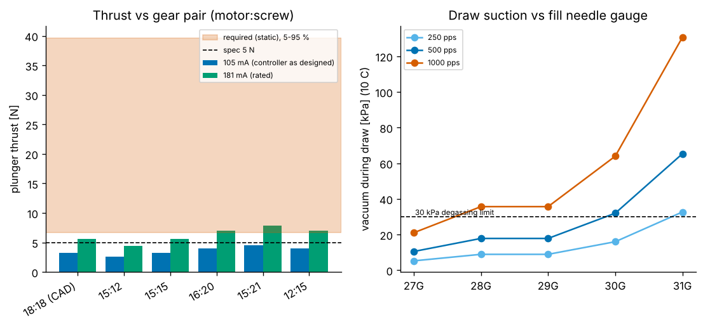
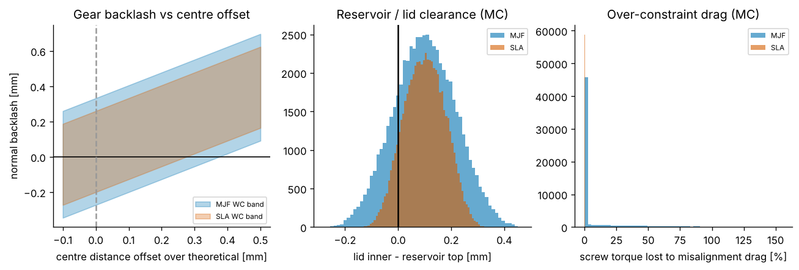
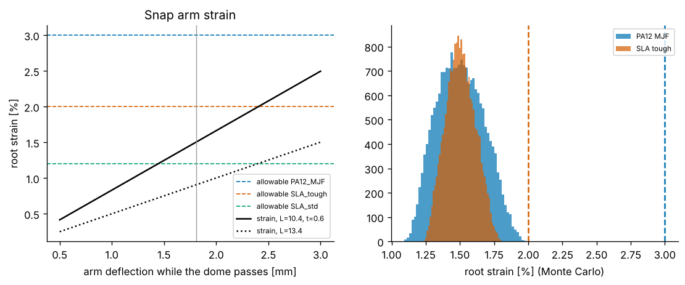
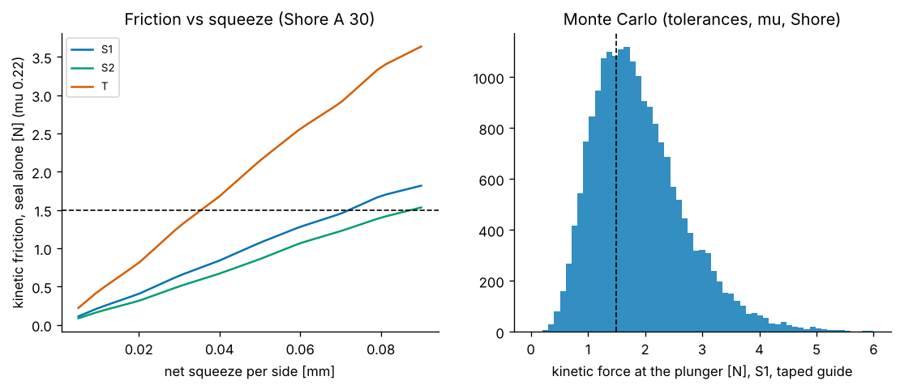

# OpenPatch bench pod: simulation report (mechanics, drive, dosing, fluidics)

Bench test project only (WATER ONLY, never insulin or any drug), never on a person.  Generated by `python3 mechanical/sim/run_all.py` (10 s); inputs: `mechanical/params.json` (sha1 af2d022853), `mechanical/out/bench/*.mech.json`.  Re-run after every CAD change.

**Model state:** gear pair in `params.json`: **16:20** (U/step 0.00395, centre 5.40 mm); sizes OP-70, OP-100, OP-200; CAD snapshots read: OP-70: 43.0 mm long, gears 16:20, OP-100: 47.0 mm long, gears 16:20, OP-200: 60.4 mm long, gears 16:20.  The OP-200 `mech.json` in `out/bench` still comes from an older coaxial snapshot (82.6 mm long), so OP-200 numbers use only its stroke from `params.json`.

## Summary

**25 PASS, 18 WARN, 4 FAIL**, 9 info rows.

Read the status with its confidence: rows that rest on *geometry from the CAD* (tongue stress, lid/reservoir stack, thread and collar budget, 105 mA current limit, prime volume, snap-arm strain) are firm; rows that rest on *[ASM] friction or process inputs* (seal friction, once-per-rev screw error, stick-slip, compliance, bubble size) show what the design **needs** and which side of the line a plausible value lands on, and are settled only by the bench tests listed at the end.

| ID | Requirement | Value | Margin | Status | Basis | Note |
|---|---|---|---|---|---|---|
| 1.1 | Plunger thrust >= 5 N (spec 4) at 105 mA controller limit | 4.0 N (CAD pair 16:20) | 0.81x | **WARN** | CAD | spec quotes ~9.5 N; power-screw + collar + current limit gives less |
| 1.2 | Plunger thrust >= 5 N at rated 181 mA | 7.0 N | 1.40x | PASS | CAD | needs VREF raised to ~0.18 V (R69) and thermal check |
| 1.3 | Thrust margin >= 1.5 over static seal friction + back-pressure (nominal) | 4.0 N vs 1.4 N | 2.87x | PASS | model [ASM] | seal friction is a model, bench pull test decides |
| 1.4 | P(motor cannot break the plunger loose) <= 1 % (MC, 105 mA) | 7 % | - | **WARN** | model [ASM] | uniform ranges of seal mu, squeeze, Shore, breakaway |
| 1.5 | same at rated 181 mA | 0 % | - | PASS | model [ASM] |  |
| 1.6 | Seal friction within budget at 105 mA (kinetic, margin 1.5 on breakaway) | 0.8 N vs budget 1.7 N | 2.15x | PASS | model [ASM] | reduce squeeze/contact width, see 1.2 sweep |
| 1.7 | Draw mode: suction <= 30 kPa at 1000 pps, 29G fill needle, 10 C | 29 kPa | 1.05x | PASS | model [ASM] | limit pps or use a larger needle (see table 1.5) |
| 1.8 | Draw mode force margin >= 1.5 (29G, 1000 pps) | 2.9 N vs 2.3 N | 1.27x | **WARN** | model [ASM] |  |
| 1.9 | Occlusion pressure the pump can build (info; typical pumps 100-300 kPa) | 44 kPa | - | INFO | model [ASM] | limited by thrust minus seal friction |
| 1.10 | Winding dissipation, both phases on (info) | 0.58 W @105 mA / 1.74 W @181 mA | - | INFO | CAD | driver must be off between pulses |
| 1.11 | Option: ball/pin thrust end (r_m 0.4 mm) at 105 mA; 16:20 pair at 105 mA; both at 181 mA | 6.0 N; 4.0 N; 10.3 N | 2.06x vs 5 N | INFO | CAD | levers to recover thrust |
| 2.1 | Resolution <= 0.03 U/step (parts.md target 0.008-0.03) | 0.00395 U/step (CAD pair 16:20); 0.05 U = 12.7 steps | 7.6x | PASS | CAD | 15:12 gives 0.00617 |
| 2.2 | Rounding of the smallest dose 0.05 U <= 5 % | +2.7 % | - | PASS | CAD |  |
| 2.3 | Static error (area + lead) 95 % <= 2 %, uncalibrated, 1 U | 1.4 % | - | PASS | model [ASM] | bore +0.05/-0 biased +0.6 % on average |
| 2.4 | 1 U dose within +-5 % (95 %), design as drawn (S1) | 6.8 % | 0.74x | **WARN** | model [ASM] | tongue wind-up x seal friction |
| 2.5 | 1 U within +-5 % with 1.2 mm tongue + seal F_kin 1.5 N (S3, uncalibrated) | 6.8 % | 0.73x | **WARN** | model [ASM] | periodic 3 um error dominates |
| 2.6 | 1 U within +-5 % with S3 + per-pod calibration (S4) | 6.7 % | 0.74x | **WARN** | model [ASM] |  |
| 2.7 | 10 U within +-5 % (95 %), S1 / S3 | 1.4 % / 1.3 % | - | PASS | model [ASM] |  |
| 2.8 | 0.05 U error (info, no requirement), S3 | 80 % | - | INFO | model [ASM] | minimum bolus is a dose-quantum, not an accuracy claim |
| 2.9 | First 1 U after a draw without backlash take-up <= 5 % | -22...-60 % | - | **FAIL** | model [ASM] | firmware needs a take-up step after every draw |
| 3.1 | Gears never bind: P(backlash < 0) <= 1 % at the CAD centre (MJF) | 8 % (SLA 2 %) | - | **WARN** | CAD | CAD centre = theoretical; window needs +0.11 mm and datum location: P(ok) passive 74 % (MJF) / 88 % (SLA) |
| 3.2 | Screw/nut/carriage misfit within float (MJF), drag < 10 % of torque | WC z 0.33 vs 0.38 mm; P(drag>10 %) 0 % | - | PASS | CAD | no vertical float on the rail; SLA: P(drag>10 %) 0 % |
| 3.3 | Needle lands in the septum: residual offset <= usable radius (MJF) | +-0.40 vs 1.34 mm | 3.4x | PASS | CAD | cannula geometry unmeasured |
| 3.4 | Dock capture: lead-in needed on guard tube/recess (MJF) | 0.30 mm | - | **WARN** | CAD | guard tube float only 0.20 mm |
| 3.5 | Snap-arm hook overlap > 0 in worst case (MJF) | 0.35 mm (SLA 0.45) | - | PASS | CAD | nominal 0.65 mm |
| 3.6 | Pod height <= 8.5 mm (WC) | 8.60 mm MJF / 8.50 SLA (RSS 8.54 / 8.47) | - | **WARN** | CAD | nominal is exactly at the limit: ~50 % of MJF pods are up to 0.2 mm too tall |
| 3.7 | Lid clears the CNC reservoir top (gap > 0), MJF | nominal 0.30 mm, WC -0.10, P(contact) 0 % | - | **WARN** | CAD | SLA: P(contact) 0 % |
| 3.8 | Lid clears the tallest board component (MJF WC) | 0.60 nominal / +0.12 WC mm | - | PASS | CAD | from layout.json keep-out heights |
| 4.1 | Snap arm peak strain <= allowable, PA12 MJF | 1.98 % vs 3.0 % | 1.51x | PASS | CAD | MC P(over) 0 %; cannula dims unmeasured |
| 4.2 | Snap arm peak strain <= allowable, SLA (tough class) | 1.98 % vs 2.0 % | 1.01x | **WARN** | CAD | needs L >= 10.4 mm; standard resin needs 13.4 mm |
| 4.3 | Pull-off force 1.5-10 N (stays on, removable by hand) [ASM], PA12 | 1.4 N (pull-off), 4.1 N (insertion) | - | **WARN** | CAD | hook overlap only 0.65 mm, P(no overlap) 0.0 % |
| 4.4 | Carriage tongue bending stress at F_max <= PA12 allowable | 540 MPa vs 200 | 0.37x | **FAIL** | CAD | tongue is 0.5 mm thick in the load direction; allowable thrust 1.5 N |
| 4.5 | Tongue stress at the as-designed 105 mA thrust (F 5.3 N) | 158 MPa | - | PASS | CAD | stall (holding torque) load |
| 4.6 | Thrust train stiffness >= 100 N/mm (wind-up <= 0.03 mm at 3 N) | 226 N/mm | 2.26x | PASS | CAD | tongue dominates; feeds start-lag (A2) and occlusion stored volume (A5) |
| 4.7 | Dry-end block + wall bending stress at F_max (PA12) | 22 / 77 MPa (merged / block only) | - | **WARN** | CAD | depends on how the block ties into the end wall |
| 4.8-OP-100 | Leadscrew Euler buckling margin >= 5 (K=2), OP-100 | 222 N at L=17 mm | 12x | PASS | CAD |  |
| 4.8-OP-200 | Leadscrew Euler buckling margin >= 5 (K=2), OP-200 | 68 N at L=30 mm | 4x | **WARN** | CAD |  |
| 4.8-OP-70 | Leadscrew Euler buckling margin >= 5 (K=2), OP-70 | 385 N at L=13 mm | 21x | PASS | CAD |  |
| 4.9 | Gear tooth bending safety >= 2 (brass, max torque) | 29 MPa | 3.8x | PASS | CAD | CAD pair |
| 4.10 | CNC reservoir wall stress at max pressure | 22.4 MPa vs 30 | 1.3x | **WARN** | CAD |  |
| 4.11 | Hard stop bearing stress at F_max | 7.4 MPa vs ~40 | 5x | PASS | CAD |  |
| 5.1 | Priming path volume <= MAX_PRIME 0.52 U (one prime command) | 0.58 U prime path (1.05 U all channels) | 0.91x | **WARN** | CAD | REFILL.md says ~0.5 U; several prime commands or a bigger limit for the bench |
| 5.2 | Unpurgeable air at the plunger stop <= 0.5 U (gap film + flange annulus) | 0.47 U (dead 0.04 mm, annulus 1.9 mm3) | 1.05x | PASS | CAD | plunger homed by stall against the end face; grooves purge outlet-up |
| 5.3 | Outlet resistance negligible: needle dP at 1.5 U/min | 107 Pa | - | PASS | CAD | duckbill cracking dominates, not the needle |
| 5.4 | Undelivered volume at occlusion alarm <= 2 U (threshold 2 U), 181 mA, F_kin 2 N, tongue 1.2 | 3.65 U (V_st 1.65) | 0.55x | **FAIL** | model [ASM] | set firmware threshold to 0.3 U to meet 2 U |
| 5.5 | same, as designed: 105 mA, F_kin 2 N, tongue as drawn | 2.69 U (V_st 0.69) | - | **FAIL** | model [ASM] | P_stall 27 kPa |
| 5.6 | Occlusion alarm time at basal 0.5 U/h (info) | 7.3 h | - | INFO | model [ASM] | 2 U volume criterion; a time or current criterion is needed for basal |
| 5.7 | Occlusion alarm time at bolus 1.5 U/min (info) | 2.4 min | - | INFO | model [ASM] |  |
| 5.8 | Start-of-flow lag from a 10 mm3 bubble <= 0.05 U | 0.049 U | 1.01x | PASS | model [ASM] | dead layer air (3 mm3) would be 0.01 U |
| 5.9 | Bubble expansion at cabin pressure, 10 mm3 (info) | 0.35 U | - | INFO | model [ASM] | pushed out without steps (bench: into a container) |
| 6.1 | Active seal S2: kinetic friction, seal alone <= 1.5 N (nominal, mu 0.22 oil-wetted) | 0.53 N | 2.84x | PASS | CAD | FE bead model |
| 6.2 | S2 force at the plunger incl. guide friction <= 1.5 N, P (MC, taped guide) | 0.79 N nominal, P = 83 % | 1.90x | **WARN** | model [ASM] | cocking x1.50; bare guide: P = 56 % |
| 6.3 | S2 breakaway <= 2.5 N, P (MC, taped guide) | P = 80 % | - | **WARN** | model [ASM] | breakaway factor 1.2-2.5 (dwell); needs the pull test |
| 6.4 | S2 leak-tight to >= 30 kPa / 40 kPa suction: mean contact pressure >= 120 kPa, P (MC) | P = 96 %, median 296 kPa | - | PASS | model [ASM] | P(no interference) = 0.5 % |
| 6.5 | Mould variant S1: force at the plunger / P(F <= 1.5 N) / P(leak-tight) | 1.48 N / 35 % / 100 % | - | INFO | model [ASM] | fall-back: more squeeze (~0.047 mm per side), single front bead, land  |
| 6.6 | Mould variant T: force at the plunger / P(F <= 1.5 N) / P(leak-tight) | 2.62 N / 7 % / 100 % | - | INFO | model [ASM] | twin bead (redundant seal, longer guide), about 1.7x the friction of S |

## Key findings (in order of consequence)

1. **Thrust is the main risk, not the leadscrew or the gears.**  With the controller's 105 mA phase limit the plunger thrust is only **4.0 N** (spec 4 assumes ~9.5 N, which neglects the current limit, the thrust-collar friction that is as large as the thread friction, and a 0.64 gearhead efficiency).  At the rated 181 mA it is 7.0 N.  The silicone plunger seal (2 rings x 0.8 mm, 0.13 mm squeeze, 37.7 mm perimeter) is modelled at **0.8 N kinetic / 1.2 N breakaway** (plausible range 3-20 N); the drive can afford only about **1.7 N kinetic** at 105 mA.  Levers: current (R69), a ball/pin thrust end (6.0 N at 105 mA), a step-down gear pair 16:20 (4.0 N), and above all a seal with less squeeze/contact width.  The spec's 15:12 pair is the weakest of those evaluated.

2. **The carriage tongue (0.6 mm thick in the load direction) cannot carry the thrust**: root stress 30 MPa per newton, 90 MPa at 3 N vs ~45 MPa PA12 allowable (allowable thrust 6.7 N) and a stiffness of only 1576 N/mm, which makes the plunger wind up 0.10 U per 3 N.  It also dominates dose error and the stored volume at occlusion.

3. **Stack-ups at the limit**: the CNC reservoir top (z 7.5) sits **0.30 mm** below the lid underside (z 7.6): P(contact) 0 % MJF / 0 % SLA; nominal height is exactly 8.5 so ~half of MJF pods exceed it; the gear centre equals the theoretical centre (zero backlash by design) while passive location of the printed bores plus a floating motor gives +-0.39 mm (backlash window only 0.21 mm wide); no vertical float exists between rail, nut and screw (z misfit up to 0.33 mm vs 0.38 mm float, MJF).

4. **Dose accuracy** (+-5 % at >= 1 U): quantisation, bore tolerance (+0.05/-0: 0 ... +1.3 %), thermal (PP area vs liquid expansion cancel) are fine; the 1 U result is set by (a) the once-per-revolution error of the real rod (3 um -> 5 % by itself), (b) stick-slip wind-up (needs a stiff tongue and low seal friction) and (c) the backlash take-up after each draw (firmware has none: first dose after a draw loses 22-60 %).

5. **Fluidics**: priming path 0.6 U (REFILL.md: 0.5 U; firmware MAX_PRIME 0.524 U) plus a **0.5 U air layer** in front of the plunger; occlusion is detected only after a stall, so stored volume (compliance x P_stall) adds to the 2 U threshold - total undelivered at alarm is 2.0-4.1 U (stored 0.0-2.1 U) over the plausible friction/current cases and the alarm takes 4-8 h at 0.5 U/h (4 h is the floor of the 2 U criterion).

6. **Snap arms**: PA12 MJF is marginal (1.98 % vs 3 %), SLA fails (1.98 % vs 2 % for tough resin, 1.2 % for standard resin) unless the free arm length grows from 10.4 to >= 10.4 mm; pull-off force 1.4 N.  Gears, shaft, leadscrew buckling (OP-70/100 >> 10x; OP-200 5x at K=2), reservoir wall and hard stops pass.

## 1. Force / torque budget of the drive chain

**Model.** Motor pull-out torque (1.6 gf*cm at 500 pps, rated 4.8 V = 181 mA) x current-limit ratio x planetary ratio 26.45 x gearhead efficiency x gear-pair ratio z_screw/z_motor x pair efficiency gives the **screw torque**; the axial force follows from the power-screw formula T = F*[ (d2/2)(tan(lam)+mu/cos(30deg))/(1-mu*tan(lam)/cos(30deg)) + mu_c*r_collar ] with d2 = 1.373 mm, lead angle 4.64 deg and a thrust collar at the bush end face (r_m = 1.20 mm; the dry-end bush face takes the delivery thrust).  Required force = plunger seal friction (squeeze x contact area x mu, Gent E(Shore A)) x breakaway factor + duckbill/needle back-pressure x bore area 74.63 mm2.  Hagen-Poiseuille is used for needle and cannula.

Sources / assumptions: motor point [DS vendor page]; current limit 105 mA is what the **controller board is designed for** (`limits.rs`, `electronics/bench/pin-assignment.md`: VREF 0.105 V / 1.0 ohm, 'tune R69' still open); efficiencies, friction coefficients, seal mu and breakaway factor are [ASM] ranges in `common.CONST` (seal mu 0.15 lubed ... 0.9 dry).  No pull-out curve exists, so torque above 500 pps is derated as (500/f)^0.5 [ASM].

### 1.1 Available thrust by gear pair (nominal efficiencies, mu_thread 0.22, mu_collar 0.18)

| pair (motor:screw) | centre mm | fits motor lane | U/step | screw torque N*mm @105 mA | F avail N @105 mA | F avail N @181 mA (rated) | margin @105 mA | margin @181 mA |
|---|---|---|---|---|---|---|---|---|
| 16:20 (CAD) | 5.40 | NO (needs >= 5.5) | 0.00395 | 1.83 | 4.05 | 6.98 | 2.87 | 4.95 |
| 15:12 | 4.05 | NO (needs >= 5.5) | 0.00617 | 1.17 | 2.59 | 4.47 | 1.84 | 3.17 |
| 15:15 | 4.50 | NO (needs >= 5.5) | 0.00494 | 1.46 | 3.24 | 5.59 | 2.30 | 3.96 |
| 18:18 | 5.40 | NO (needs >= 5.5) | 0.00494 | 1.46 | 3.24 | 5.59 | 2.30 | 3.96 |
| 15:21 | 5.40 | NO (needs >= 5.5) | 0.00353 | 2.05 | 4.53 | 7.82 | 3.22 | 5.55 |
| 12:15 | 4.05 | NO (needs >= 5.5) | 0.00395 | 1.83 | 4.05 | 6.98 | 2.87 | 4.95 |

Margin = F available / F required (static) with F required = 1.5 x seal friction 0.8 N + back-pressure 0.22 N = **1.4 N**.  The spec text (spec 4) quotes 9.5 N by assuming a flat 20 % overall screw efficiency; the power-screw model with a collar gives the numbers above (thread efficiency 24 % at mu 0.22, collar torque is as large as the thread torque).

### 1.2 Plunger seal friction model (the dominant unknown; details and variants in `SEAL-AND-DEAD-VOLUME.md` and analysis 6)

Active variant **S2** (1 bead(s), land 0.15 mm, cast oversize 0.12 mm, Shore A 30): net squeeze 0.032 mm per side, FE line load 0.063 N/mm over a 37.8 mm perimeter -> normal force 2.4 N, mean contact pressure 0.31 MPa.  Kinetic friction at mu 0.22 (oil-wetted): seal alone **0.53 N**, with the cocking factor 1.50 (eccentric push e = 7.2 mm over a 4.3 mm guide span, guide mu 0.10) **0.79 N at the plunger**.  Superseded design (2 full-width 0.8 mm bands, 0.3 oversize, Shore 40): FE 23.5 N seal alone at mu 0.40 (the earlier block model said 9.6 N; the FE with the groove walls is stiffer), cocking x1.9.

| mu seal | CNC bore oversize (frozen tol +0.05/0) | squeeze/side mm | F seal alone N | F kinetic at plunger N (guide mu 0.15) | F breakaway N |
|---|---|---|---|---|---|
| 0.12 | +0.00 | 0.044 | 0.41 | 0.61 | 0.91 |
| 0.12 | +0.05 | 0.019 | 0.16 | 0.25 | 0.37 |
| 0.22 | +0.00 | 0.044 | 0.74 | 1.11 | 1.67 |
| 0.22 | +0.05 | 0.019 | 0.30 | 0.45 | 0.67 |
| 0.40 | +0.00 | 0.044 | 1.35 | 2.02 | 3.04 |
| 0.40 | +0.05 | 0.019 | 0.55 | 0.82 | 1.23 |
| 0.90 | +0.00 | 0.044 | 3.04 | 4.56 | 6.83 |
| 0.90 | +0.05 | 0.019 | 1.23 | 1.84 | 2.76 |

Friction budget at the CAD gear pair, 105 mA: (F avail - back-pressure)/breakaway/1.5 = **1.7 N** kinetic.

### 1.3 Sensitivity of the available thrust (CAD pair (16, 20), base 4.05 N at 105 mA)

| parameter (low .. high) | F avail N (low) | F avail N (high) |
|---|---|---|
| gearhead efficiency 0.50..0.81 | 3.16 | 5.12 |
| gear pair efficiency 0.90..0.98 | 3.83 | 4.17 |
| thread mu 0.35..0.15 | 3.26 | 4.64 |
| collar mu 0.30..0.10 | 3.07 | 5.14 |
| motor current 105 mA .. 181 mA | 4.05 | 6.98 |
| thrust collar mean radius 1.2 mm (bush face) .. 0.4 mm (ball/pin end) | 4.06 | 5.96 |

### 1.4 Monte Carlo: can the motor break the plunger loose? (N = 40000, uniform/triangular over all ranges above)

| current limit | F avail N median (5..95 %) | kinetic force at the plunger N median (5..95 %), oil-wetted | P(F avail < F req static) | P(margin < 1.5) |
|---|---|---|---|---|
| 105 mA (as designed) | 3.81 (2.94..4.96) | 0.9 (0.3..2.1) | 7 % | 25 % |
| 181 mA (rated) | 6.58 (5.06..8.58) | 0.9 (0.3..2.0) | 0 % | 4 % |

### 1.5 Reverse (draw) mode: suction through the fill needle

Delivery rates are tiny (bolus 1.5 U/min = 6.3 steps/s, basal 0.5 U/h = one step every 28 s) so the motor runs at low speed where torque >= the 500 pps value.  Draw is the only fast mode: DRAW_MAX_PPS = 1000 pps = 3.95 U/s (100 U in 25 s).  The syringe/vial needle through the septum is the restriction; the plunger must also pull a vacuum dP = Q*R_needle.  Needle ID from gauge tables [LIT]; viscosity 1.1 mPa*s (1.6 at 10 C), needle length 12.7 mm (insulin syringe) + 0.7 mm cap channel (negligible).  Vacuum above about 30 kPa risks degassing and air bubbles in the fill (dissolved air supersaturates); stored-volume effects of the vacuum are in analysis 5.

| needle | ID mm | pps | U/s | vacuum dP kPa (25 C) | dP kPa (10 C) | F draw N (seal + dP*A) | F avail N at pps | dP<=30 kPa and margin>=1.5 |
|---|---|---|---|---|---|---|---|---|
| 27G | 0.210 | 250 | 0.99 | 2.9 | 4.2 | 1.0 | 4.05 | ok |
| 27G | 0.210 | 500 | 1.98 | 5.8 | 8.4 | 1.2 | 4.05 | ok |
| 27G | 0.210 | 1000 | 3.95 | 11.6 | 16.8 | 1.7 | 2.86 | ok |
| 28G | 0.184 | 250 | 0.99 | 4.9 | 7.1 | 1.2 | 4.05 | ok |
| 28G | 0.184 | 500 | 1.98 | 9.8 | 14.3 | 1.5 | 4.05 | ok |
| 28G | 0.184 | 1000 | 3.95 | 19.6 | 28.5 | 2.3 | 2.86 | no |
| 29G | 0.184 | 250 | 0.99 | 4.9 | 7.1 | 1.2 | 4.05 | ok |
| 29G | 0.184 | 500 | 1.98 | 9.8 | 14.3 | 1.5 | 4.05 | ok |
| 29G | 0.184 | 1000 | 3.95 | 19.6 | 28.5 | 2.3 | 2.86 | no |
| 30G | 0.159 | 250 | 0.99 | 8.8 | 12.8 | 1.4 | 4.05 | ok |
| 30G | 0.159 | 500 | 1.98 | 17.6 | 25.6 | 2.1 | 4.05 | ok |
| 30G | 0.159 | 1000 | 3.95 | 35.2 | 51.2 | 3.4 | 2.86 | no |
| 31G | 0.133 | 250 | 0.99 | 18.0 | 26.1 | 2.1 | 4.05 | ok |
| 31G | 0.133 | 500 | 1.98 | 35.9 | 52.3 | 3.5 | 4.05 | no |
| 31G | 0.133 | 1000 | 3.95 | 71.9 | 104.5 | 6.2 | 2.86 | no |

Max step rate that keeps the vacuum <= 30 kPa at 10 C: 27G 1784 pps (7.05 U/s), 28G 1051 pps (4.15 U/s), 29G 1051 pps (4.15 U/s), 30G 586 pps (2.32 U/s), 31G 287 pps (1.13 U/s).

### 1.6 Pressure the pump can build (occlusion)

P_stall = (F avail - kinetic seal friction) / A = (4.05 - 0.8) N / 74.6 mm2 = **44 kPa** (CAD pair, 105 mA, nominal).  Stall thrust incl. holding torque x1.3 = 5.26 N.  Cracking pressure of a duckbill (1-5 kPa) is only 0.07-0.37 N, i.e. small compared to the seal.

### 1.7 Winding dissipation (one-line thermal check)

Both phases energised: 0.58 W at 105 mA, 1.74 W at the rated 181 mA for a 6 mm motor (no heat path except the printed saddles).  A 20 s refill is fine, a continuously energised hold is not: the firmware must switch the driver off between pulses (to be confirmed on the bench by motor temperature).

## 2. Dose resolution and accuracy

**Resolution.** U/step = pitch x (z_motor/z_screw) / (steps/rev x gearhead ratio) x A / 10, A = 74.63 mm2 (16 x 5 stadium).

| pair | U/step | steps per U | steps in 0.05 U | rounding error of 0.05 U | um/step at the nut |
|---|---|---|---|---|---|
| 16:20 (CAD) | 0.00395 | 253 | 12.66 | +2.7 % | 0.529 |
| 15:12 | 0.00617 | 162 | 8.10 | -1.2 % | 0.827 |
| 15:15 | 0.00494 | 203 | 10.13 | -1.2 % | 0.662 |
| 18:18 | 0.00494 | 203 | 10.13 | -1.2 % | 0.662 |
| 15:21 | 0.00353 | 284 | 14.18 | -1.2 % | 0.473 |
| 12:15 | 0.00395 | 253 | 12.66 | +2.7 % | 0.529 |

Firmware keeps an exact rational per preset (no default), so the pair in the CAD and the firmware feature must match: the 18:18 and 15:12 presets differ by 25 % in U/step.

### 2.1 Error sources (relative to the firmware's nominal 74.63 mm2 / 0.35 mm pitch)

| source | magnitude | nature |
|---|---|---|
| Reservoir area, frozen drawing +0.05/-0 on both axes | 0 ... +1.27 % (mean +0.63 %) | static per pod; removable by calibration; mean bias could be put in the preset |
| Reservoir area, CNC +-0.02 (task statement) | -0.50 ... +0.51 % | static |
| Leadscrew lead error (rolled rod) | sigma 0.2 % (max +-0.5 %) [ASM] | static per rod |
| Once-per-rev periodic error (runout, thread form) | +-3 um -> up to +-0.045 U per dose, dose-independent [ASM] | dominates small doses |
| Temperature 5-40 C: PP bore area vs liquid expansion | 2*alpha*dT - beta*dT: +-0.3 % (they nearly cancel) | dynamic |
| Gear transmission error (DIN 58405 q8, 20 um) | +-0.0055 U | negligible |
| Elastic wind-up of the thrust train (stick-slip) | amplitude = A * 0.25 * F_kinetic / k_train (see 2.3) | dominates once friction is high / train soft |
| Bubble / compliance at start of flow (duckbill 1-5 kPa) | bubble V_b/P_atm * P_crack (see 2.3) | dynamic |
| Quantisation (whole steps) | see table above | deterministic |

### 2.2 Backlash and the start of a bolus

Delivery always pushes the same flank, so backlash only matters after a **direction reversal** (every draw, and when backing off the end stop).  Un-compensated, the first delivery after a draw loses the whole play; the firmware has no backlash term (`grep -ri backlash firmware-rs` finds nothing), so a take-up routine (reverse draw ends with a forward move of >= 152 steps before counting delivered volume) is required.

| source | loss at reversal (nut travel) | volume |
|---|---|---|
| gear pair (j_t 0.06 mm at the pitch circle) | 1.11 um | 0.0083 U |
| gearhead (6 deg at the output shaft [ASM]) | 4.67 um | 0.035 U |
| nut on rod, axial play 0.03-0.08 mm [ASM] | 30-80 um | 0.22-0.60 U |

### 2.3 Monte Carlo accuracy (N = 40000 per dose and scenario)

Error = delivered volume / commanded - 1 after whole-step rounding.  Tolerances: bore +0.05/0 (frozen drawing), lead sigma 0.2 %, periodic 3 um, temperature 5-40 C, bubble 10 mm3 against 5 kPa crack (0.49 mm3), stick-slip lag amplitude = A * 0.25 * F_kin / k_train (the stop force of the plunger varies by about 25 % of F_kin [ASM]).  Reported: 95 % interval half-width = 97.5th percentile of |error|.  **Target: +-5 % at >= 1 U.**

| scenario | 0.05 U | 0.1 U | 0.5 U | 1 U | 5 U | 10 U |
|---|---|---|---|---|---|---|
| S1 as drawn: tongue 0.6 mm (k=226 N/mm), F_kin 0.8 N | 79.1 % | 39.8 % | 10.8 % | 6.8 % | 1.6 % | 1.4 % |
| S2 tongue 1.2 mm (k=260 N/mm), F_kin 0.8 N | 79.0 % | 39.7 % | 10.7 % | 6.8 % | 1.6 % | 1.3 % |
| S3 tongue 1.2 mm, seal redesigned F_kin 1.5 N | 79.9 % | 40.4 % | 10.8 % | 6.8 % | 1.6 % | 1.3 % |
| S4 as S3 + per-pod gravimetric calibration | 79.9 % | 40.5 % | 10.7 % | 6.7 % | 1.2 % | 0.9 % |

Contribution of single sources at 1 U (alone, 95 % half-width): area+lead (static) 1.4 %, periodic 3 um 4.9 %, stick-slip lag S1 1.5 %, stick-slip lag S3 1.7 %, bubble 4.1 % (thermal and gear terms are always on).

Static part only (no lag, no periodic) at 1 U: bore +-0.02 -> 0.86 %, bore +0.05/-0 -> 1.36 % (95 % half-width); the +0.05/-0 band is biased by 0.63 % on average, which can be absorbed by shifting the preset area by +0.63 %.

Sensitivity to the once-per-revolution axial error (S4 settings, calibrated): the largest unknown of the lead screw, only a measurement of a real rod can settle it.

| periodic amplitude | 1 U error (95 %) | 5 U error (95 %) |
|---|---|---|
| 0 um | 4.1 % | 1.1 % |
| 1.5 um | 5.0 % | 1.2 % |
| 3 um | 6.8 % | 1.2 % |
| 6 um | 10.5 % | 1.3 % |
| 10 um | 15.8 % | 1.6 % |

First 1 U after a draw without take-up: loses 0.22-0.60 U = 22-60 % of a 1 U dose.  With a take-up routine (residual 20 % of the play) 0.04-0.12 U.

## 3. Tolerance stack-ups

Process tolerance per printed feature position: MJF PA12 +-0.10 mm, SLA +-0.05 mm (task statement).  Worst case (WC) = sum, RSS = root-sum-square (each tolerance read as 3 sigma), Monte Carlo with uniform distributions.  CNC reservoir: bore +0.05/0, outer +-0.1 (frozen drawing).

### 3.1 Gear centre distance vs module 0.3 backlash

The CAD centre equals the theoretical centre (m (z1+z2)/2, e.g. 5.40 mm for 18:18, `bench.gears`), i.e. **zero designed backlash**.  Contributors: motor bore position +-0.100; motor float in the d6.1 bore +-0.100; screw bush bore position +-0.100; bush float in its bore +-0.025; screw radial play in the bush +-0.050; gear bores on shaft/sleeve (2 x 0.01) +-0.020 (MJF values shown).  j_t = j0 + 2 da tan(20 deg), j0 = 0.015...0.045 mm (tooth thinning of DIN 58405 q8 [ASM]).

| process | centre error WC mm | RSS mm | min backlash WC mm | P(j_t < 0 -> binding) at CAD centre | centre offset needed RSS / WC mm | max backlash with WC offset mm |
|---|---|---|---|---|---|---|
| MJF | +-0.395 | +-0.183 | -0.273 | 8 % | +0.19 / +0.40 | 0.63 |
| SLA | +-0.295 | +-0.136 | -0.200 | 2 % | +0.14 / +0.30 | 0.48 |

A tight mesh (negative backlash) multiplies the friction torque; the budget in 1.1 has only a small reserve.  The usable window for the centre error is narrow: normal backlash must stay within 0.02-0.20 mm (tooth height of module 0.3 is 0.65 mm), i.e. the centre distance may vary only over **0.21 mm** (offset 0.01 ... +0.21 mm over theoretical).  Passive location of two printed bores plus a floating motor needs +-0.39 mm (WC), so a centre offset alone cannot fix it:

| process | location concept | centre error WC / RSS mm | P(backlash in window) with design centre +0.11 mm |
|---|---|---|---|
| MJF | passive location (as designed) | +-0.39 / 0.18 | 74 % |
| MJF | motor clamped to a datum, screw bush reamed | +-0.25 / 0.15 | 84 % |
| SLA | passive location (as designed) | +-0.29 / 0.14 | 88 % |
| SLA | motor clamped to a datum, screw bush reamed | +-0.15 / 0.08 | 100 % |

A backlash of 0.20 mm at the pitch circle moves the nut by only 0.028 U per reversal, so a loose mesh costs nothing in dose accuracy; a tight one costs thrust.  **Recommendation: design centre = theoretical + 0.11 mm, clamp the motor against a datum (spring or screw) instead of a 0.1 mm floating saddle, or give the motor saddle a slot.**

### 3.2 Leadscrew - nut - carriage alignment (over-constraint)

The screw is guided by two bushes 16-30 mm apart, the nut is pressed into the carriage hex pocket, the carriage rides on a rail (groove depth = rail height, no vertical play) and is also tied to the plunger through the tongue.  Any axis misfit beyond the available float therefore bends the screw / tongue and loads the thread sideways.  Float available: y 0.53 mm (nut pocket 0.30 + rail groove 0.15 + screw in bush 0.05 + thread 0.03), z 0.38 mm.  Lateral stiffness at the nut: screw (midspan, 17 mm) 260 N/mm in series with the tongue in z 12352 N/mm = 255 N/mm.  Drag torque = mu_thread x F_side x d2/2, compared with the screw torque 1.83 N*mm at 105 mA.

| process | WC offset y vs float | WC offset z vs float | misfit 99 % um | side force 99 % N | drag torque / available median / 99 % | P(drag > 10 %) |
|---|---|---|---|---|---|---|
| MJF | 0.225 vs 0.530 | 0.325 vs 0.380 | 0 | 0.0 | 0 / 0 % | 0 % |
| SLA | 0.125 vs 0.530 | 0.175 vs 0.380 | 0 | 0.0 | 0 / 0 % | 0 % |

### 3.3 Needle position vs the Insight Flex septum (all cannula numbers are unmeasured placeholders)

Lateral: the guard tube (OD 3.2) enters the recess (D 3.6), giving 0.20 mm of radial float; before it enters, the dock stack must be absorbed by a lead-in.  Septum usable radius 1.50 - needle radius 0.15 = 1.34 mm [ASM]. Axial needle penetration nominal 1.9 mm (F), window needed ~1.0 (septum thickness [ASM]) ... 2.6 (bore end F+0.7).

| process | dock stack lateral WC / RSS mm | lead-in needed on tube/recess mm | residual offset after guard centring WC vs usable | needle penetration range mm |
|---|---|---|---|---|
| MJF | +-0.50 / 0.22 | 0.30 | +-0.40 vs 1.34 | 1.35 ... 2.45 |
| SLA | +-0.40 / 0.19 | 0.20 | +-0.40 vs 1.34 | 1.40 ... 2.40 |

### 3.4 Snap-arm engagement (hook overlap behind the notch)

Nominal overlap = notch depth H 0.7 - hook clearance 0.05 = 0.65 mm.

| process | nominal mm | RSS minimum mm | WC minimum mm |
|---|---|---|---|
| MJF | 0.65 | 0.48 | 0.35 |
| SLA | 0.65 | 0.53 | 0.45 |

### 3.5 Lid / bottom closure: height and reservoir clearance

Height: bottom shell and lid meet on hard stops (gasket is not in the loop), so H = 8.4 +- (t_bottom + t_lid).  Reservoir clearance: lid inner z 7.50 (= H - wall) minus CNC reservoir top (floor 0.9 + outer height 6.6 = 7.50) = **0.30 mm nominal**.

| process | height RSS max / WC max mm (limit 8.4) | nominal gap mm | reservoir-lid gap RSS min / WC min mm | P(lid presses on reservoir) |
|---|---|---|---|---|
| MJF | 8.54 / 8.60 | 0.30 | +0.10 / -0.10 | 0 % |
| SLA | 8.47 / 8.50 | 0.30 | +0.17 / +0.05 | 0 % |

Board stack: lid inner 7.50, board top 5.90, tallest top-side part 1.0 mm -> clearance 0.60 mm nominal, RSS min 0.38, WC min 0.12 (MJF).

## 4. Structural checks

All printed parts: PA12 MJF (E 1700 MPa, snap strain allowable 3.0 %) or SLA (Tough-class E 1500 MPa, 2.0 %; standard resin E 2600 MPa, 1.2 %).  These are [ASM] values from typical vendor data; replace by the datasheet of the resin you really order (`common.CONST`).

Design load for all structure checks: **F_max = 18.0 N** (rated 181 mA, holding torque x1.3, best efficiency, lowest friction) and a gearhead output torque of 4.4 N*mm; the as-designed 105 mA limit gives 5.3 N.

### 4.1 Dock snap arms (cantilever, from `mech.json -> dock`)

Arm t = 0.75 mm, height 3.65 mm, free length L = 10.4 mm, deflection while the dome passes = 1.91 mm (R 5.0 + clearance - hook_in).  Strain at the root = 1.5 t d / L^2; tip force = 3 E I d / L^3.

| material | E MPa | peak strain | allowable | safety factor | tip force N (per arm) | root stress |
|---|---|---|---|---|---|---|
| PA12_MJF | 1700 | 1.98 % | 3.0 % | 1.51 | 1.11 | 34 MPa (lin.) |
| SLA_tough | 1500 | 1.98 % | 2.0 % | 1.01 | 0.98 | 30 MPa (lin.) |
| SLA_std | 2600 | 1.98 % | 1.2 % | 0.60 | 1.70 | 52 MPa (lin.) |

Hook faces are 45 deg ramps on both sides (`op_dock.py`), so insertion and pull-off both ride the wedge: F = P (mu+tan a)/(1-mu tan a) = 1.86 x arm force (mu 0.3).  Pull-off only needs the overlap (H - hook_clr = 0.65 mm) of deflection, insertion the full 1.91 mm.

| material | arm stiffness N/mm | insertion force N (2 arms) | pull-off force N (2 arms) |
|---|---|---|---|
| PA12_MJF | 0.58 | 4.1 | 1.4 |
| SLA_tough | 0.51 | 3.6 | 1.2 |
| SLA_std | 0.89 | 6.3 | 2.1 |

Monte Carlo (arm thickness +-print tolerance, dome travel +-0.15 mm, notch depth +-0.1 mm [ASM: cannula dims unmeasured]):

| material | strain median (99 %) | P(strain > allowable) | pull-off N 1/50/99 % | overlap mm 1 % | P(overlap < 0.05) |
|---|---|---|---|---|---|
| PA12_MJF | 1.98 (2.40) % | 0 % | 0.7 / 1.4 / 2.4 | 0.43 | 0.0 % |
| SLA_tough | 1.98 (2.25) % | 44 % | 0.9 / 1.2 / 1.7 | 0.50 | 0.0 % |
| SLA_std | 1.98 (2.25) % | 100 % | 1.5 / 2.1 / 3.0 | 0.50 | 0.0 % |

Minimum free arm length for strain <= allowable at the current deflection: PA12_MJF 8.5 mm, SLA_tough 10.4 mm, SLA_std 13.4 mm (now 10.4 mm).  Strain falls with L^2 and rises linearly with the deflection, i.e. with how far off the dome equator the hook notch sits (G = 3.2 mm).

### 4.2 Thrust path (screw collar -> end wall block; nut -> carriage -> tongue -> plunger socket)

Bending stress at F_max = 18.0 N, stiffness, and the PA12 flexural allowable.  The tongue carries the whole push force in its thin direction (0.6 mm in x), cantilevered 1.75 mm out of the carriage, root stress 30.0 MPa per newton (shear only 1.4 MPa/N).

| element | stress at F_max MPa | stiffness N/mm | allowable MPa |
|---|---|---|---|
| dry-end bearing block, block only (1.03 mm thick x 4.35 wide, load 3.3 mm above floor) | 77 | 56 | 45 |
| same, merged with the 0.9 mm end wall | 22 | 370 | 45 |
| carriage tongue as drawn: 0.50 (x) x 1.40 (z) mm, lever 1.75 mm | 540 | 1576 | 200 |
| carriage tongue 1.2 mm thick (proposal) | 94 | 21780 | 200 |

Allowable thrust through the tongue as drawn: **6.7 N** (PA12) / 1.3 N (SLA tough); with a 1.2 mm tongue 38.4 N.  Series stiffness of the whole train: 226 N/mm (as drawn), 260 N/mm (tongue 1.2 mm), 51 N/mm (block alone).  Elastic wind-up at 3 N: 0.013 mm = 0.10 U (as drawn).

### 4.3 Leadscrew M1.6 x 0.35 (A2 stainless): buckling, torsion

Equivalent diameter (d2+d3)/2 = 1.272 mm, EI = 24773 N*mm2.  The screw is in compression between the dry-end collar and the nut (delivery) with the carriage at the front.  Pinned-pinned (K=1) and a pessimistic K=2.

| size | free length mm | P_cr pinned N | margin vs F_max | P_cr K=2 N | margin |
|---|---|---|---|---|---|
| OP-70 | 12.6 | 1540 | 86x | 385 | 21x |
| OP-100 | 16.6 | 887 | 49x | 222 | 12x |
| OP-200 | 30.0 | 272 | 15x | 68 | 4x |

Torsion at the maximum screw torque 4.4 N*mm: tau = 13.9 MPa on the root diameter 1.17 mm (yield > 200 MPa): not critical.

### 4.4 Gear teeth (module 0.3, brass), shaft and bonding

Lewis bending stress sigma = Ks Wt / (b m Y), Ks = 2, b = 1.4 mm (CAD gear_t; the purchasable thin discs are 1.4 mm), Wt = 2 T / d_pitch at the maximum torque (T = 4.4 N*mm).  Allowable 110 MPa (brass, bending).

| pair | tangential force N | face width mm | max tooth stress MPa | safety |
|---|---|---|---|---|
| 16:20 (CAD) | 1.82 | 1.4 | 29 | 3.8x |
| 15:12 | 1.94 | 1.4 | 38 | 2.9x |
| 15:15 | 1.94 | 1.4 | 32 | 3.4x |
| 18:18 | 1.62 | 1.4 | 25 | 4.4x |
| 15:21 | 1.94 | 1.4 | 32 | 3.4x |
| 12:15 | 2.43 | 1.4 | 47 | 2.3x |

Motor shaft: radial load 1.94 N at ~0.7 mm from the gearhead boss -> bending 1.7 MPa (trivial).  Whether the gearhead output bearing accepts 1.9 N radial is **not in the vendor data** (bench item).  Adhesive joint (Loctite 638 class, 15 MPa x 0.5): capacity 66 N*mm vs 4.4 N*mm -> 15x.

Motor reaction torque on the housing: 4.4 N*mm; the printed saddles are 0.1 mm clear of the body (`t_mcut` d6.1), so the torque must be taken by the terminal-block pocket or a clamp: lever 3 mm -> 1.5 N on a printed rib (fine if a positive anti-rotation feature exists, to be verified in the CAD review).

### 4.5 CNC reservoir wall and end stops

Maximum pressure the drive can build: (F_max - lowest plausible seal friction 0.3 N)/A = 237 kPa.  Flat wall (strip 11 mm span, t 0.8 mm, clamped): sigma = q b^2/(2 t^2) = 22.4 MPa vs PP yield 30 MPa -> 1x.  Rear/front hard stop bearing area 2.4 mm2: 7.4 MPa at F_max vs PA12 ~40 MPa (REFILL.md).

## 5. Fluidics: priming, dead volume, bubbles, compliance, occlusion detection

### 5.1 Priming and dead volume

| element (from `op_cap.py`, `reservoir_frozen`) | group | volume mm3 |
|---|---|---|
| frozen port d2.0, 0.10 mm left in front of the spigot | prime | 0.31 |
| O-ring face recess + spigot half grooves d0.60 x 2.65 | prime | 0.75 |
| gasket port slot 0.8 x 1.1 x 0.50 | prime | 0.42 |
| via d0.8 x 1.1 | prime | 0.55 |
| valve inlet plenum d1.2 x 0.9 | prime | 1.07 |
| check valve internal cavity, 12 % of the envelope [ASM] (compressed in its pocket, no annulus) | prime | 2.38 |
| valve outlet -> hub d0.60 x 0.7 | prime | 0.20 |
| needle lumen d0.159 x 4.2 | prime | 0.08 |
| fill branch: 3 gasket slots 0.8 x 0.5, total length 11.8 | fill | 4.72 |
| **prime path (chamber -> needle tip)** | prime | **5.8 mm3 = 0.58 U** |
| **all wetted channels** |  | **10.5 mm3 = 1.05 U** |

Before the 2026-11-19 redesign (spigot 2.0 mm so the whole 2.5 mm port stayed open, all channels d0.7, 30 % valve void, annulus) the path was 2.21 U (22.1 mm3), prime path 1.77 U; dead layer 0.3 mm + unfilled annulus (0.2 clearance) = 2.2 + 0.7 U.  After: prime path 0.58 U, wetted total 1.05 U.  Unpurgeable air at the plunger stop: gap film 2.8 mm3 + flange annulus 1.9 mm3 = **0.47 U** (with the PTFE guide tape on; 1.1 mm3 purge grooves are connected to the port and purge with the outlet up).

The reservoir chamber itself keeps a **0.04 mm dead layer** in front of the plunger at the end of its stroke (`reservoir.dead`, front stop): 3.0 mm3 = **0.3 U**, which is air after assembly and cannot be expelled through the single port in the centre of the closed end unless the pod is held with the outlet up.  REFILL.md quotes ~0.5 U priming and 3 mm3 dead volume; the geometry gives 1.0 U for the fluid path, and `MAX_PRIME` in the firmware is 0.524 U per prime command.

| size | deliverable U (stroke) | chamber + dead layer U | unusable dead + path U | share of capacity |
|---|---|---|---|---|
| OP-70 | 70.2 | 70.5 | 1.3 | 1.9 % |
| OP-100 | 100.0 | 100.3 | 1.3 | 1.3 % |
| OP-200 | 200.0 | 200.3 | 1.3 | 0.7 % |

### 5.2 Outlet flow resistance (Hagen-Poiseuille)

Viscosity 1.6 mPa*s (10 C worst case).  The outlet is not a restriction at delivery rates (tens of pascal); only the duckbill cracking pressure (1-5 kPa [ASM]) and, on a body, tissue back-pressure would matter (bench: containers, ~0).

| element | flow | pressure drop |
|---|---|---|
| 30G blunt needle d0.159, 4.2 mm cut | bolus 1.5 U/min | 107.10 Pa |
| 30G blunt needle d0.159, 4.2 mm cut | basal 0.5 U/h | 0.59 Pa |
| 30G blunt needle d0.159, 4.2 mm cut | priming 1 U/s | 4.28 kPa |
| 30G, 6.35 mm (uncut) | bolus 1.5 U/min | 161.92 Pa |
| 30G, 6.35 mm (uncut) | basal 0.5 U/h | 0.90 Pa |
| 30G, 6.35 mm (uncut) | priming 1 U/s | 6.48 kPa |
| Insight Flex cannula d0.25 x 8 mm [ASM] | bolus 1.5 U/min | 33.38 Pa |
| Insight Flex cannula d0.25 x 8 mm [ASM] | basal 0.5 U/h | 0.19 Pa |
| Insight Flex cannula d0.25 x 8 mm [ASM] | priming 1 U/s | 1.34 kPa |

### 5.3 System compliance (mm3 per kPa)

PP reservoir flat walls (strip 11 mm, t 0.8 mm, clamped, no support from the housing = upper bound), thrust-train wind-up (A^2/k_train, from 4.2; value in brackets with the 1.2 mm tongue), a 10 mm3 air bubble (isothermal, V/p_atm), silicone duckbill/septum/cap [ASM], liquid compressibility.

| size | PP walls | train wind-up (tongue 1.2) | bubble 10 mm3 | silicone parts | liquid | total mm3/kPa (tongue 1.2) |
|---|---|---|---|---|---|---|
| OP-70 | 0.054 | 0.025 (0.021) | 0.099 | 0.050 | 0.0003 | 0.23 (0.22) |
| OP-100 | 0.077 | 0.025 (0.021) | 0.099 | 0.050 | 0.0005 | 0.25 (0.25) |
| OP-200 | 0.154 | 0.025 (0.021) | 0.099 | 0.050 | 0.0009 | 0.33 (0.33) |

### 5.4 Occlusion detection (spec 7: alarm at <= 2 U undelivered)

The firmware detects occlusion as (commanded - encoder-confirmed) > 2 U (`safety.rs`), i.e. only **after the motor has stalled** (the encoder measures the leadscrew, not the plunger).  Pressure therefore builds to P_stall = (F available - F kinetic) / A first; the volume stored in the compliance V_st = C x P_stall is *additional* undelivered insulin, and it is released as a bolus when the line is cleared.  Total undelivered at alarm = V_st + 2 U; time to alarm = that / flow rate.

Reference size OP-100 (compliance from 5.3).

| current limit | F kinetic N | train | F avail N | P_stall kPa | stored V_st U | undelivered at alarm U (V_st + 2) | firmware threshold needed for <= 2 U total | t alarm @ bolus 1.5 U/min | t alarm @ basal 0.5 U/h |
|---|---|---|---|---|---|---|---|---|---|
| 105 mA | 1.0 | as drawn | 4.0 | 41 | 1.03 | 3.03 | 0.97 | 2.0 min | 6.1 h |
| 105 mA | 1.0 | tongue 1.2 | 4.0 | 41 | 1.01 | 3.01 | 0.99 | 2.0 min | 6.0 h |
| 105 mA | 2.0 | as drawn | 4.0 | 27 | 0.69 | 2.69 | 1.31 | 1.8 min | 5.4 h |
| 105 mA | 2.0 | tongue 1.2 | 4.0 | 27 | 0.68 | 2.68 | 1.32 | 1.8 min | 5.4 h |
| 105 mA | 4.0 | as drawn | 4.0 | 1 | 0.02 | 2.02 | 1.98 | 1.3 min | 4.0 h |
| 105 mA | 4.0 | tongue 1.2 | 4.0 | 1 | 0.02 | 2.02 | 1.98 | 1.3 min | 4.0 h |
| 105 mA | 0.8 | as drawn | 4.0 | 44 | 1.10 | 3.10 | 0.90 | 2.1 min | 6.2 h |
| 105 mA | 0.8 | tongue 1.2 | 4.0 | 44 | 1.08 | 3.08 | 0.92 | 2.1 min | 6.2 h |
| 181 mA | 1.0 | as drawn | 7.0 | 80 | 2.01 | 4.01 | 0.00 | 2.7 min | 8.0 h |
| 181 mA | 1.0 | tongue 1.2 | 7.0 | 80 | 1.99 | 3.99 | 0.01 | 2.7 min | 8.0 h |
| 181 mA | 2.0 | as drawn | 7.0 | 67 | 1.68 | 3.68 | 0.32 | 2.5 min | 7.4 h |
| 181 mA | 2.0 | tongue 1.2 | 7.0 | 67 | 1.65 | 3.65 | 0.35 | 2.4 min | 7.3 h |
| 181 mA | 4.0 | as drawn | 7.0 | 40 | 1.00 | 3.00 | 1.00 | 2.0 min | 6.0 h |
| 181 mA | 4.0 | tongue 1.2 | 7.0 | 40 | 0.99 | 2.99 | 1.01 | 2.0 min | 6.0 h |
| 181 mA | 0.8 | as drawn | 7.0 | 83 | 2.08 | 4.08 | 0.00 | 2.7 min | 8.2 h |
| 181 mA | 0.8 | tongue 1.2 | 7.0 | 83 | 2.06 | 4.06 | 0.00 | 2.7 min | 8.1 h |

Reading: with the threshold at 2 U the *total* undelivered insulin at alarm is always > 2 U; to meet the spec literally the threshold has to be lowered by V_st (last-but-one column), and at basal 0.5 U/h the alarm takes about 4 hours or more regardless (the 2 U criterion is volume-based).  If the seal friction is as high as the model in 1.2 (0.8 N) the pump never reaches a pressure above the seal friction at 105 mA, so P_stall = 0 and every dose looks like an occlusion.

### 5.5 Bubbles

A bubble acts as a spring: it delays the start of flow by V_b x P_crack / P_atm, expands when pressure drops (altitude, 75 kPa) or temperature rises and pushes that volume out (into the container) without a motor step, and adds compliance to the occlusion path.

| trapped air | start lag at 5 kPa crack U | expansion at 75 kPa cabin U | expansion 20 -> 37 C U | compliance |
|---|---|---|---|---|
| 2 mm3 | 0.010 | 0.07 | 0.01 | 0.002 U/kPa |
| 5 mm3 | 0.025 | 0.18 | 0.03 | 0.005 U/kPa |
| 10 mm3 | 0.049 | 0.35 | 0.06 | 0.010 U/kPa |
| 3 mm3 | 0.015 | 0.10 | 0.02 | 0.003 U/kPa |

Draw mode adds air through the vacuum: dissolved gas nucleates above roughly 30 kPa suction (1.5); the check valve prevents air from the outlet only if it seals against that suction (the REFILL.md test pressure of 20 kPa is below the 25-35 kPa of a 29G fill needle at full speed).  The duckbill pocket in the cap is bored d3.05 for a d3.0 valve and has an open slot to the pod interior (`t_cap_vs`): unless the valve has its own sealing flange / interference fit, flow can bypass the valve around its outer diameter and leak into the pod.

## 6. Plunger seal variants (FE bead model, tolerance Monte Carlo)

Model chain in `seal_model.py`: Gent E(Shore A); plane-strain Q4/B-bar FE of the cast ring in its groove (floor bonded, groove walls frictionless up to the core OD, bead top pushed onto the bore wall) -> line load F' [N/mm] and contact width; N = F' x perimeter x beads; kinetic force = mu x N; breakaway = k x kinetic; **cocking factor** 1/(1 - 2 mu_g e/L_g) from the eccentric push (tongue contact 7.2 mm off the plunger axis, guide span 4.3 mm).  The FE reproduces the confined-block closed form exactly and the Hertz thick-ring bound is its upper limit.  Monte Carlo: bore +0.05/0, printed cavity +-0.05 mm (diameter), shrink 0.1-0.3 %, Shore A +-4, mu_seal (0.12, 0.22, 0.4), breakaway (1.2, 1.5, 2.5), guide mu (0.06, 0.1, 0.2) (PTFE-taped flanges) .

### 6.1 Variants: nominal values (mu 0.22, bore +0.025, Shore 30) and Monte Carlo (N = 20000)

| variant | guide | net squeeze/side mm | F' N/mm | contact b mm | mean contact p kPa | F seal alone N | cocking x | F at plunger N | MC median (95 %) N | P(F <= 1.5 N) | P(breakaway <= 2.5 N) | P(leak-tight: p >= 120 kPa) |
|---|---|---|---|---|---|---|---|---|---|---|---|---|
| S1 | taped guide | 0.046 | 0.119 | 0.30 | 397 | 0.99 | 1.50 | 1.48 | 1.77 (3.41) | 35 % | 34 % | 100 % |
| S1 | bare guide | 0.046 | 0.119 | 0.30 | 397 | 0.99 | 1.99 | 1.97 | 2.59 (8.43) | 15 % | 15 % | 100 % |
| S2 | taped guide | 0.032 | 0.063 | 0.21 | 305 | 0.53 | 1.50 | 0.79 | 0.93 (2.03) | 83 % | 80 % | 96 % |
| S2 | bare guide | 0.032 | 0.063 | 0.21 | 305 | 0.53 | 1.99 | 1.05 | 1.37 (4.81) | 56 % | 54 % | 96 % |
| T | taped guide | 0.042 | 0.105 | 0.30 | 351 | 1.75 | 1.50 | 2.62 | 3.15 (6.21) | 7 % | 8 % | 100 % |
| T | bare guide | 0.042 | 0.105 | 0.30 | 351 | 1.75 | 1.99 | 3.49 | 4.62 (15.34) | 3 % | 3 % | 100 % |

### 6.2 Alternative concepts (nominal, analytic or FE)

| concept | F kinetic seal alone N (mu 0.22) | contact pressure kPa | remarks | taken |
|---|---|---|---|---|
| O-ring cord d1.0 spliced (CA), Shore 55, 0.05 squeeze (Hertz bound) | 2.55 | 681 | needs a 1.1 mm wide groove (not the shared core), cord is round-spliced: joint = leak/friction bump; stiffer | no |
| pair of back-to-back thin cup lips (t 0.3, L 0.9), pressure-energised | 0.23 at 30 kPa | 3 unpressurised, >= 30 under load | lowest friction, seals only when energised (bubbles/air at < 5 kPa); needs a 1 mm free skirt: not castable in the shared groove | Rev B |
| PTFE-tape jacket on the S1 bead (0.1 mm skived tape, one overlap) | 0.45 | 397 | mu 0.10 and no stick-slip; seam crosses the contact line (leak path), tape creep; test as an add-on to S1 | option |
| rolling diaphragm (stadium 16 x 5) | ~0.1-0.3 (rolling resistance) | - | needs >= 0.8 mm radial convolution gap each side (piston 14.4 x 3.4, -25 % area), a clamp ring in the frozen CNC part, a cast stadium diaphragm; not a hobby part | no |
| superseded: 2 full-width 0.8 mm bands, 0.13 squeeze, Shore 40 | 23.5 (x3.4 cocking = 80) | 975 | FE with the groove walls; the earlier block model said 9.6 N | replaced |

### 6.3 Guide friction and the eccentric push (S1)

The carriage tongue pushes 7.2 mm off the plunger axis, so the core is pressed against the bore by a couple; the push needed is F_seal / (1 - 2 mu_g e / L_g) and the plunger jams when 2 mu_g e / L_g >= 1 (mu_g >= 0.30 here).  This is why the core flanges are turned down for a PTFE tape wrap (`seal.guide.tape_recess`).  The robust fix is a central push (1.2 mm stainless blade reaching the plunger centre, slot +0.6 mm): cocking disappears (listed in `SEAL-AND-DEAD-VOLUME.md`, not applied).

| guide condition | mu_g | 2 mu_g e / L_g | cocking factor | F at plunger N (S1, mu 0.22) |
|---|---|---|---|---|
| PTFE tape + oil | 0.10 | 0.33 | 1.50 | 1.48 |
| bare resin, oil wetted | 0.15 | 0.50 | 1.99 | 1.97 |
| bare resin, damp | 0.25 | 0.83 | 5.90 | 5.84 |
| bare resin, dry | 0.35 | 1.16 | JAM | JAM |

## Recommended design changes before ordering (for the CAD owner; not applied)

| # | change | why / numbers | analysis |
|---|---|---|---|
| 1 | **Thicken the carriage tongue (`seal.tongue_off`)** | from 0.6 to >= 1.2 mm in x (or add a gusset / steel pin): root stress drops 4x, allowable thrust 6.7 -> 8 N, train stiffness 226 -> 260 N/mm.  Check the plunger socket (0.8 mm wide) and the reservoir slot follow. | A4, A2, A5 |
| 2 | **Recover thrust** | (a) raise the STSPIN220 current to ~150-180 mA (R69; VREF 0.105 V -> ~0.18 V) after a motor temperature check; (b) put a hardened pin / ball end (r_m <= 0.4 mm) against the thrust bush instead of the gear/bush face (+47 %); (c) prefer a step-down pair at the same centre such as **16:20** (centre 5.40, +25 % torque, 0.00395 U/step) or 15:21 over 18:18 / 15:12; 15:12 gives the least thrust of all options and the parts list says it does not fit the lane anyway. | A1 |
| 3 | **Cut seal friction by design** | 2 rings x 0.8 mm at 0.13 mm squeeze is about 4x a syringe stopper.  Use ONE ring or contact width <= 0.4 mm, cast oversize 0.1-0.2 mm (squeeze <= 0.07 mm/side), Shore 30-40, and a medical silicone oil film; target kinetic friction <= 1.7 N (budget at 105 mA), breakaway <= 2.5 N.  Mould change only (`op_mould.py`, `seal.*`); the CNC reservoir stays frozen. | A1, A2 |
| 4 | **Close the 0.1 mm reservoir-lid gap** | lid underside z 7.6 vs reservoir top z 7.5: add a >= 0.3 mm local recess in the lid over the reservoir (lid wall stays >= 0.6) or lower the floor under the reservoir by 0.3 mm; the reservoir envelope is frozen, the shell is not. | A3 |
| 5 | **Height budget** | decide: nominal 8.4 mm so that WC (MJF) <= 8.6 and RSS <= 8.5, or accept 8.5 +0.2 for the bench.  Same for the PCB under the lid (0.2 mm nominal clearance to the 1.3 mm keep-out). | A3 |
| 6 | **Gear centre and motor location** | design centre = theoretical + 0.11 mm; locate the motor against a datum/spring (no 0.1 mm floating saddle) or slot the saddle; with SLA and a datum P(backlash in window) = 100 % (passive MJF: 74 %).  Match the firmware feature to the pair (`drive-nfp-608-26-45-g18-18` vs `g15-12`: 25 % dose error). | A3 |
| 7 | **Float the nut** | give the nut pocket >= 0.3 mm of radial float in the plane normal to the axis (or add 0.2 mm z-float between rail and carriage) so that bush/rail errors of up to 0.3 mm do not load the thread; today MJF has P(drag > 10 %) = 0 %. | A3 |
| 8 | **Snap arms** | lengthen the free arm to >= 10.4 mm (SLA tough) or keep PA12 MJF only and accept 2.6 % strain; alternatively move the hook notch toward the dome equator (smaller G) to cut the deflection.  Add a lead-in >= 0.4 mm on the guard tube / recess for the dock capture.  Re-run after the cannula is measured. | A3, A4 |
| 9 | **Dead layer and priming** | move the plunger front stop so the dead layer is <= 0.3 mm (now 1.0 mm = 0.5 U of trapped air); prime with the outlet up; cut the 10 mm fill side-branch / valve pocket volume or raise MAX_PRIME for the bench (path 0.6 U vs 0.524 U). | A5 |
| 10 | **Duckbill pocket** | make the bore 0.1-0.2 mm smaller than the valve OD (interference) or use a flanged valve, and close the open slot (`t_cap_vs`) so that flow cannot bypass around the valve or leak into the pod; spec the valve to hold >= 40 kPa suction. | A5 |
| 11 | **Firmware (tell the firmware owner)** | (i) backlash take-up of >= 152 steps after every draw; (ii) occlusion threshold = 2 U minus stored volume, or add a pressure/current criterion that triggers before the stall (stored volume 0.0-2.1 U otherwise); (iii) limit the draw rate by fill-needle gauge (suction <= 30 kPa: 27G 1784 pps, 28G 1051 pps, 29G 1051 pps, 30G 586 pps, 31G 287 pps) instead of a fixed 1000 pps; (iv) de-energise the driver between pulses. | A1, A2, A5 |
| 12 | **Leadscrew supply** | specify a ground or rolled rod with measured once-per-rev error <= 3 um, or accept >= 10 % at 1 U; add a thrust shoulder/collar at BOTH ends (reverse thrust appears to bear on the Ø2 magnet against a Ø1.7 bush face, 0.9 mm2 (check in CAD)).  OP-200 has only 5x buckling margin (K=2): keep the far bush. | A2, A4 |

## Bench tests that remain necessary (simulation cannot settle these)

1. **Plunger seal friction**: pull test of the real cast plunger in a real PP bore (or a bore coupon), kinetic and breakaway, dry / wet / oil-film, dwell 1 min / 1 h / 24 h, 3 squeeze levels.  This single number decides thrust margin, dose accuracy and occlusion behaviour (budget 1.7 N kinetic).
2. **Motor torque and heat**: thrust at the carriage with a force gauge vs phase current (105 / 150 / 181 mA) and step rate (50-1000 pps) on 5 motors; winding temperature after a 20 s draw and a 10 min hold; gearhead radial/axial load limit and backlash (ask the vendor for the drawing/curve).
3. **Screw and nut**: no-load drag torque, collar friction with bush face vs pin end, nut axial play, once-per-rev axial error and lead error with a dial gauge/laser on real rods (target <= 3 um), 15 mm lead error.
4. **Gear mesh**: backlash vs centre distance on MJF and SLA housings (feeler gauge / angular play), drag torque, noise; the position tolerance of printed bores on the real printer batch.
5. **Carriage tongue / thrust train**: load-deflection to 8 N and failure test of 5 printed coupons (MJF PA12 and SLA), creep at 4 N for 24 h; stiffness decides stick-slip.
6. **Compliance and occlusion**: blocked outlet with a pressure sensor, record pressure vs steps (compliance mm3/kPa with and without a deliberate bubble), P_stall, alarm time at 0.5 U/h and 1.5 U/min, and the volume released when the block is removed.
7. **Gravimetric dose accuracy** (balance 0.1 mg, water into a container): 0.05, 1, 10 U x 10 repeats at 5 / 20 / 40 C, before and after per-pod calibration, and the first dose after a draw.
8. **Draw mode**: suction pressure and bubble formation vs fill-needle gauge and step rate; duckbill cracking pressure, hold at >= 40 kPa suction, leak/bypass around the valve in the cap; priming volume and air removal with the outlet up/down.
9. **Dock** (after the coupon measurement of the Insight Flex): insertion / pull-off force over 50 cycles, strain whitening or creep of the arms, needle lands in the septum for all coupon variants, capture with the lead-in.
10. **Fit and closure**: measure heights, bore positions and thickness of the first MJF and SLA batch; check lid vs reservoir contact, gasket compression, PCB and component clearance.
11. **Material data**: tensile/flexural data of the actual resin and PA12 lot (E, strain allowable) to replace the [ASM] values in `common.CONST`.

## Method, assumptions and limits

* Every number that is not in `params.json` / the CAD json is a named constant in `mechanical/sim/common.py` with a tag: **[DS]** vendor page, **[LIT]** textbook / literature order of magnitude, **[ASM]** assumption to be replaced by a measurement.  Change a value there and re-run.
* The models are first-order (power-screw formula, Euler beams, Lewis, Hagen-Poiseuille, clamped-strip plate, Gent E(Shore A) squeeze model, uniform/triangular Monte Carlo).  They bound the design, they do not replace tests; no FEA solver (CalculiX/gmsh) was used: all load paths are slender beams where closed-form results are adequate.
* Printed-part allowables are for PA12 MJF and generic SLA resins; no insulin, biocompatibility, sterility or on-body aspect is analysed.
* Thermal/battery analysis is out of scope (a one-line winding dissipation check is in 1.7).

Files: `common.py` (inputs), `a1_drive.py`, `a2_dose.py`, `a3_tolerance.py`, `a4_structural.py`, `a5_fluidics.py`, `run_all.py`, `plots/`.
